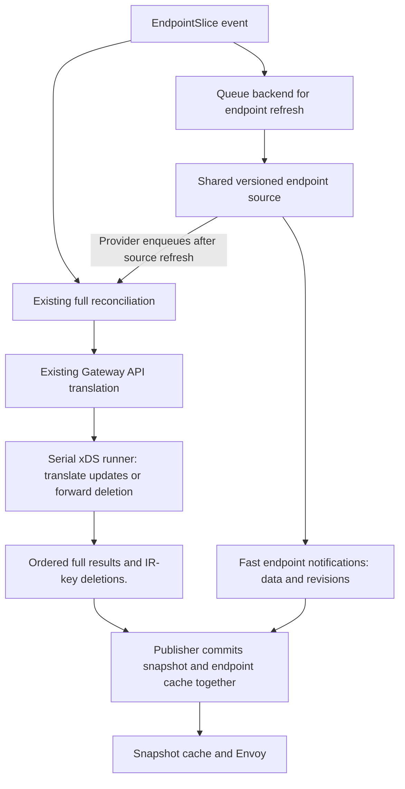
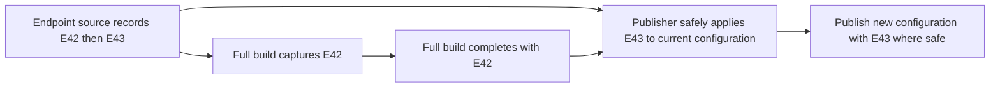
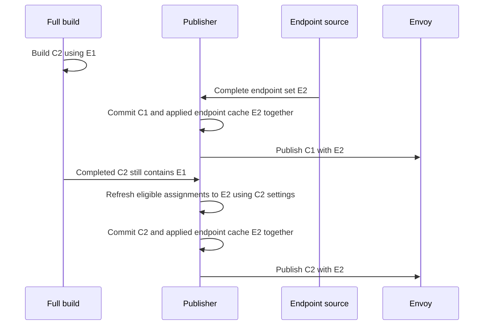
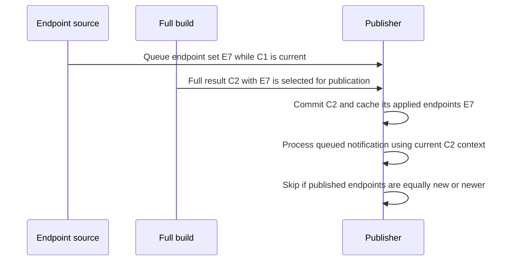

# Endpoint fast path: publishing updates safely

Status: design proposal; not implemented. Updated October 24, 2026.

Related issue: [envoyproxy/gateway#9777](https://github.com/envoyproxy/gateway/issues/9777).

## Purpose and chosen approach

Endpoint changes should reach Envoy without waiting for a full configuration
build. Today, an EndpointSlice change goes through resource collection, Gateway
API translation, and xDS translation. A slow build delays endpoint updates even
when only a backend address changed.

Use one publisher goroutine for each independently published xDS configuration,
identified by its IR key. This is one publisher per snapshot key, not per route
or cluster. It owns the current snapshot, configuration context, and one cache of
applied endpoint data and revisions. It rebuilds endpoint assignments and commits
updates one at a time.
EDS, Envoy's Endpoint Discovery Service, delivers those endpoint assignments.

The two paths have different responsibilities:

- **Fast path:** use the configuration context currently committed when the
  publisher processes the update, including its routes, policies, and cluster
  settings. It can keep working while a newer full build is slow or fails
  translation. Retain endpoint data only for dependencies where the update
  was successfully applied. Skip unsafe updates without caching them.
- **Full path:** translate everything as today, including endpoints. Before
  publication, replay newer cached endpoints where they remain safe under the new
  settings. Keep the full result's endpoints when they are equally new or newer,
  or replay is unsafe. Update the same cache with the endpoints actually committed.

Keep full translation serial. Successful full results and configuration deletions
reach the publisher through one ordered stream. The publisher therefore needs no
configuration generation, build number, or configuration lifetime ID. It keeps
the latest valid configuration and context, the current published snapshot, and
its applied endpoint cache. Both paths update this cache at commit. The provider
owns full reconciliation; the publisher does not track pending rebuilds or request
them.

There is no separate translation phase for configuration without endpoints. If C1
is published and C2 is being built, the normal sequence is:

```text
Published:            C1 + E1
Full build starts:    C2 using E1
Endpoints change:     E2 arrives
Fast path publishes:  C1 + E2
Full build publishes: C2 + E2 after refreshing endpoints
```

For eligible updates, publishing C2 + E1 and repairing it with another fast push
would restore removed endpoints unnecessarily. Refresh before publication instead.
Changes that also affect routes or clusters are skipped by the fast path and
handled by normal full reconciliation.

The freshness guarantee protects successfully published endpoint updates where
replay remains safe. It does not require the publisher to remember every observed
change. Skipped updates, including those received before the first full result,
wait for the normal full path.

The first version is opt-in and keeps existing full reconciliation enabled for
EndpointSlice events. It improves endpoint latency; it does not reduce the number
of full builds and may increase total CPU use. Endpoint changes are still subject
to existing reconciliation coalescing. Public option details and concrete channel
and cache types are outside this document's scope.

## Pipeline and changes to full translation



Keep the existing full translation stages. Add the information and publication
step needed to join the two paths safely:

1. **Carry endpoint sources and revisions.** Resource collection captures a
   backend's slice set and revision together. Carry source information through IR
   only for settings actually derived from EndpointSlices. When a full build
   generates no endpoint assignment, such as a direct response for an empty
   backend, remove its refresh context and applied cache entry. The provider
   still tracks the source; restoring forwarding requires a full translation.
2. **Save endpoint context while creating clusters.** The xDS translator already
   has the destination settings, their order, health checks, locality, weights,
   and TLS metadata used to build each endpoint assignment. Retain the required
   immutable context alongside the result.
3. **Prepare the full snapshot outside the publisher.** Full translation, patch
   policies, extension calls, validation, and full-resource hash preparation stay
   outside the publisher. The publisher validates and hashes any assignments it
   replaces afterward; earlier validation does not cover those replacements.
4. **Commit through the publisher.** Replace the xDS runner's direct publication
   with ordered submission of successful full results and deletions. Compare
   endpoint revisions, refresh where safe, and commit the snapshot, context, and
   applied endpoint cache together.

Route and policy translation stays authoritative, including endpoint-dependent
routing decisions. This avoids splitting translation into base and policy stages
or adding partial route translation. The separate endpoint input path, dependency
index, and publication coordination are still substantial new work.

## Endpoint input and shared revisions

### Keep informer callbacks small

Use the same watch filters and namespace restrictions as full reconciliation.
Callbacks identify affected Service or ServiceImport backends and queue their
keys. On reassociation, refresh both the old and new backend. Deletion must also
refresh the former backend, including when it loses its final slice.

Coalesce repeated keys before listing and converting slices. Avoid listing and
converting the complete backend for every callback during a burst. Use the existing
EndpointSlice indexes and backend-association rules.

A refresh worker captures the backend's complete current slice set, normalizes
its order, and derives endpoints by port name and protocol. Move endpoint
extraction into shared code so both paths agree on addresses, draining state,
zones, and address types.

### Record the data and revision together

Maintain an immutable entry per backend that ties together its captured slice set,
derived per-port endpoints, and a controller-local revision. The full path uses
that recorded slice set and revision; the fast path sends the reduced endpoint
view and the same revision. An empty set is a real update.

Serialize refreshes for the same backend, including refreshes requested by full
resource collection or startup. Replace the stored entry and advance its revision
together when the endpoint view changes. The full path must not independently
read slices and attach a counter obtained elsewhere. Neither path writes revisions
back to Kubernetes. Pruning and later recreating a source entry for the same
backend UID must not reuse old revisions while delayed notifications can remain.

Backend identity includes kind, namespace, name, and resource UID. A recreated
Service has a different UID; old endpoint data cannot be applied to it. The source
must check the backend UID when accepting a completed refresh. This identifies
the source of endpoint data; it is separate from the configuration lifetime ID
that this design does not need.

The provider must make accepted endpoint changes visible to full reconciliation.
After updating the shared source, enqueue normal reconciliation for the affected
configuration before delivering fast notifications. Do not wait for that
reconciliation to finish. Coalesce these requests with existing watch events. If
a reconcile already captured older state, the queue must retain a subsequent
request; an in-progress reconcile cannot consume an update it has not seen.

This scheduling belongs to the provider. The publisher can then skip an unsafe
endpoint update without keeping it or requesting another build. Leaving the
original watch enabled alone is insufficient if that reconcile can finish before
the asynchronous source refresh makes new data available.



### Cache applied endpoints from both paths

The shared provider source retains the latest endpoint data for full translation.
The publisher keeps one **applied endpoint cache** containing the endpoint inputs
and revision used by each dependency in its current desired snapshot. Either path
can supply those inputs. This cache describes what was committed, not the latest
update observed by the provider or received by the publisher. Here, "applied"
means committed to the desired snapshot, not received or acknowledged by Envoy.

Update the cache together with the snapshot and its configuration context:

- **Full publication:** populate it on the first successful build, then replace
  each entry with the inputs actually used in the final result. These are the full
  build's inputs unless newer cached inputs were safely replayed into that result.
- **Fast publication:** replace the entries for dependencies successfully updated
  by this publication. Keep all other entries unchanged.

For example, if a full result commits E7 before the fast notification for E7 is
processed, the cache already contains E7. The late notification is ignored without
another push. Full results do not need to wait for the fast path to populate the
cache.

Cache data and its revision together. Do not simply retain the highest revision
ever seen: if a full result must use older endpoints because replay is unsafe,
record those older inputs and their revision at commit. Remove entries for
dependencies absent from the new configuration or no longer represented by a
refreshable endpoint assignment. A failed candidate leaves the
existing cache unchanged.

This is one logical cache, not separate full-path and fast-path caches. It can
share immutable endpoint data with the configuration context and provider source;
it does not require another copy of each endpoint set.

If a fast update is unsafe, discard it after processing and leave the existing
snapshot and applied cache unchanged. If no configuration exists, ignore the
notification; there is no published context to refresh. Do not save these updates
for a later attempt under different settings. The provider's normal full path
handles them.

Track application per dependency, including its backend UID and port/protocol.
An update may be safe for one cluster and unsafe for another. Update the cache
only for the dependencies where it was applied; its use by one cluster does not
make it eligible for replay into a cluster that skipped it. The skipped dependency
keeps its previously applied inputs and revision.

A publisher turn uses a fixed set of inputs. Endpoint notifications arriving
during it are processed in later turns. Only successfully applied data persists
beyond notification processing; the publisher has no cache of skipped changes.

### What Kubernetes already provides

Each EndpointSlice has a `metadata.resourceVersion`. An API-server list response
also has a collection resource version. Starting with Kubernetes 1.35, conformant
API servers guarantee numeric ordering of resource versions within the same
resource type. A blanket statement that resource versions only support equality
is outdated for those versions. See [Kubernetes resource-version semantics](https://kubernetes.io/docs/reference/using-api/api-concepts/#resource-versions).

Those versions do not directly supply the aggregate revision this design needs:

- A backend may span several EndpointSlices.
- Taking the largest remaining slice version misses deletions and can move
  backward when the slice with that version disappears.
- The controller-runtime cached List implementation used by the current provider
  does not populate a collection resource version.

Use a local revision for the complete backend entry in v1. Kubernetes versions
remain useful metadata; we do not rely on comparing them across resource types
or on introducing API-server list requests for every endpoint update.

## Publisher ownership and input queues

A single goroutine owns each key's mutable publication state. In v1, perform
endpoint eligibility checks, assignment rebuilding, validation, hashing of changed
assignments, and commit inside that goroutine. Do not create separate fast workers
that build assignments using a captured configuration context.

This needs no additional publication mutex around the publisher-owned state.
Full translation runs separately and supplies immutable results. The endpoint
source and snapshot cache still need their own synchronization for shared data;
the design does not remove all locks from the controller.

| State | Purpose |
| --- | --- |
| Published snapshot and configuration context | Keep the latest valid full-path settings and the current desired Envoy resources together. No configuration means endpoint updates cannot publish. |
| Applied endpoint cache | Keep endpoint inputs and their revision for each dependency and backend UID, updated by either path when its publication commits. Use it for revision checks, safe replay, and preserving unchanged backend contributions during refresh. |
| Backend-to-cluster index | Find affected clusters without scanning all routes or clusters. |

There is no pending-rebuild state in the publisher. The provider schedules full
reconciliation whenever endpoint inputs change, whether or not the fast path can
use them. The publisher remains in the serving state while full builds run.

### Preserve the full path's existing order

The existing subscription handlers process full updates serially. Keep that
behavior and have the xDS runner submit each successful result or deletion in
the order it handles them. Different pipeline stages may overlap, but later full
results for a key must not overtake earlier results or deletions. Failed builds
leave the previous valid configuration in place and do not send a replacement.

Use one ordered stream for both full results and deletion. Do not launch separate
goroutines to submit them or introduce a separate deletion shortcut. A completed
result may publish while the next full translation is running. Arrival order on
this stream supplies the ordering guarantee; no configuration counters are needed.

Snapshot-cache installations also run synchronously within the publisher's turn.
A delivery retry is a request to install the current desired state, including
removal when appropriate. It carries no saved old snapshot to replay. Existing
xDS resource versions still identify resources for Envoy; a separate publisher
sequence number is unnecessary for this ordering scheme.

### Bound work without changing that order

Coalesce queued endpoint notifications by backend UID and keep the highest
revision for processing. These are temporary inputs awaiting an eligibility
decision, not applied records. After processing, release skipped or obsolete data;
retain only the data needed by successfully applied dependencies. An unsafe update
does not replace an existing applied cache entry.

Bound the full-result/deletion queue and apply backpressure when it is full.
Preserve its order and deletion events; do not accumulate an unbounded history of
full snapshots. Messages can share immutable data rather than copy it.

Batch the backend updates already pending when a publisher turn begins. Regenerate
each affected cluster once, then publish one snapshot for the batch. Do not wait
indefinitely for a batch to fill, or continuously extend a batch while new events
arrive. Pending full results, deletion, and delivery retries must get a turn under
endpoint churn, while retaining the full stream's order.

Refresh blocks subsequent turns for the same key. This replaces lock waiting with
queue waiting; it does not make endpoint rebuilding free or parallel. Existing
snapshot-cache locking can also couple different keys during installation.

## Cluster context, eligibility, and snapshot construction

### Reuse the full path's endpoint semantics

Build a reverse index from each backend to the clusters and destination settings
that consume it. Source references include port name and protocol. The current
implementation supports Service and ServiceImport references. A future Backend
type that reads Kubernetes endpoints must identify its underlying Service too.

Cover route backends, mirrors, merged backend clusters, and Service-backed policy
or infrastructure clusters, including external auth, external processing, OIDC,
JWT, access logs, tracing, rate limiting, and the proxy's Service cluster where
applicable. Unsupported consumers must be explicitly excluded rather than given
an incomplete context.

Only settings derived from slices get source references. ClusterIP routing,
static Backend endpoints, DNS clusters, and dynamic resolvers do not participate.
Preserve destination order, including the indexes used in TLS match metadata.
Reuse the existing endpoint-assignment builder.

Keep context immutable and retain only the needed configuration. Share immutable
endpoint data instead of copying the same endpoint set into every cluster's
context. Avoid retaining an entire old resource tree or IR through a convenience
pointer. Install context and its reverse index only with the matching snapshot.

Use the applied endpoint cache to rebuild a merged cluster without changing
unrelated backend contributions. If backend A changes, preserve backend B's cached
inputs, whether they came from a full result or a successful fast update. Do not
substitute an unsafe skipped update for B. An update to A must not restore older
endpoints for B. Unchanging inputs from sources outside the fast path remain in
the configuration context.

### Skip anything that needs more than EDS

| Condition | Action |
| --- | --- |
| No live snapshot or no known context | Ignore the fast notification; normal full reconciliation supplies configuration and endpoints. |
| A setting crosses between zero and nonzero endpoints after port/protocol filtering | Skip without caching the update; normal full reconciliation handles it. |
| Address type changes and can affect cluster type or backend validity | Skip without caching the update; normal full reconciliation handles it. |
| Setting was not derived from slices | Do not fast-path it. |
| A patch modifies its endpoint assignment or changes cluster-to-endpoint relationships | Exclude the affected configuration unless compatibility is established. |
| An extension hook can rewrite endpoints or clusters | Conservatively exclude the affected snapshot key in v1. |

Evaluate each backend contribution, including dependencies shared by routes and
merged clusters. A cluster remaining nonempty does not prove all its settings are
safe. A direct 503 response generated for an empty backend cannot be removed by an
EDS update alone. Compare fast updates with the published context; compare full
build refreshes with that build's context.

Preserve the affected published configuration and applied endpoint cache entries
on a skipped fast update. Do not retain the skipped data or schedule a
build from the publisher. Continue safe updates for unrelated dependencies.
The provider has already scheduled normal full reconciliation for the source
change. The fast path does not independently change route status.

### Copy only changed state and reuse hashes

The live snapshot must never be edited in place. For an endpoint-only batch:

1. Share immutable non-EDS resources and their versions.
2. Copy the EDS resource map once and replace only changed assignments.
3. Copy the EDS per-resource hash map once and update hashes for changed assignments.
4. Reuse unchanged types' hash maps and advance only the EDS type version.
5. Install the new snapshot as the desired snapshot used by both existing and
   newly connected Envoys.

Prepare full-build resource maps and delta hashes outside the publisher. When the
publisher refreshes a full result, regenerate hashes only for its changed endpoint
assignments. Fully initialize hash maps before exposing snapshots to readers, and
never mutate a map shared with an older snapshot.

This prevents a fast update from triggering serialization and hashing of every
listener, route, and cluster. Copying the EDS maps still scales with the total
number of EDS resources in that snapshot, so batching matters even when only one
backend changed.

## Publication rules and race handling

### A full build finishes after a fast update



For a completed full build, the publisher:

1. Processes it in order with all other full results and deletions.
2. Matches each dependency with its applied cache entry, if any. The backend
   UID and port/protocol must match; records from unrelated consumers do not apply.
3. Replays cached inputs only if their revision is newer than the full result and
   replay is safe under the new build's settings. Otherwise it keeps the full
   result's coherent output for that dependency.
4. Validates replacement assignments and updates their hashes.
5. Prepares the next cache from the inputs actually used: replayed inputs for
   dependencies safely refreshed, and the full result's inputs for all others.
6. Commits the snapshot, context, reverse index, and applied endpoint cache together.

Remove cache entries for dependencies absent from the result. A new backend UID
starts with the full result's inputs; it cannot inherit an old backend's entry.
If validation fails, discard the candidate snapshot and cache together. Merely
receiving a full result must not change the applied cache. The publisher requests
no follow-up build.

### An endpoint update is processed after a full build

Every fast update uses the publisher's currently committed configuration context.
This is an invariant, not a special case after a full build. Endpoint messages
carry data and revisions without a saved configuration context. If a notification
was queued while C1 was current but C2 commits before it is processed, the update
uses C2. The context cannot change halfway through rebuilding and publication
because both happen within one publisher turn.

Replaying applied endpoints into a new full result uses that full result's context.
It must use the new settings even though the result has not yet committed.

Before rebuilding a dependency, compare the notification's revision with the
revision already applied to that dependency, for the same backend UID. Skip when
the notification revision is less than or equal to the applied revision. The
snapshot already contains endpoint state at least as new as the notification.
An older revision would roll endpoints back; an equal revision would repeat work.

For example, after a full result commits C2 with endpoint revision E7:

| Fast notification | Action |
| --- | --- |
| E6 | Ignore: the snapshot already contains newer endpoints. |
| E7 | Ignore: this endpoint revision is already applied. |
| E8 | Check safety using C2; apply and record E8 only if safe. |

Read the applied revision from the applied endpoint cache, which either path can update.
Check each dependency separately; another cluster consuming the same backend may
still need the update. Here, "applied" means committed to the publisher's desired
snapshot, not acknowledged by Envoy. A skipped notification requires no push and
leaves the cache unchanged. A successful update commits the snapshot and its
applied cache entries together.



Parallel full builds or assignment workers are outside v1. Introducing them would
require a new check that their results still match the current configuration and
endpoint state; the serial design does not carry counters for hypothetical workers.

### Endpoints arrive during refresh

The publisher processes one turn at a time. It cannot accept E3 halfway through
refreshing and committing E2. A notification that arrives during the operation
stays pending and is processed against the new snapshot afterward.

This is why v1 performs refresh inside the publisher. Checking freshness in one
goroutine and committing later in another would reintroduce a gap. Long refreshes
still delay pending updates, so measure their duration rather than claiming a
fixed latency bound.

### A full result supplies newer endpoints before the fast notification

The paths can read the same source state and deliver their outputs at different
times. For example:

```text
Current applied endpoint cache: E1, from either path
Full result arrives:            C2 + E2
Publisher commits:             C2 + E2; cache now contains E2 data and revision
Fast notification E2 arrives:   Ignored; no extra push or cache change
```

The full publication updates the cache immediately; it does not wait for the fast
notification. Blindly replaying the old cached inputs would publish C2 + E1.
Compare revisions for each dependency instead:

| Input being processed | Comparison | Action |
| --- | --- | --- |
| Full result | Cached revision is newer, and replay is safe | Replay using the full result's settings; commit the replayed data and revision in the cache with the snapshot. |
| Full result | Cache entry is missing, older, or equal | Keep the full result's endpoints; commit their data and revision in the cache with the snapshot. |
| Full result | Cached revision is newer, but replay is unsafe | Keep the full result's coherent output; replace the cache entry with its actual inputs and revision, even if older. |
| Fast notification | Revision is newer than the dependency's applied revision, and the update is safe | Apply using the current published settings; commit the new cache entry with the snapshot. |
| Fast notification | Revision is older than or equal to the applied revision | Ignore; no endpoint change, push, or cache change. |
| Fast notification | Update is unsafe or no configuration exists | Skip without retaining its data; normal full reconciliation handles it. |

These comparisons apply only to matching dependencies and backend UIDs. The
shared versioned source makes revisions comparable. Never decide endpoint
freshness from message arrival order or from a counter read independently of the
endpoint data. A skipped update does not advance a dependency's applied revision.

### A newer fast update is skipped

```text
Published state:               C1 + E2; E2 was successfully applied by the fast path
Fast notification E3:           Requires route changes, so skip it without caching
Publisher state afterward:     Still C1 + E2, with E2 in the applied cache
Provider's full reconciliation: Builds the route changes and endpoints from E3
Full result commits:            C2 + E3; the same cache now contains E3
```

The provider retains E3 in the shared source and schedules full reconciliation.
The publisher needs neither the skipped E3 payload nor a pending-rebuild entry.
If the same notification is safe for another dependency, retain its data only for
the dependency that successfully applied it.

### Deletion and late delivery

Deletion here removes the entire configuration for an IR key. By default, the key
is a Gateway's `namespace/name`. With `mergeGateways` enabled, it is the
GatewayClass name and represents the shared configuration for that class. Removing
one Gateway from a shared configuration normally produces an updated full result
while the other Gateways remain.

Deleting an individual route, Service, EndpointSlice, or endpoint changes the
configuration's contents; it is not itself an IR-key deletion.

Deletion follows the existing full path and is forwarded by the same serial xDS
runner that submits full results. It needs no translation work itself, but waits
behind work already in progress. It cannot overtake an earlier result:

```text
Old full result -> Delete -> Next successful full result for the same key
```

When the publisher processes deletion, it clears the configuration context,
reverse index, and applied endpoint cache, and publishes removal with the existing
empty-snapshot semantics. Endpoint messages alone
cannot reactivate the key. Only a later successful full result can do so. If that
build fails, the configuration remains absent rather than restoring the old result.

Do not add an independent deletion channel: it could clear the configuration
while an old full build is still running, then let that result restore it. Waiting
for the ordered deletion is the tradeoff that removes the need for a configuration
lifetime ID.

Delivery retries run through the publisher and install its current desired state.
A retry queued before deletion therefore installs removal if that is now desired;
after recreation it installs the new snapshot. It never retains an old removal or
snapshot to apply later. No cache installation may run independently and finish
after a newer publisher turn.

Keep one owner of publication for a key. If an idle publisher is retired, finish
its cache operations and retire its input routing before creating a replacement.
Shared backend entries can be released when no consumer needs them. Recreating
a Service still requires matching its UID; serial configuration ordering does
not make endpoint data from different Services interchangeable.

Stop producers and wait for in-flight submissions before closing their input
channels during shutdown. Publisher goroutines must terminate on cancellation;
leaving a writable channel open is not a substitute for lifecycle management.

## Fallback and failures

### Why newer cached endpoints can be unsafe for a full result

Safety depends on the configuration that will use the endpoints. Applying E8 to
the current configuration C1 proves that E8 works with C1. A new full result C2
may contain different route or cluster decisions based on the endpoint inputs it
captured earlier. Its endpoint assignments can only be refreshed when those
decisions remain valid.

For example, consider a route with one backend:

| Event | Published state and effect |
| --- | --- |
| C1 is serving E6, which has ready endpoints | The route forwards requests to its backend cluster. |
| E7 has no ready endpoints | The fast path skips the update because it changes empty/nonempty state. C1 continues serving E6. |
| A full build captures E7 | It builds C2 with a direct 503 response for that route. |
| E8 has ready endpoints again, while C2 is still building | The fast path can safely update C1 from nonempty E6 to nonempty E8. The snapshot and cache now contain E8. |
| C2 finishes with E7 | E8 is newer, but replacing endpoint assignments alone cannot turn C2's direct 503 response back into a forwarding route. |

Reusing E8 in C2 would require route changes and possibly rebuilding its cluster,
which are outside the publisher's endpoint-only refresh. Keeping C1's route
instead could also discard route or policy changes in C2. The publisher therefore
commits coherent C2 with E7 and removes the vanished endpoint assignment's cache
entry. The provider has already queued full reconciliation for E8; that build restores forwarding with
the current configuration and endpoints. This fallback can temporarily return 503
even though ready endpoints exist. It is the tradeoff of allowing the full result
to publish without doing another full translation inside the publisher.

Other examples include an address-type change that requires a different cluster
type, or new patch or extension settings that make endpoint replacement
unsupported. A route or policy change alone does not require fallback: replay is
safe when the newer inputs can be used with the new settings by rebuilding only
eligible endpoint assignments.

### Keep the cache consistent with fallback and failures

An unsafe fast update is skipped. It does not modify the snapshot, replace
applied endpoint cache entries, or create pending-rebuild state. The provider
keeps the latest source data and schedules normal full reconciliation.

If replaying previously applied endpoints would require route or cluster
changes under a new full result, keep that result coherent for the dependency and
publish it without the replay. Replace the cache entry with that result's inputs
and revision when committing the new snapshot. For example, if E8 is cached but
the full result must keep E7, an existing endpoint assignment records E7 as well.
If the result instead emits a direct response without that assignment, remove the
cache entry. There is no endpoint-only operation that can restore forwarding.
Retaining E8 would
incorrectly claim it is still applied and suppress a later E8 notification.
Do not splice old routes or policies into the result. The provider's normal full
path handles source changes that the result has not yet captured.

This allows configuration updates to make progress under continuous endpoint
churn. The guarantee is:

> A full result preserves newer applied endpoints from either path when replay
> remains safe. Skipped updates wait for normal full reconciliation.

The provider's scheduling contract is essential: a source update accepted after
a full reconcile captures its inputs must still cause a subsequent reconcile.
This is tested at the provider, not implemented as publisher bookkeeping. The
publisher does not promise to include every observed but unapplied endpoint change
in the next full publication.

Translation or replacement-validation failure keeps the previous valid desired
snapshot and its matching context, or leaves the configuration absent if deletion
has already been processed. Discard the failed candidate and leave the applied
cache unchanged; report the failure through normal error handling. A subsequent normal
full reconciliation can repair the state when its inputs produce a valid result.
Do not resubmit a saved old full result after newer stream events. The fast path
can continue using the previous context after a failed full build only while that
configuration remains active.

Publication means installing the control plane's desired snapshot. It does not
mean every Envoy received or ACKed it. Partial delivery failures retry the current
desired publication rather than rolling back its context or applied endpoint
cache. Retries of removal follow the same rule and cannot overwrite a recreated
configuration.

## Resource estimates and latency limits

Temporary microbenchmarks on October 22, 2026 used the existing endpoint builder,
validation, deterministic serialization, and xDS hashing code. The machine was an
Apple M2 Pro running Go 1.27.3 on darwin/arm64. The comparison below uses
GOMAXPROCS=4, two runs, and a synchronous request/acknowledgment publisher harness.
Benchmark runs used a 250 ms target; process CPU measurements used separate timed
loops. No production publisher has been implemented.

### Publisher overhead versus a mutex

| Measurement | Mutex | Publisher goroutine |
| --- | ---: | ---: |
| Empty operation, elapsed time | About 0.008 microseconds | About 0.26 microseconds |
| Rebuild, validate, and hash one 100-endpoint assignment | About 62 microseconds | About 67 microseconds |
| Process CPU time for the 100-endpoint operation | About 75 microseconds | About 84 microseconds |
| Allocation for the 100-endpoint operation | About 48 KiB | About 48 KiB |

The isolated 100-endpoint operation used roughly 12% more process CPU through the
publisher in this run. At 1,000 such operations per second, the measured difference
is about 0.009 CPU core. Production batching, asynchronous submission, contention,
and garbage collection can change that result; these are estimates, not limits.

Bare idle publishers with small buffered channels measured about 2-5 KiB each,
excluding endpoint data and context. A planning allowance of 8-16 KiB per active
publisher permits additional stack and bookkeeping space: roughly 8-16 MiB for
1,000 active snapshot keys. This allowance is not a measured bound.

Provider endpoint entries, applied endpoint inputs, cluster context, and snapshots
are needed by either concurrency approach. Avoid duplicating them merely to send
messages. The publisher releases skipped notification payloads after processing
and replaces or removes obsolete cache entries at commit. Both paths populate the
same cache by sharing immutable input data; no second endpoint cache is needed.
A bounded queue of pointers can still retain substantial memory if those pointers
keep large old snapshots alive.

### Endpoint work and snapshot copying dominate

| Work per operation | Elapsed time | Temporary allocation |
| --- | ---: | ---: |
| 1 cluster with 100 endpoints | About 0.06 ms | About 48 KiB |
| 10 clusters with 100 endpoints each | About 0.69 ms | About 482 KiB |
| 100 clusters with 100 endpoints each | About 6.2 ms | About 4.7 MiB |
| 100 clusters with 1,000 endpoints each | About 63 ms | About 46.5 MiB |
| Copy EDS resource and hash maps for 10,000 clusters | About 0.18 ms | About 1.38 MiB |

The assignment cases include rebuilding, validation, serialization, and hashing
with simple IP endpoints. They exclude source collection, queue waiting, and
Envoy delivery. The map-copy case is measured separately; allocations are not
retained-memory measurements. Policies and locality settings can change costs.

For an illustrative snapshot with 10,000 EDS clusters, an update affecting 10
clusters of 100 endpoints each costs about 0.88 ms when adding the measured
refresh and map-copy components. At 100 publications per second, that occupies
about 9% of the publisher's time before other overhead and allocates about
194 MB per second. At 1,000 publications per second, it approaches saturation
before delivery overhead. These are arithmetic estimates, not a combined load test.

An update arriving during a 63 ms refresh can wait for the remainder of that turn
and any work ahead of it. A mutex protecting the same work has the same
serialization problem. Choose the publisher for clear ownership, while controlling
work per turn, batching updates, and sharing immutable state. Its existence alone
does not guarantee millisecond propagation or isolation from global cache locks.

## Verification, observability, and rollout

Tests should control interleavings explicitly rather than depend on sleeps.

| Scenario | Expected result |
| --- | --- |
| Full results arrive while the publisher is busy | Results retain the serial full path's order, including across deletion. |
| A full result is ready while the next translation is running | The ready result may publish without waiting for the next translation. |
| Provider retries full reconciliation | Use current inputs; do not replay a saved old result after newer events. |
| First successful full build commits | Populate the applied endpoint cache with the full result's inputs and revisions. |
| Full build finishes after newer endpoints were published | Its eligible assignments are refreshed before commit; snapshot and cache both contain the replayed inputs. |
| Endpoint notification is processed after a full commit | Assignments use the new context; already-applied revisions are ignored. |
| Endpoint update arrives during refresh | It stays queued for the next turn, where it is applied if safe or skipped without caching. |
| Full result publishes E3 before delayed notification E2 | E2 cannot replace E3. |
| Full result contains E2 while the cache contains E1 | Publish E2 and cache its data and revision; ignore a later E2 notification without another push or cache change. |
| An unsafe E3 follows a successful fast update E2 | Skip and release E3 in the publisher; keep published E2 and its cache entry until full reconciliation commits E3 to both. |
| One consumer can apply an update while another must skip it | Update only the successful consumer's cache entry; preserve the skipped consumer's inputs and revision. |
| Endpoint notification arrives before the first valid configuration | Ignore it without caching; the provider's full reconciliation supplies the endpoints. |
| Full result removes a dependency | Remove its applied cache entry with the full commit. |
| Full result uses E7 because replay of cached E8 is unsafe | Commit E7 to both snapshot and cache; a later E8 notification must be checked for safety, not mistaken for already applied. |
| Full build captures an empty backend, then the fast path applies nonempty endpoints to the old configuration | Do not attach newer endpoints to the full result's direct 503 route. Commit coherent full output and remove the missing assignment's cache entry; the provider's subsequent full reconciliation restores forwarding. |
| Backend A changes in a merged cluster while backend B received newer full-path endpoints | Rebuild A's contribution using B's current cached inputs; keep B's cache entry unchanged. |
| Concurrent source refresh and full resource capture | The endpoint data and revision always describe the same source entry. |
| Source refresh completes after an earlier full reconcile captured its inputs | The provider queues another reconcile; skipped fast updates cannot be lost when there are no further events. |
| Slice deletion or backend reassociation | Both affected sets are refreshed, including transitions to empty. |
| Port, address type, or empty/nonempty transition changes configuration | Fast path skips without caching; normal full reconciliation produces coherent output. |
| Patches or hooks affect endpoints or cluster relationships | Their effects are not overwritten by fast refresh. |
| ClusterIP, static, or DNS destination | Fast updates cannot replace its endpoints. |
| Mirrors, merged clusters, and supported policy services | The reverse index finds every affected eligible cluster. |
| Churn produces repeated backend updates | Coalescing retains the highest revision; a batch rebuilds each cluster once. |
| A full build or deletion waits during churn | Endpoint batching cannot starve the control event. |
| Configuration is deleted and recreated | Ordered deletion clears old context and applied cache; only a later successful full result can reactivate it and populate the cache. |
| First full build after deletion fails, or only endpoint events arrive | The configuration remains absent. |
| Service is deleted and recreated | Endpoint data from its old UID cannot be applied to its replacement; the new dependency starts with the full result's inputs. |
| Full translation or replacement validation fails | Previous desired snapshot, matching context, and applied cache remain unchanged. |
| Desired snapshot commits but delivery fails for some Envoys | Keep the committed cache and context; retry the current desired snapshot. |
| A delivery retry waits behind deletion or a newer full result | It installs current desired state within its publisher turn, including removal when appropriate. |
| EDS-only publication | Non-EDS contents, versions, and hashes are preserved. |
| New Envoy connects after a fast publication | It receives the latest desired patched snapshot. |
| Full and fast paths use equivalent supported inputs | They produce equivalent endpoint assignments. |
| Controller shuts down during endpoint churn | Producers and publishers terminate without writes to closed channels or leaked goroutines. |

Use golden fixtures for endpoint translation equivalence and eligibility context,
unit tests for publication ordering and source ownership, and the race detector
for shared-memory access. Keep flag-off translation output unchanged. Add e2e
coverage with the feature enabled and verify traffic follows endpoint changes.

Record applied batches, skipped updates by reason, coalesced updates, queue delay,
refresh duration, provider reconciliation requests, allocation rate, and endpoint
propagation latency. Avoid backend-name labels that create unbounded metric
cardinality.

Benchmark endpoint churn against deliberately slow full translation, using many
routes and expensive patches. Compare flag off and on, including p50/p95/p99
propagation latency, CPU, retained memory, allocation rate, and behavior under
high backend-to-cluster fanout. The local measurements above do not replace this
end-to-end test.

Ship disabled by default. Consider enabling it by default only after correctness,
skip-reason, and latency data from realistic workloads support that change.
Moving endpoints out of the IR and suppressing ordinary endpoint-triggered full
builds are separate follow-ups. Such work would not by itself eliminate patch and
extension compatibility checks.


## Implementation and local verification

The implementation is opt-in through `runtimeFlags.enabled: [EndpointFastPath]`.
The user guide is in
`site/content/en/latest/tasks/operations/endpoint-fast-path.md`.

The provider uses one shared versioned source for full captures and fast updates.
Each publisher owns its desired snapshot, refresh context, and applied endpoint
inputs. Refresh runs without a publication mutex. Small locks protect source
collection, routing indexes, and input mailboxes. Full translation remains serial,
and deletion barriers survive coalescing.

Applied endpoint inputs live in the immutable destination settings retained by
an eligible endpoint context; there is no second copy of each set in a separate
cache. If a full result replaces forwarding with a direct response and has no
endpoint assignment, that context and its applied inputs are removed. The
provider still holds the source for the next full reconcile. A late endpoint
notification cannot turn a direct response into forwarding.

The new `EndpointFastPath` e2e test and deployment profile are registered in the
CI matrix; the test covers backend changes, empty endpoints, and recovery.
A live Kubernetes run and a production-scale endpoint-churn benchmark remain
required before treating this experimental feature as production-ready.

### Measured snapshot work

The committed `BenchmarkEndpointSnapshot` benchmark measures snapshot preparation
only: 100 endpoints per assignment and one changed assignment. It includes map
copying and resource hashing, but excludes provider collection, endpoint building,
full translation, queue wait, and Envoy delivery. Measurements on the local
Apple M2 Pro with Go 1.27.2:

| Assignments | Fast replacement | Full snapshot preparation | Fast allocated bytes | Full allocated bytes |
| --- | --- | --- | --- | --- |
| 100 | 0.119 ms | 10.75 ms | 13,769 | 292,099 |
| 1,000 | 0.212 ms | 140.30 ms | 183,832 | 3,052,000 |

These are allocation measurements, not retained heap measurements or end-to-end
latency. Retained state includes the shared source data, endpoint contexts,
routing indexes, and one goroutine per active IR key. Full builds still run, so
total CPU and memory can increase even when endpoint propagation becomes faster.

### Validation scope

Tests cover provider revision capture, full reconciliation scheduling (including
debouncing), shared Service/ServiceImport sources, full/fast arrival orders,
per-consumer revision tracking, backend recreation, deletion barriers, delivery
retries, immutable snapshots, and endpoint translation equivalence. Golden
fixtures cover merged backends, mirrors, TLS metadata, health-check overrides,
draining and patch exclusion.

The runtime flag is the only public API addition and remains disabled by default.
The new end-to-end test and deployment profile are included in CI. Live Kubernetes
validation and production-scale churn measurements remain outstanding for this
draft. Check the pull request description and CI results for the exact checks run.
