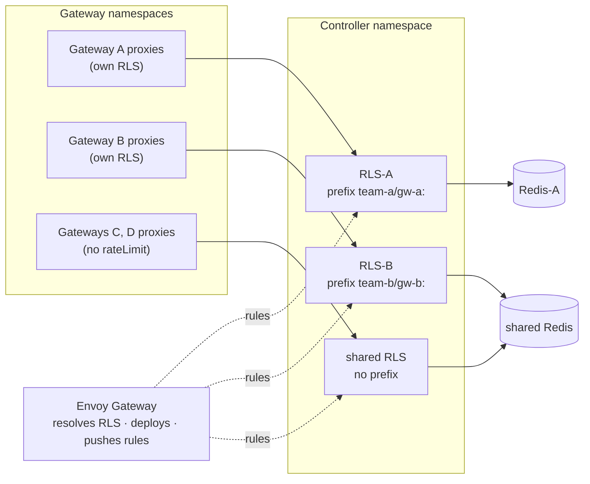
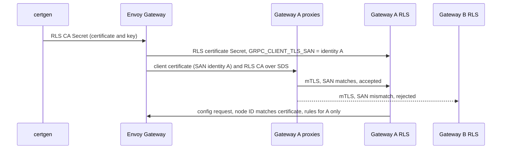

## Overview

This design lets one Envoy Gateway control plane run **dedicated rate limit services (RLS)**, each with its
own Redis connection, for individual Gateways. Today a single RLS and Redis are shared by every Gateway
the control plane manages.

Envoy Gateway provisions the RLS; users provision Redis. Several RLS instances may reference the same
Redis, so dedicated Redis capacity and failure isolation depend on the supplied backends.

This proposal covers only the Gateway scope. A dedicated RLS shared by a GatewayClass is out of scope:
`rateLimit` on a GatewayClass's `EnvoyProxy` is ignored, and may be supported in the future (see
[TODO](#gatewayclass-scope)).

Tracking issue: [#10520](https://github.com/envoyproxy/gateway/issues/10520)

## Background

Global rate limiting is configured once for the whole control plane, in `EnvoyGateway.rateLimit`. Envoy
Gateway deploys one `envoy-ratelimit` service backed by one Redis, and every Gateway's proxies call it with
the same timeout and failure behaviour.

Ordinary rate limit domains (`<namespace>/<gateway>/<listener>`) keep each Gateway's counters separate;
`shared: true` rules use policy domains to share counters across targets. Infrastructure and service
behaviour are shared in either case:

* **Capacity:** one Redis and one RLS deployment for all traffic.
* **Blast radius:** if one Gateway overloads or breaks the RLS or Redis, every Gateway is affected.
* **Behaviour:** `timeout` and `failClosed` apply to all Gateways.

In multi-team clusters this is often not enough isolation. The only workaround today is running a
separate control plane per Gateway, which is heavy when the rate limit backend is the only thing that
needs to be isolated.

## Goals

* Let a Gateway use its own RLS, optionally backed by its own Redis.
* Let `timeout`, `failClosed`, telemetry and connection settings to the RLS differ between Gateways.
* Keep the shared RLS working exactly as today; dedicated services are opt-in, both for the admin
  (a control-plane setting) and per Gateway.
* Allow global rate limiting with a dedicated RLS even when no shared RLS is configured.
* Accept calls to a dedicated RLS only from its own Gateway's proxies, authenticated with a
  per-Gateway client certificate rather than inferred from the network.

## Non-Goals

* A dedicated RLS per GatewayClass, or one shared by any other set of Gateways, in the first iteration.
  Each dedicated RLS serves exactly one Gateway.
* Dedicated RLS for merged Gateways (`mergeGateways`) in the first iteration.
* User-managed (bring-your-own) RLS in the first iteration. Envoy Gateway still deploys and configures
  the RLS. A user-managed RLS may be proposed separately as a follow-up.
* Rate limit backends other than Redis.
* Dedicated RLS with any infrastructure other than Envoy Gateway's built-in Kubernetes infrastructure
  in the first iteration.
* Changing how rate limit rules or domains are generated.
* Validating RLS workload overrides or guaranteeing they are safe. Overrides are gated behind a
  default-off switch, and admins enforce their own requirements with tools such as Kyverno (see
  [Trust boundary](#trust-boundary)).
* Per-Gateway `timeout`, `failClosed` or other proxy-side settings while keeping the shared RLS. That
  needs a separate shared-mode design.
* Redis migration, including data transfer, counter synchronization, backend cutover orchestration
  and rollback. Users provision and operate Redis outside Envoy Gateway.
* Seamless switching between shared and dedicated RLS, or uninterrupted enforcement during a scope
  change. These are planned, potentially disruptive operations.
* Per-Gateway client identities for the shared RLS. Proxies keep presenting the shared client
  certificate to the shared RLS, which keeps accepting every proxy as today.
* Automatic certificate renewal or revocation before expiry. Operators manage certificate expiry (see
  [RLS identities and certificates](#rls-identities-and-certificates)).
* Restart-safe cleanup of dedicated RLS resources. A dedicated RLS's resources are removed when Envoy
  Gateway observes its Gateway being deleted or dropping `rateLimit`. If that change happens while Envoy
  Gateway is stopped, they can be left behind in the controller namespace. The same is true today of
  per-Gateway proxy resources in the default deployment mode, and a startup sweep or Gateway finalizer
  should cover both together in a separate change.
* Hardening tenant namespaces or proxy workloads. Proxy `patch`, privileged containers, host
  networking and host path mounts can already let a tenant's proxy escape its namespace's network
  isolation, for every namespace-based NetworkPolicy and not only for the RLS. This proposal relies on
  operator's existing multi-tenant controls. This proposal introduces no admission hook or built-in
  validation for tenant hardening. Operators choose and maintain those controls and accept the risks
  of enabling the feature without them. Changing the `EnvoyProxyPatch` default is also out of scope.

## Assumptions

A dedicated RLS is infrastructure: a platform or Gateway owner sets it up once, together with its Redis,
and it normally stays unchanged for the life of the Gateway. Switching a Gateway between the shared and a
dedicated RLS, or changing its Redis backend or credentials, is expected to be rare and planned.

The first iteration optimizes for a correct steady state and ordinary Kubernetes reconciliation.
Changes to RLS scope are planned maintenance operations, not coordinated migrations. Operators who
require continuous rate-limit enforcement must stop or externally gate affected traffic before a scope
change and restore it only after verifying the new configuration. A low-traffic window alone does not
provide that guarantee. Credential rotation remains supported without changing the selected RLS.

**xDS clients are trusted.** This proposal requires that every client of the Envoy Gateway xDS server
requests only its own Gateway's configuration. In practice, proxy pods run only the Envoy image and
containers that Envoy Gateway generates, and no other process can authenticate to the xDS server. This
is a precondition, not a property the design provides: if it does not hold, isolation between dedicated
RLS does not hold either, and the guarantees in this proposal no longer apply.

This is not new with this proposal; Envoy Gateway already relies on it today. The xDS server does not
bind clients to their Gateway: in either deployment mode, a client chooses the snapshot it receives.
A custom proxy image, an extra container in the proxy pod, or any other process with valid xDS client
credentials can already request another Gateway's configuration, including the private keys of its
listener certificates and backend client certificates. A dedicated RLS client certificate is one more
secret in that snapshot and is exposed the same way. Operators who let Gateway owners run such
workloads must already prevent this, as part of proxy hardening (see [Non-Goals](#non-goals)).
Authenticating xDS clients per Gateway is a separate xDS change, out of scope for this proposal.

## API

The setting lives on `EnvoyProxy`, the existing API for per-Gateway infrastructure. A Gateway already
references an `EnvoyProxy` in its own namespace through `spec.infrastructure.parametersRef`, so no new
attachment mechanism is needed. Only this Gateway-level attachment enables a dedicated RLS; see
[GatewayClass EnvoyProxy](#gatewayclass-envoyproxy).

A new optional `spec.rateLimit` field holds the same settings as `EnvoyGateway.rateLimit`:

| Field             | Description                                                                     |
| ----------------- | ------------------------------------------------------------------------------- |
| `backend`         | Required Redis connection for the dedicated RLS (URL or Secret reference, TLS). |
| `timeout`         | How long proxies wait for the RLS. Defaults to 20ms.                            |
| `failClosed`      | Deny traffic when the RLS can't be reached. Defaults to false.                  |
| `telemetry`       | Metrics and tracing for the dedicated RLS.                                      |
| `serviceSettings` | Connection settings from proxies to the RLS (circuit breakers, etc.).           |

`spec.rateLimit` reuses the `EnvoyGateway.rateLimit` type. Its `failClosed` is a plain boolean
defaulting to `false`, so an omitted field and an explicit `false` behave the same way. Today that field
has neither `omitempty` nor an `+optional` marker, so the generated EnvoyProxy CRD would make it required
inside `rateLimit` and reject an `EnvoyProxy` that omits it. As part of this API change,
`RateLimit.FailClosed` gains `+optional` and `omitempty`. It stays a `bool`, so the meaning of an
omitted value is unchanged and existing `EnvoyGateway` configurations remain valid.

Reusing the `RateLimit` type also reuses its API documentation, which today describes only the shared
RLS. In particular, `RateLimitRedisSettings.urlRef` and `RedisURLSource.secretKeyRef` say the Secret
must be in the namespace of the Envoy Gateway rate limit deployment, which is wrong for `EnvoyProxy`
(see [Redis credentials](#redis-credentials)). As part of this API change, these descriptions are made
to cover both uses: in `EnvoyGateway.rateLimit` the Secret is in the controller namespace, and in
`EnvoyProxy.spec.rateLimit` it is in the `EnvoyProxy`'s namespace. The same review applies to every
other description in the reused types, including the TLS `certificateRef`.

Deployment settings for the dedicated RLS (`rateLimitDeployment`, `rateLimitHpa`, `rateLimitPDB`) sit under
`spec.provider.kubernetes`, next to the existing proxy deployment settings.

These use the same types as the proxy settings (`KubernetesDeploymentSpec` and friends). `patch` is applied
only when the `EnvoyProxyPatch` runtime flag is enabled, the same as for the proxy Deployment.

> **Security risk.** The dedicated RLS runs in the controller namespace (see
> [Namespace](#namespace)), but its workload settings come from
> `EnvoyProxy`, which is often authored by Gateway owners. Whoever can author that `EnvoyProxy` can use
> `patch`, `volumes`, `securityContext` and similar fields to configure a pod in the controller namespace,
> for example to mount a Secret there or run with elevated privileges. That includes the RLS CA Secret
> (see [RLS identities and certificates](#rls-identities-and-certificates)): a pod that reads it can
> impersonate any Gateway to any dedicated RLS. Proxy Deployment settings already
> carry this risk outside Gateway namespace mode. Dedicated RLS introduces it even in Gateway namespace
> mode, because the RLS still runs in the controller namespace.
>
> **Workload overrides delegate administrator-level authority in the controller namespace.** Envoy Gateway does not validate workload
> overrides or make them safe; that is why they sit behind a separate switch,
> `enableDedicatedRateLimitWorkloadOverrides`, that is off by default. Admins who enable it accept
> these risks and choose their own controls, such as restricting who can author the supplying `EnvoyProxy`
> through RBAC, or with admission policy tools such as Kyverno, OPA Gatekeeper or Kubernetes
> `ValidatingAdmissionPolicy`. Disabling `EnvoyProxyPatch` alone is not enough: ordinary
> `KubernetesDeploymentSpec` fields can also select images and reference controller-namespace Secrets.
>
> Built-in workload settings remove the workload risks above, but not every risk. With only
> `enableDedicatedRateLimit` enabled, Gateway owners still choose addresses that a pod in the controller
> namespace connects to: the Redis URL and the OTLP endpoint in `telemetry.tracing.provider.url`. This
> can bypass NetworkPolicies that restrict tenant namespaces and reach internal services from the
> controller namespace. Each Gateway owner can also add an RLS Deployment to the controller namespace,
> consuming its resources; a ResourceQuota there could then prevent Envoy Gateway's own pods from
> scheduling. Admins should restrict egress from dedicated RLS pods with NetworkPolicy and plan capacity
> and quota for the controller namespace before enabling dedicated RLS for tenants. Operators accept
> these risks when enabling the feature; the guidance below describes possible mitigations.

### Operator responsibility for tenant isolation

Both dedicated RLS and its workload overrides are disabled by default. Enabling either switch is an
administrator decision to delegate the corresponding capabilities and accept their risks. Envoy Gateway
does not validate workload overrides for safety, enforce tenant hardening, or verify operator security
policies. This proposal adds no admission hook or tenant-hardening checks.

Operators decide which controls fit their environment. Possible mitigations include:

* Restricting RLS ingress and egress with NetworkPolicy, including access to Redis, telemetry, DNS
  and the configuration server. Policies are additive and require a CNI that enforces them.
* Limiting per-tenant RLS allocation and workload resources while reserving controller capacity.
  A shared namespace ResourceQuota alone does not reserve recovery headroom for the controller.
* Protecting the RLS CA Secret in the controller namespace: limiting who can read Secrets there, and
  keeping workload overrides, which can mount Secrets, away from tenant authors. Caller isolation
  between dedicated RLS relies on that key, not on tenant namespaces or network policy.
* Restricting who can author or select override-bearing `EnvoyProxy` resources, using existing RBAC
  or admission tools if desired. Preventing edits alone does not prevent a tenant from referencing
  an administrator's privileged configuration.

These are operator-owned mitigations, not feature enablement requirements or implementation acceptance
checks. The installation guide documents the risks and example controls. Neither enabling the feature
nor `RateLimitReady=True` guarantees tenant isolation.

### Example: restricting dedicated RLS network access

The following NetworkPolicies, applied by an admin in the controller namespace, restrict dedicated RLS
pods (selected by the labels defined in [Service identity](#service-identity)). Envoy Gateway does not
create them. NetworkPolicy rules are additive: a pod may make any connection allowed by at least one
policy that selects it, so a narrower policy cannot take away access that a broader one grants. The
rules that must differ per Gateway therefore live only in per-Gateway policies.

A common policy selects every dedicated RLS. It denies all traffic except DNS, the Envoy Gateway
configuration server, an approved OTLP collector, and Prometheus scraping from the monitoring namespace:

```yaml
apiVersion: networking.k8s.io/v1
kind: NetworkPolicy
metadata:
  name: dedicated-ratelimit
  namespace: envoy-gateway-system          # the controller namespace
spec:
  podSelector:
    matchLabels:
      app.kubernetes.io/component: ratelimit
      gateway.envoyproxy.io/ratelimit-scope: gateway
  policyTypes:
  - Ingress
  - Egress
  ingress:
  - from:                                  # Prometheus, if RLS metrics are enabled (the default)
    - namespaceSelector:
        matchLabels:
          kubernetes.io/metadata.name: monitoring
      podSelector:
        matchLabels:
          app.kubernetes.io/name: prometheus
    ports:
    - port: 19001                          # RLS metrics
  egress:
  - to:                                    # cluster DNS
    - namespaceSelector:
        matchLabels:
          kubernetes.io/metadata.name: kube-system
      podSelector:
        matchLabels:
          k8s-app: kube-dns
    ports:
    - port: 53
      protocol: UDP
    - port: 53
      protocol: TCP
  - to:                                    # rate limit configuration server
    - podSelector:
        matchLabels:
          control-plane: envoy-gateway
    ports:
    - port: 18001
  - to:                                    # approved OTLP collector, if tracing is used
    - namespaceSelector:
        matchLabels:
          kubernetes.io/metadata.name: observability
      podSelector:
        matchLabels:
          app: otel-collector
    ports:
    - port: 4317
```

One policy per Gateway then allows connections to that tenant's Redis only. Its ingress rule allows
calls from proxies in the Gateway's namespace. Restricting callers by namespace is optional defense in
depth because the dedicated RLS authenticates its Gateway's client certificate (see
[Isolation between Gateways](#isolation-between-gateways)). However, the common policy above denies
gRPC ingress, so an explicit allowance for proxy traffic on port 8081 is required while that policy is
installed. Operators who omit namespace filtering must replace this rule with an allowance covering
the intended proxies. This example is for Gateway namespace mode, where proxies run in the Gateway's
namespace:

```yaml
apiVersion: networking.k8s.io/v1
kind: NetworkPolicy
metadata:
  name: dedicated-ratelimit-team-a-gw-a
  namespace: envoy-gateway-system          # the controller namespace
spec:
  podSelector:
    matchLabels:
      gateway.envoyproxy.io/ratelimit-scope: gateway
      gateway.envoyproxy.io/owning-gateway-namespace: team-a
      gateway.envoyproxy.io/owning-gateway-name: gw-a
  policyTypes:
  - Ingress
  - Egress
  ingress:
  - from:                                  # proxies in the Gateway's namespace
    - namespaceSelector:
        matchLabels:
          kubernetes.io/metadata.name: team-a
      podSelector:
        matchLabels:
          app.kubernetes.io/component: proxy
    ports:
    - port: 8081                           # RLS gRPC
  egress:
  - to:                                    # team-a's Redis
    - namespaceSelector:
        matchLabels:
          kubernetes.io/metadata.name: team-a-redis
    ports:
    - port: 6379
```

Notes for adapting them:

* The optional per-Gateway ingress rule identifies callers by namespace, using the
  `kubernetes.io/metadata.name` label that Kubernetes sets and users cannot change, so it narrows
  access to a namespace, not to a single Gateway. Proxy pod labels are not a reliable identity, because
  `EnvoyProxy` pod labels can set any label on a proxy pod. In the default deployment mode, all proxies
  run in the controller namespace and the rule adds nothing. Caller isolation between Gateways comes
  from the per-Gateway client certificates in every mode.
* The selector labels of dedicated RLS pods are generated by Envoy Gateway (see
  [Service identity](#service-identity)), so with built-in workload settings the per-Gateway
  `podSelector` selects only that Gateway's RLS.
* NetworkPolicy matches pods, namespaces and IP ranges, not hostnames. A Redis outside the cluster
  needs an `ipBlock`, or a CNI-specific policy that supports FQDN rules.
* The DNS, controller, proxy and Prometheus labels and the ports shown match a default Helm
  installation; check them against the cluster. The metrics rule can be dropped when RLS Prometheus
  metrics are disabled in `telemetry`. NetworkPolicy has no effect unless the CNI enforces it.
* The shared RLS is not selected, because it does not carry the `ratelimit-scope: gateway` label.

### Enabling dedicated RLS

Because of this risk, dedicated RLS is disabled by default. Admins opt in through a new field in the
`EnvoyGateway` configuration, next to the other switches for risky features such as
`enableEnvoyPatchPolicy`, `enableLua` and `enableBackend`:

```yaml
apiVersion: gateway.envoyproxy.io/v1alpha1
kind: EnvoyGateway
extensionApis:
  enableDedicatedRateLimit: true   # defaults to false
  enableDedicatedRateLimitWorkloadOverrides: false   # defaults to false
```

The table shows what happens to a Gateway whose own `EnvoyProxy` sets `rateLimit`, for each
combination of the two switches. For an otherwise valid Gateway and `EnvoyProxy` configuration, the
switches alone do not change `Accepted=True`. The table describes steady-state behavior after
reconciliation.

| `enableDedicatedRateLimit` | `enableDedicatedRateLimitWorkloadOverrides` | Dedicated RLS | Workload fields¹ | Routes with global rate limits                                                       | Other routes | Gateway status                                              |
| -------------------------- | ------------------------------------------- | ------------- | ---------------- | ------------------------------------------------------------------------------------ | ------------ | ----------------------------------------------------------- |
| `false`                    | any (no effect)                             | Not deployed  | Ignored          | Same as without `rateLimit`: the shared RLS, or rejected if none is configured       | Unaffected   | `EnvoyProxy` warning; no dedicated `RateLimitReady`         |
| `true`                     | `false`                                     | Deployed      | Ignored, warning | Rate limited by the dedicated RLS                                                    | Unaffected   | `RateLimitReady` reflects the RLS                           |
| `true`                     | `true`                                      | Deployed      | Applied          | Rate limited by the dedicated RLS                                                    | Unaffected   | `RateLimitReady` reflects the RLS                           |

¹ `rateLimitDeployment`, `rateLimitHpa` and `rateLimitPDB`. When they are ignored, the RLS uses
built-in workload defaults.

Ignored settings produce warnings on `EnvoyProxy` status naming the switch to enable. A disabled
switch does not reject the Gateway or remove its listeners. With dedicated RLS disabled, adding a
`rateLimit` block cannot move a Gateway off the shared RLS or bypass its limits. If no shared RLS is
configured, global rate limit policies are rejected as today.

Disabling the setting after dedicated RLS is in use has the same effect: each affected Gateway moves
back to the shared RLS, if configured, and its dedicated RLS is removed after that change converges,
with the transition behavior in [Changing the configuration](#changing-the-configuration).
Re-enabling the setting moves it to a dedicated RLS again. RLS workload fields on an `EnvoyProxy`
without `rateLimit` have no effect either way.

The two settings are control-plane-wide opt-ins. `enableDedicatedRateLimit` allows Gateway owners to
configure a dedicated RLS using built-in workload defaults. It does not permit RLS workload customization.
When `enableDedicatedRateLimitWorkloadOverrides` is false, `rateLimitDeployment`, `rateLimitHpa` and
`rateLimitPDB` on a Gateway-level `EnvoyProxy` are ignored with a warning naming the setting, and the
dedicated RLS runs with built-in workload defaults. Rate limiting keeps working. Fields on a
GatewayClass or without `rateLimit` retain the scope behavior described below.

Admins may additionally enable `enableDedicatedRateLimitWorkloadOverrides` to accept those workload
fields. It only takes effect together with `enableDedicatedRateLimit: true`. While
`enableDedicatedRateLimit` is false, `enableDedicatedRateLimitWorkloadOverrides` has no effect whatever
its value, and Envoy Gateway logs a warning at startup when it is true. This lets admins disable
dedicated RLS by changing only `enableDedicatedRateLimit`, as described above. The RBAC or admission
controls described above remain optional operator-owned mitigations when customization is enabled.
Disabling customization rolls existing dedicated RLS back to built-in workload defaults and reports the
ignored fields as warnings; Gateways are not rejected.

`rateLimit` is not accepted in the control-plane default `EnvoyGateway.envoyProxy`. Control-plane-wide
rate limiting stays configured in one place, `EnvoyGateway.rateLimit`.

### Example

This example customizes replicas and therefore requires both
`extensionApis.enableDedicatedRateLimit: true` and
`extensionApis.enableDedicatedRateLimitWorkloadOverrides: true`
(see [Enabling dedicated RLS](#enabling-dedicated-rls)).
Omit the `provider` block to use built-in workload defaults with only the first switch enabled.

```yaml
apiVersion: gateway.envoyproxy.io/v1alpha1
kind: EnvoyProxy
metadata:
  name: team-a
  namespace: team-a
spec:
  rateLimit:
    backend:
      type: Redis
      redis:
        urlRef:
          secretKeyRef:
            name: team-a-redis
            key: url
    timeout: 50ms
    failClosed: true
  provider:
    type: Kubernetes
    kubernetes:
      rateLimitDeployment:
        replicas: 3
---
apiVersion: gateway.networking.k8s.io/v1
kind: Gateway
metadata:
  name: team-a
  namespace: team-a
spec:
  gatewayClassName: eg
  infrastructure:
    parametersRef:
      group: gateway.envoyproxy.io
      kind: EnvoyProxy
      name: team-a
  listeners:
  - name: http
    protocol: HTTP
    port: 80
```

## Scope

A dedicated RLS always serves exactly one Gateway. Which RLS a Gateway uses is decided as follows:

| Configuration                                              | Result                                                   |
| ---------------------------------------------------------- | -------------------------------------------------------- |
| The Gateway's own `EnvoyProxy` sets `rateLimit`            | A dedicated RLS for that Gateway.                        |
| Only the GatewayClass's `EnvoyProxy` sets `rateLimit`      | Ignored; one of the last two rows applies.               |
| `mergeGateways` enabled                                    | No Gateway-level `EnvoyProxy`; one of the last two rows. |
| No Gateway-level `rateLimit`, `EnvoyGateway.rateLimit` set | The shared control-plane RLS (today's behaviour).        |
| No Gateway-level `rateLimit`, no shared RLS                | Global rate limits are rejected (today's behaviour).     |

### Shared rules

Ordinary rules keep separate counters through their Gateway listener domains, as today.

Rules with `shared: true` share one bucket among the policy's targets **that use the same RLS**. Each
dedicated RLS keeps its own bucket for the rule, and the shared control-plane RLS keeps one bucket for
all targets on it. For example, a shared 100rps rule whose targets are on Gateway A (dedicated RLS),
Gateway B (dedicated RLS) and Gateways C and D (shared RLS) allows up to 100rps on A, 100rps on B and
100rps across C and D together.

Domains are generated exactly as today, on every RLS; proxies and RLS configuration see no change.
Buckets are kept apart in Redis instead. The RLS supports a `CACHE_KEY_PREFIX` setting that it prepends
to every Redis key it reads or writes. Envoy Gateway sets it on each dedicated RLS Deployment to
`<gatewayNamespace>/<gatewayName>:` and leaves it unset on the shared RLS, as today. All keys of a
dedicated RLS, for shared and ordinary rules alike, are therefore separate from those of every other RLS,
even when several RLS use the same Redis database. Whether targets share a bucket depends only on which
RLS their Gateways use, never on the Redis backends behind them.

The prefix cannot collide with existing keys. The RLS builds each key from the prefix, the domain, `_`
and the descriptors. Domains consist only of Kubernetes names, listener section names and `/`, so
without a prefix a shared RLS key contains only lowercase letters, digits, `-`, `.` and `/` before its
first `_`. A dedicated RLS key always contains `:` before that point, so it never matches a shared RLS
key. Two dedicated RLS keys differ in the text before their first `:`, which is their Gateway's
namespace and name.

Admins can already set a custom `CACHE_KEY_PREFIX` on the shared RLS through its workload settings, for
example `eg:rl:` as shown in the global rate limit task. Envoy Gateway does not check it; like any
workload override, it is the admin's responsibility (see [Trust boundary](#trust-boundary)). A custom
shared prefix must not have the `<namespace>/<name>:` form that dedicated RLS use, or shared and
dedicated counters in the same Redis database can merge. Leaving the shared prefix unset, or giving
dedicated RLS a different Redis database, avoids the question.

The prefix is derived from the Gateway, not from the RLS settings. It stays the same when the RLS is
updated, including when its Redis backend changes.

Users who need one bucket across Gateways should keep those Gateways on the shared RLS. A shared bucket
never spans more than one RLS.

Whenever a shared rule's effective targets use more than one RLS, the policy reports
`SharedRateLimitCrossScope=True` with reason `MultipleRLSScopes`. The message lists the RLS involved
and states that each enforces the limit separately. The policy remains accepted, and the condition is
removed when no shared rule's targets span more than one RLS. The user guide must explain this
behaviour.

### GatewayClass EnvoyProxy

`rateLimit` and the RLS workload fields (`rateLimitDeployment`, `rateLimitHpa`, `rateLimitPDB`) are
ignored on an `EnvoyProxy` referenced by a GatewayClass's `spec.parametersRef`. Gateways in the class
are not affected by them. The GatewayClass stays `Accepted=True`, and its condition message notes that
these fields are ignored, so the configuration is not silently dropped.

These fields are also never inherited from the class through `mergeType`. With StrategicMerge or
JSONMerge, Envoy Gateway resolves `rateLimit` and the RLS workload fields from the Gateway's own,
unmerged `EnvoyProxy`; class values for them are discarded before merging. Normal merge rules still
apply to unrelated proxy fields. A Gateway therefore gets a dedicated RLS only when its own `EnvoyProxy`
sets a complete `rateLimit` block, including `backend`.

### Merged Gateways

With `mergeGateways` enabled, a Gateway's `spec.infrastructure.parametersRef` must be unset, as required
today, and the class `rateLimit` block is ignored as above. Merged Gateways therefore keep using the
shared RLS. This design does not change that attachment restriction.

### Workload settings

A dedicated RLS uses the `rateLimitDeployment`, `rateLimitHpa` and `rateLimitPDB` of the Gateway's
`EnvoyProxy`, then built-in defaults for omitted settings. Neither the GatewayClass `EnvoyProxy`,
`EnvoyGateway.envoyProxy` nor the shared RLS settings under `EnvoyGateway.provider.kubernetes` supply
defaults for dedicated RLS workloads. RLS workload fields in `EnvoyGateway.envoyProxy` are rejected when
loading the control-plane config. RLS workload fields on a Gateway `EnvoyProxy` without `rateLimit` have
no effect and are reported as a warning on the `EnvoyProxy` status. The shared RLS continues to use its existing
control-plane workload settings.

The exception is where the RLS image comes from. Private-registry and air-gapped installations set the
RLS image, pull secrets and pull policy in `EnvoyGateway.provider.kubernetes.rateLimitDeployment`, for
example through the Helm values `global.imageRegistry`, `global.images.ratelimit` and
`global.imagePullSecrets`. Without them, a built-in dedicated RLS would pull the compiled default image
and fail with `ImagePullBackOff`, with no admin-level fix while workload overrides are disabled.
The built-in defaults for a dedicated RLS therefore take these settings from the shared RLS
configuration:

* the container image;
* the pod's `imagePullSecrets`;
* the container's `imagePullPolicy`, including when set through a patch as the Helm chart does.

These are admin-authored and apply to every dedicated RLS whether or not workload overrides are
enabled. No other shared RLS setting is inherited. `EnvoyGateway.rateLimit` does not need to be set for
these defaults to apply, so dedicated-only installations can use them too. When workload overrides
are enabled, a Gateway's `EnvoyProxy` can still override them, subject to the
[security note](#api). The pull secrets are referenced from the controller namespace, where the RLS
runs, as they are for the shared RLS today.

## How it works

1. **Resolution.** When translating each Gateway, Envoy Gateway works out which RLS it uses (dedicated or
   shared) from the scope rules above. Global rate limit policies are accepted for a Gateway when it has
   either kind of RLS.
2. **Deployment.** Envoy Gateway deploys one RLS per Gateway with a dedicated RLS, named after that
   Gateway (for example `envoy-ratelimit-<hash>`), with a cache key prefix derived from the Gateway (see
   [Shared rules](#shared-rules)). It removes the RLS when the Gateway is deleted or no longer sets
   `rateLimit`, through ordinary reconciliation as described below.
3. **Rate limit configuration.** Each dedicated RLS receives only the rate limit rules of its Gateway.
   The shared RLS keeps receiving the rules of all Gateways without a dedicated RLS. A shared policy
   domain is included in the configuration of every RLS that serves at least one of the policy's
   targets. The configuration server runs whenever any RLS exists, even when no shared RLS is
   configured.
4. **Proxy configuration.** Each Gateway's proxies are pointed at their RLS, with that RLS's `timeout`,
   `failClosed` and connection settings.



Solid arrows are rate limit checks; dotted arrows are rules pushed by Envoy Gateway. RLS-B and the
shared RLS use the same Redis database but keep separate counters through their cache key prefixes.

### Service identity

Each RLS has a stable identity: the Gateway (namespace/name) for a dedicated RLS, or the existing shared
identity. Resource names and the configuration each RLS receives are keyed by this identity, so several
Gateways referencing the same `EnvoyProxy` each get their own RLS rather than sharing one.

The identity depends only on the Gateway, not on settings. Changing the settings of an existing RLS, including
its Redis backend, therefore updates that RLS in place rather than creating a new one; see
[Changing the configuration](#changing-the-configuration).

For dedicated RLS, explicit `rateLimitDeployment.name`, `rateLimitHpa.name` and `rateLimitPDB.name` are
not supported; they are ignored and reported as a warning on the `EnvoyProxy`. Envoy Gateway generates the names of the Deployment,
Service, HPA, PDB, certificate Secret and copied credential Secrets from the scope identity. Generated identities reserve the
existing shared RLS identity and include the scope kind, leaving room for a GatewayClass scope later. The
HPA target and Service and PDB selectors refer only to that scope's Deployment and pods; no selector
spans dedicated scopes or the shared RLS.

Today the shared RLS pods also depend on two support resources with fixed names in the controller
namespace: the `envoy-ratelimit` ServiceAccount and, with default telemetry, the
`statsd-exporter-config` ConfigMap. They exist only while the shared RLS is configured: Envoy Gateway
never creates them, or deletes them, when `EnvoyGateway.rateLimit` is not set. Dedicated RLS pods
therefore cannot use them, and must not depend on resources whose lifecycle belongs to another RLS, so
each dedicated RLS gets its own ServiceAccount and, when needed,
its own statsd exporter ConfigMap, with names generated from the scope identity like its other
resources. They are created and deleted with that dedicated RLS. Deleting the shared RLS, or another
dedicated RLS, therefore never removes resources a dedicated RLS uses, including in dedicated-only
installations without `EnvoyGateway.rateLimit`. The shared RLS keeps its existing fixed-name resources.
For the same reason, a dedicated RLS does not use the `envoy-rate-limit` TLS Secret, which may not
exist when only dedicated RLS are configured. Each dedicated RLS gets its own certificate Secret,
named from the scope identity (see [RLS identities and certificates](#rls-identities-and-certificates)).

Dedicated RLS pods carry the following labels:

| Label                                            | Value                                             |
| ------------------------------------------------ | ------------------------------------------------- |
| `app.kubernetes.io/name`                         | The generated RLS name, never `envoy-ratelimit`   |
| `app.kubernetes.io/component`                    | `ratelimit`                                       |
| `app.kubernetes.io/managed-by`                   | `envoy-gateway`                                   |
| `gateway.envoyproxy.io/ratelimit-scope`          | `gateway`                                         |
| `gateway.envoyproxy.io/owning-gateway-namespace` | The Gateway's namespace                           |
| `gateway.envoyproxy.io/owning-gateway-name`      | The Gateway's name                                |

The shared RLS Service, Deployment and PDB select `app.kubernetes.io/name: envoy-ratelimit`,
`app.kubernetes.io/component: ratelimit` and `app.kubernetes.io/managed-by: envoy-gateway`. Adding the
scope labels alone would not exclude dedicated pods from that selector, so dedicated pods use a
different `app.kubernetes.io/name` value instead. The shared selectors therefore never match a
dedicated pod, and they stay unchanged, which matters because a Deployment's selector is immutable.
Each dedicated RLS selects all six labels above, so its selectors match neither the shared RLS nor any
other dedicated RLS.

The owning-gateway labels are the same ones Envoy Gateway already sets on proxy resources. The shared
RLS does not carry them or the `ratelimit-scope` label. A future GatewayClass scope would use a different
`ratelimit-scope` value. The labels are part of the supported interface, so admins can select dedicated
RLS pods in NetworkPolicies and admission policies; see
[Example: restricting dedicated RLS network access](#example-restricting-dedicated-rls-network-access).

#### Trust boundary

Envoy Gateway generates everything a dedicated RLS needs: resource names, labels and selectors, the
credential version annotation, environment variables such as the cache key prefix and the Redis and TLS
settings, and volumes and mounts. With built-in workload settings, Gateway owners cannot change any of
it, and this design describes exactly what runs.

Workload overrides and patches are applied on top without validation, as they are for the shared RLS
today. Changing generated values through them is unsupported: it can break isolation between RLS,
credential rotation or readiness reporting, and the behavior in this design then no longer applies.
The same is true of additions such as extra environment variables, `envFrom` sources, custom images,
other Deployment strategies or extra containers. This is why overrides need the separate, default-off
`enableDedicatedRateLimitWorkloadOverrides` switch, and why admins who enable it own the resulting
risk (see the [security note](#api)).

### Namespace

In the first iteration, dedicated RLS deployments run in the controller namespace, like the shared one.
Proxies in Gateway namespaces reach them as they reach the shared RLS today. Running the RLS in the
Gateway namespace (in Gateway namespace mode) is a possible follow-up.

### RLS identities and certificates

The shared RLS keeps today's certificates: it serves with the `envoy-rate-limit` Secret and accepts the
client certificate that every proxy presents. Dedicated RLS use a separate certificate authority, the
**RLS CA**, and a separate identity per Gateway.

**The RLS CA.** certgen creates the RLS CA together with the existing control plane certificates and
stores them in the `envoy-rate-limit-ca` Secret in the controller namespace. The Secret has type
`kubernetes.io/tls` and requires `tls.crt` containing a PEM-encoded CA certificate and `tls.key`
containing its matching PEM-encoded private key. The certificate must have CA basic constraints and
certificate-signing key usage. V1 uses a single self-signed root CA; intermediate CA chains are outside
scope. Custom installations supply the same Secret format. Only the controller reads it; no pod mounts it. It is separate from the control
plane CA for two reasons:

* The existing Secrets contain only certificates signed by the control plane CA, not the CA private key,
  which certgen discards. Their keys cannot sign new certificates.
* Storing the control plane CA key in the cluster would let anyone who reads it sign certificates that
  the xDS server and every proxy trust. A leaked RLS CA key only affects dedicated RLS identities.

certgen creates Secrets that do not exist yet and leaves existing ones alone, so upgrading an
installation adds the RLS CA without touching the existing certificates. Installations that bring their
own certificates must also provide this Secret before enabling dedicated RLS.

**Gateway identity.** Each dedicated RLS uses its Service FQDN as its Gateway's certificate identity:
`<rls-service>.<controller-namespace>.svc.<dns-domain>`. The Service name is derived from the Gateway's
namespace/name, and `<dns-domain>` uses the existing configured `DNSDomain`, as control-plane
certificate generation does today. Resource names, Redis key prefixes and certificate identities remain
stable when a Gateway is recreated with the same namespace and name in the same installation. The
configuration server maps this identity to the corresponding scope's snapshot. The RLS checks this DNS
SAN through `GRPC_CLIENT_TLS_SAN`; proxies verify the same FQDN in the RLS server certificate. The
separate RLS CA remains the trust boundary. The RLS CA never issues wildcard SANs.

Reusing a Gateway name assumes the same trust ownership. Certificates from the previous Gateway remain
accepted by the recreated RLS until expiry, provided they are signed by the current RLS CA; a former
owner retaining a client certificate can still call it. Deletion does not revoke certificates or create
a fresh security boundary. Operators accept this risk when reusing names, or choose a different Gateway
name when ownership changes. An existing valid certificate may be reused if it is still available and
matches the CA, identity and required SANs. This does not retain certificate Secrets beyond the normal
RLS cleanup lifecycle or persist proxy client certificates: if cleanup removed them, reconciliation
issues new certificates with the same identity.

**Certificates the controller issues.** For each dedicated RLS, the controller signs two certificates
with the RLS CA:

* A **proxy client certificate** with the Gateway identity as its only SAN and the `clientAuth` usage.
  It is sent to that Gateway's proxies only, over SDS, as the client certificate for the dedicated RLS
  cluster. Proxy pods do not change: the RLS client certificate already reaches proxies over xDS
  today, not from a mounted Secret. The certificate and key are kept in controller memory, not in a
  Secret. Each controller replica issues its own; all are valid because the RLS checks the CA and the
  SAN, not a specific certificate. A controller restart issues new ones, which proxies receive over SDS
  without restarting.
* An **RLS certificate** with the RLS Service DNS names, including its identity FQDN, as SANs, and both
  the `serverAuth` and `clientAuth` usages. It is stored in the RLS's own certificate Secret, together
  with the RLS CA certificate and the control plane CA certificate, and is written by the controller
  that provisions infrastructure. It reuses an existing valid certificate matching the current CA,
  Gateway identity and Service names; it does not periodically renew certificates. Restarts and infrastructure-leader changes
  do not themselves reissue it or change the certificate version annotation.

**What each side checks.**

* The **dedicated RLS** serves with its RLS certificate, trusts only the RLS CA for clients, and sets
  `GRPC_CLIENT_TLS_SAN` to its Gateway identity.
* **Proxies** verify the dedicated RLS against the RLS CA, delivered over xDS rather than read from a
  file, and require its Service DNS name as the SAN. A proxy cannot be pointed at another RLS that
  holds a valid RLS CA certificate.
* The **configuration server** accepts client certificates from both the control plane CA (the shared
  RLS) and the RLS CA (dedicated RLS). For a client with an RLS CA certificate, it serves only the
  snapshot whose node ID maps to the current Gateway identity in that certificate, so a dedicated RLS
  cannot fetch another Gateway's rules. Clients authenticated by the control plane CA may request only
  the shared snapshot; they cannot access dedicated snapshots. This authorization applies to every
  configuration request, including requests on an existing stream. The dedicated RLS uses its RLS certificate as the client certificate and
  verifies the configuration server against the control plane CA.



**Certificate lifetime.** The RLS CA, proxy client certificates and RLS certificates use the existing
certgen lifetime of 1,825 days (five years). Every issued leaf certificate's expiry is capped at its
CA's expiry; custom CAs may have a shorter remaining lifetime. V1 does not automatically renew
certificates. Provisioning issues missing certificates when a valid CA is available and reuses valid
matching certificates. Expiry alone does not trigger replacement: an expired persisted RLS certificate
remains an operator-managed failure. Controller restarts reissue in-memory
proxy client certificates, still capped at the same CA expiry, and deliver them over SDS without proxy
restarts. This does not extend the CA's lifetime.

Operators are responsible for monitoring certificate expiry and arranging replacement. An expired or
not-yet-valid CA reports `CertificateUnavailable`; expired certificates clear readiness, and TLS calls
that cannot be served follow `failClosed`. Deleting a Gateway does not revoke its certificates.
Expired or compromised certificate material requires operator-managed recovery, which may disrupt
service. V1 provides no coordinated replacement workflow. Automatic renewal for both shared and
dedicated RLS is deferred (see [RLS certificate renewal](#rls-certificate-renewal)).

When reconciliation writes a new RLS certificate Secret, it updates the certificate version annotation
on the pod template only after the Secret write succeeds, so the workload rolls to use that version.

**Missing RLS CA.** If the RLS CA Secret is missing or invalid, the controller cannot issue
certificates. Dedicated RLS that need a certificate report `RateLimitReady=False` with reason
`CertificateUnavailable`, and their proxies keep any certificate they already have until it expires.
This failure does not change RLS selection, fall back to the shared RLS, or skip infrastructure, rule
or proxy reconciliation. On first creation without a usable CA, the Service and Deployment are still
provisioned, but RLS pods cannot start without their certificate Secret. The proxy configuration keeps
the dedicated RLS cluster and rate limit filter; without a client certificate, the cluster cannot make
authenticated calls. Unavailable calls follow `failClosed`. Once the CA becomes available, ordinary
reconciliation issues the certificates and delivers them to the RLS and proxies. The shared RLS is not
affected.

### Isolation between Gateways

A dedicated RLS accepts only its own Gateway's proxies. Other Gateways' proxies present a certificate
with a different SAN, and the shared client certificate is signed by a different CA, so both are
rejected during the TLS handshake. This holds in every deployment mode, including the default mode where
all proxies share the controller namespace, and for Gateways that share a namespace. Pointing a proxy at
another Gateway's RLS, for example through `EnvoyPatchPolicy`, does not help, because a proxy only ever
receives its own Gateway's client certificate. NetworkPolicy ingress rules are optional defense in depth
(see [Example: restricting dedicated RLS network access](#example-restricting-dedicated-rls-network-access)).

This isolation relies on the RLS CA private key and on the certificates delivered to proxies staying
confidential:

* Anyone who can read the RLS CA Secret can impersonate any Gateway. Reading Secrets in the controller
  namespace, and workload overrides that mount them, must be limited to administrators (see
  [Operator responsibility for tenant isolation](#operator-responsibility-for-tenant-isolation)).
* A Gateway owner can read their own proxies' client certificate, but that only lets them call their
  own Gateway's RLS.
* Every xDS client requests only its own Gateway's configuration. This is a precondition Envoy
  Gateway already relies on for listener and backend certificates (see [Assumptions](#assumptions));
  without it, a custom proxy image or extra container can obtain another Gateway's client certificate.

The shared RLS keeps today's behavior: it accepts every proxy and is not a security boundary between
Gateways. Egress from a dedicated RLS, for example to an internal address set as its Redis URL, is not
covered by certificates and still needs NetworkPolicy (see the [security note](#api)).

### Redis credentials

Redis references are resolved against the Gateway's `EnvoyProxy` that supplied the `rateLimit` block.
`urlRef.secretKeyRef` must be in that `EnvoyProxy`'s namespace. A TLS `certificateRef`
defaults to the same namespace; a cross-namespace reference requires a `ReferenceGrant` that allows that
`EnvoyProxy` to reference the Secret.

Because the RLS runs in the controller namespace, Envoy Gateway copies only the referenced keys into a
Secret it owns for that RLS. It keeps the copy in sync with the source Secret and deletes it when the RLS
is removed. A credential version is set as an annotation on the RLS pod template, so a
credential rotation triggers a normal rolling update and new pods pick up the new credentials.

The RLS reads credentials once, at startup, so the copied Secret must be current before any new pod
starts. Envoy Gateway therefore changes the copied Secret first and changes the pod template only after
that write has succeeded: on rotation, it updates the copy and then the annotation; on deletion or
revocation, it deletes the copy and then updates the annotation. If the Secret write fails, the pod
template is left unchanged and the change is retried. A pod started for the new template thus never
reads the previous credentials.

The annotation is never derived from the credential values themselves. A plain hash of a Redis URL
containing a human-chosen password would let anyone who can read Deployments in the controller
namespace, but not Secrets, test password guesses offline. Instead, it is a hash of non-secret version
data: a canonical, unambiguous encoding of each reference's purpose, resolved namespace and name,
selected key names, source Secret UID and `resourceVersion`, and authorization state. Reference and key
selection are included even when two references resolve to the same Secret version. Changing a URL key
or TLS reference therefore changes the pod template version even if the source Secret is unchanged.
Credential values are never included. Any change to a source Secret therefore rolls the RLS, including changes to keys
it does not use, which is acceptable for configuration that rarely changes (see
[Assumptions](#assumptions)).

**Missing or revoked credentials.** If a referenced Secret is deleted or its `ReferenceGrant` is revoked,
Envoy Gateway deletes its copy, then updates the annotation, and the Gateway reports a condition naming the problem.
The new pods cannot start without the Secret, so with the built-in `RollingUpdate` strategy the
rollout stalls and the old pods keep serving with the credentials they already loaded. An old pod that
stops for any other reason (eviction, node drain, crash) is not replaced until the references are valid
again; once they are, the rollout completes. A different strategy set through workload overrides, such
as `Recreate`, can stop the old pods first (see [Trust boundary](#trust-boundary)).

Deleting the source Secret is therefore **not** a reliable way to cut off Redis access, nor one to keep
the RLS running: the outcome depends on pod churn. Envoy Gateway does not
provide an RLS stop switch in the first iteration. Removing the `rateLimit` block isn't one either: the
Gateway moves to the shared RLS, if configured, and the dedicated RLS is removed only after that change
converges. To stop a dedicated RLS from using credentials that must no longer be used, revoke them at Redis
(change the password or ACL, or revoke the client certificate). The running pods then lose access on
their next connection attempt, and rate limit checks follow `failClosed`.

Credential resolution failures do not change RLS selection or remove its desired infrastructure or
rules. Envoy Gateway continues translating the Gateway's listeners and routes, including its RLS cluster
and rate limit filter, and never falls back to another RLS because credentials are unavailable.
This also applies on first creation with a missing Secret: the Service and Deployment are provisioned,
but pods requiring the missing credential copy cannot start. Checks that cannot be served follow
`failClosed`. After deletion or revocation, existing pods may continue serving, as described above.
These rules are derived from current resources on restart and do not depend on retaining an old snapshot.

### Validation and status

A `rateLimit` block without `backend` is rejected by schema validation when the `EnvoyProxy` is applied.
Other invalid settings, such as an unsupported `serviceSettings` field, are reported the same way as
other invalid `EnvoyProxy` settings. The `serviceSettings` restrictions are the same as for the shared
RLS. Settings not allowed by a disabled `extensionApis` switch are not invalid parameters: they are
ignored with an `EnvoyProxy` warning and never set the Gateway `Accepted=False` (see
[Enabling dedicated RLS](#enabling-dedicated-rls)).

Missing Secrets, missing or invalid credential keys, and denied or revoked Secret references are
operational credential failures, not fatal `EnvoyProxy` validation errors. They do not set Gateway
`Accepted=False` or enter the existing path that skips Gateway translation. Instead, the Gateway reports
a separate `RateLimitReady=False` condition with reason `InvalidCredentials` and a message identifying
the failed reference without exposing credential values. Selection, provisioning and proxy translation
continue as specified in [Redis credentials](#redis-credentials). Valid credentials clear this failure;
`RateLimitReady` becomes true only when all the readiness criteria below are met.

Each Gateway using global rate limiting with a dedicated RLS reports which RLS it uses and whether
that RLS infrastructure is ready.
The condition message identifies the selected scope and Service without exposing credentials. For a
dedicated RLS, `RateLimitReady=True` requires all of the following for the current desired configuration:

* All credential references resolve successfully and the owned credential copies are up to date.
* The RLS certificate Secret holds a current certificate issued by the RLS CA, and a proxy client
  certificate for the Gateway is currently valid under that CA.
* Infrastructure reconciliation has succeeded. The Deployment has observed its latest generation,
  completed the desired rollout, and has at least one available replica, with no old replicas remaining.
  Its pod template includes the current credential and certificate versions.
* The Service has at least one ready endpoint belonging to the current rollout.

The controller recomputes readiness as desired workload settings, credentials, certificates, workloads
and endpoints change, and when certificates expire. It does not retain `True` from the previous desired workload configuration while a new rollout
is pending. On restart, readiness remains unknown until the controller has observed the required state.
This condition describes credential resolution and Kubernetes infrastructure readiness. It does not
confirm that RLS endpoints have loaded the desired rules, can connect to Redis, or provide uninterrupted
enforcement. ACK-based configuration readiness is deferred to [TODO](#todo). Operators must verify
actual enforcement separately before restoring traffic after planned maintenance.

`RateLimitReady=False` uses the following reasons, in priority order when multiple failures apply:

| Reason                       | Meaning                                                                         |
| ---------------------------- | ------------------------------------------------------------------------------- |
| `InvalidCredentials`         | A required credential or its authorization cannot be resolved.                  |
| `CertificateUnavailable`     | A required CA or leaf certificate is missing, invalid or expired.             |
| `ProvisioningFailed`         | Creation or update of a required Kubernetes resource failed.                    |
| `RolloutFailed`              | The Deployment reports that the desired rollout exceeded its progress deadline. |
| `Provisioning`               | Required resources have not yet been observed.                                  |
| `RollingOut`                 | The current Deployment rollout has not completed.                               |
| `NoReadyEndpoints`           | The Service has no ready endpoint from the current rollout.                     |

An unknown observation state uses `RateLimitReady=Unknown` with reason `PendingObservation`. Successful
convergence uses reason `Ready`. A Gateway that no longer uses global rate limiting has this condition
removed, as does a Gateway that switches to the shared RLS. Shared RLS status and credential validation
retain their existing control-plane behavior.

### Supported infrastructure

Dedicated RLS is supported only when Envoy Gateway provisions infrastructure itself with its built-in
Kubernetes infrastructure manager, that is, with `provider.type: Kubernetes`. That manager is the only
one that can create a per-Gateway RLS and report the Deployment and Service state that `RateLimitReady`
requires. Every other configuration is unsupported in the first iteration, including:

* the host provider;
* a custom provider with remote infrastructure: the remote contract cannot request a per-Gateway RLS,
  because `CreateOrUpdateRateLimitInfraRequest` carries no scope, backend, settings or address;
* a custom provider without infrastructure, where nothing provisions the RLS at all;
* any infrastructure type added in the future, until it is explicitly supported.

While `enableDedicatedRateLimit` is true, setting `rateLimit` on a Gateway's `EnvoyProxy` with
unsupported infrastructure makes the Gateway `Accepted=False`, with a message saying so, and no RLS
infrastructure request is sent. Supporting more infrastructure needs its own provisioning and readiness
contract.

While `enableDedicatedRateLimit` is false, this check does not run. `rateLimit` is ignored as for any
other provider, and the Gateway stays accepted, as described in
[Enabling dedicated RLS](#enabling-dedicated-rls). Rejecting it then would let a block the admin never
enabled take down all of the Gateway's listeners. Admins should therefore not enable dedicated RLS with
unsupported infrastructure; if they do, the Gateways that set `rateLimit` are rejected, which is visible and
limited to Gateways that asked for a dedicated RLS.

## Changing the configuration

Envoy Gateway reconciles the desired RLS selection, infrastructure, rules and proxy settings directly.
There is no migration record, ACK gate, retained source configuration or coordinated cutover in v1.
Controller restart reconstructs desired state from current resources.

Adding or removing `rateLimit`, or toggling `enableDedicatedRateLimit`, can switch a Gateway between
shared and dedicated RLS. Treat these as planned maintenance operations. During convergence:

* Calls to an unavailable RLS follow `failClosed`.
* A proxy may still call the previous RLS after its rules have moved. An unknown domain is allowed by
  the RLS, so those requests can bypass limits **even with `failClosed: true`**. Disconnected proxies
  or rejected updates can prolong this gap without a guaranteed upper bound.

Operators requiring continuous enforcement must stop or externally gate affected traffic throughout
the change and verify proxy configuration and actual rate-limit behavior before restoring it.
`RateLimitReady=True` alone is insufficient. Feature disablement requires the same planning; it is
not an emergency enforcement or credential-revocation mechanism.

Updating Redis connection settings rolls the existing RLS Deployment normally. Redis provisioning,
data transfer, cutover, rollback and counter continuity are outside this proposal. Old and new pods
may temporarily use different backends and enforce independent buckets. Credential updates use the
copy-and-rollout procedure above and do not change RLS selection.

**Counters after a change.** Moving a Gateway between the shared RLS and a dedicated one changes the
cache key prefix of its keys (see [Shared rules](#shared-rules)), selecting a different keyspace even
if both use the same Redis database. Counters start from zero only when matching, unexpired keys do not
already exist in the destination keyspace. Switching shared → dedicated → shared can reuse surviving
shared counters. Likewise, re-enabling the dedicated RLS for the same Gateway, or recreating a Gateway
with the same namespace and name, can reuse its earlier dedicated counters. A shared policy bucket on
the destination shared RLS may also already contain usage from other targets. The transition does not
reset counters of other targets of the same policy. These are RLS keyspace semantics, not a promise
to transfer or synchronize counters.

## Upgrade and compatibility

Without `EnvoyProxy.spec.rateLimit` on a Gateway's `EnvoyProxy`, nothing changes: same shared RLS, same
resource names, same behaviour. Dedicated RLS is disabled by default, so upgrading does not let anyone
create RLS workloads in the controller namespace until an admin sets
`extensionApis.enableDedicatedRateLimit`. The certgen job of an upgraded installation creates the RLS CA
Secret and leaves existing certificates unchanged; installations with custom certificates must create
it before enabling dedicated RLS. `rateLimit` on a GatewayClass's `EnvoyProxy` is ignored in this
iteration, so adding GatewayClass support later only changes behaviour for configurations that are
explicitly reported as ignored today. The GatewayClass condition message makes this visible before
support lands.

## Alternatives considered

* **Support GatewayClass scope in the first iteration.** A class `rateLimit` block would deploy one RLS
  shared by every Gateway in the class, including merged Gateways. This reduces the number of RLS
  deployments, but requires deciding how class and Gateway blocks interact under each `mergeType`,
  tracking which level supplied the merged block, and handling the class RLS lifecycle as Gateways join
  and leave. Deferred; see [TODO](#gatewayclass-scope).
* **No switch; rely on RBAC and admission policy only.** Less configuration, but every upgraded control
  plane would immediately let anyone who can author an `EnvoyProxy` create pods in the controller
  namespace, protected only by guidance in the docs.
* **A runtime flag instead of an `extensionApis` field.** Runtime flags guard breaking changes and
  experimental behaviour, are often enabled by default and are removed once the change settles; they
  are not meant as permanent security switches. `EnvoyProxyPatch` is enabled by default for this
  reason. `extensionApis` already holds the permanent, disabled-by-default switches for risky features.
* **The switch under `EnvoyGateway.rateLimit`.** That block configures the shared RLS, and one goal is
  to allow dedicated RLS without a shared RLS, so users would have to set it only to reach the switch.
* **A single switch for dedicated RLS and workload customization.** Simpler API, but enabling per-Gateway
  Redis configuration would also allow controller-namespace workload customization. Separate switches
  let admins offer built-in workloads without requiring workload admission policies.
* **Named rate limit profiles in the `EnvoyGateway` config**, referenced by name from `EnvoyProxy`. This
  keeps Redis credentials admin-only, but `EnvoyGateway` changes need a control plane restart, and it adds
  a second place to configure per-Gateway infrastructure.
* **A new `RateLimitService` resource** referenced from `EnvoyProxy` or `BackendTrafficPolicy`. This lets
  any set of Gateways share one dedicated RLS, but it is a new API. Per-Gateway isolation, the main
  need, is covered by the existing `EnvoyProxy` attachment; sharing across Gateways is left to future work.
* **Choosing the RLS per `BackendTrafficPolicy`.** A proxy would then talk to several RLS instances, which
  makes the proxy configuration much more complex and gives Gateways no isolation by default.
* **One ServiceAccount and statsd exporter ConfigMap shared by all RLS instances.** Fewer objects, but
  the shared resources would need their own owner and a rule for deleting them once no RLS uses them,
  independent of `EnvoyGateway.rateLimit`. Per-RLS copies are created and deleted with their RLS, so
  no RLS depends on another's lifecycle. The copies are cheap: the ServiceAccount has no RBAC
  bindings, and the ConfigMap content is the same static statsd mapping.
* **Network-only caller isolation.** Keep the shared client certificate and rely on NetworkPolicy to
  restrict each dedicated RLS to its Gateway's proxies. No certificate handling is added, but
  NetworkPolicy identifies callers by namespace only: it cannot separate Gateways that share a
  namespace, or any Gateways in the default mode where all proxies run in the controller namespace, and
  it fails open when a tenant's proxy escapes its namespace's network.
* **Sign per-Gateway certificates with the existing control plane CA**, or with the `envoy-rate-limit`
  Secret. The existing Secrets hold only certificates without the `CertSign` usage; certgen discards
  the CA private key. Storing that key would let its holder sign certificates trusted by the xDS server
  and every proxy, and putting it in `envoy-rate-limit` would expose it to the shared RLS pod. The
  `envoy-rate-limit` Secret may also not exist in dedicated-only installations.
* **Admin-supplied certificate per Gateway**, for example from cert-manager, in a Secret with an
  expected name. Envoy Gateway would never hold a CA key, but every Gateway would need a manual step
  before its RLS works, and the proxy client certificate would have to be stored in a Secret.
* **Proxy client certificates stored in Secrets** instead of controller memory. Certificates would
  stay stable across controller restarts and replicas, but every Gateway would get a stored private key
  in the controller namespace, and stored copies would need cleanup. Reissuing after a restart only
  makes proxies reconnect to their RLS.
* **Multiple control planes** (today's workaround). It works, but it is heavy when only the rate limit
  backend needs to be isolated.

## Proposed decisions

These are the author's recommendations and are open for review.

* Support Gateway scope on the built-in Kubernetes infrastructure, with dedicated RLS in the controller
  namespace. GatewayClass scope and merged Gateways remain on the shared RLS.
* Reuse `EnvoyProxy` for configuration, with separate default-off switches for dedicated RLS and
  workload overrides. Disabled settings are ignored with warnings, as defined in the
  [behavior table](#enabling-dedicated-rls).
* Resolve dedicated settings from the Gateway's unmerged `EnvoyProxy`. Use built-in workload defaults,
  inheriting only administrator-configured image, pull secrets and pull policy from shared RLS settings.
* Keep workload customization and tenant hardening operator-owned, without new admission hooks,
  safety validation or generated NetworkPolicies.
* Keep shared buckets within each RLS, isolate Redis keys by Gateway namespace/name, and warn when a
  shared rule spans RLS scopes.
* Authenticate each dedicated RLS scope using a separate RLS CA and its Service FQDN as identity.
  Namespace/name reuse preserves identity. Use five-year certificates capped by CA expiry, with
  operator-managed expiry and no automatic renewal or revocation in v1.
* Copy and synchronize authorized Redis credentials into the controller namespace, rolling workloads
  on credential changes. Credential revocation is enforced at Redis.
* Report infrastructure and credential readiness through `RateLimitReady`. Operational failures
  preserve RLS selection and rate limit filters; configuration ACK tracking is deferred.
* Use ordinary reconciliation for scope changes and require planned maintenance when continuous
  enforcement is needed, including with `failClosed: true`.

## Acceptance and validation plan

Implementation must cover the following cases with meaningful automated tests:

* **Opt-ins and scope:** both switches default off; built-in workloads work with only dedicated RLS
  enabled and use the image, pull secrets and pull policy from the shared RLS settings, also without
  `EnvoyGateway.rateLimit`; workload overrides require both switches; the overrides switch alone has no effect and does
  not block startup, so disabling only `enableDedicatedRateLimit` works; class fields are ignored and
  never inherited.
* **Disabled switches:** Gateways stay accepted and serving with an `EnvoyProxy` warning; with dedicated
  RLS disabled, a Gateway with `rateLimit` (including `failClosed` false or unset) stays on the shared
  RLS and its shared limits keep being enforced, or its policies are rejected as today without a
  shared RLS; disabling the switch moves dedicated Gateways back to the shared RLS; with workload
  overrides disabled, the RLS runs with built-in defaults.
* **Coexistence:** shared and dedicated RLS operate together; dedicated-only operation works without a
  shared RLS; multiple Gateways referencing one `EnvoyProxy` receive distinct services and snapshots.
* **Counter isolation:** two dedicated RLS and the shared RLS using the same Redis database keep
  separate counters, including for `shared: true` rules and a shared RLS with an admin-set prefix such
  as `eg:rl:`. Cross-scope policy warnings appear and clear correctly.
* **Caller isolation:** without any NetworkPolicy, a Gateway's proxies can call its dedicated RLS;
  another Gateway's proxies, including one in the same namespace and in the default deployment mode,
  are rejected during the handshake, also when pointed at that RLS through `EnvoyPatchPolicy`; the
  shared client certificate is rejected by every dedicated RLS and still accepted by the shared RLS.
  Proxies reject a dedicated RLS whose certificate does not match its Service name. The configuration
  server refuses a dedicated RLS that requests another identity's node ID.
* **Certificates:** a fresh install and an upgraded install both get the RLS CA Secret without changing
  existing certificates; a missing or invalid RLS CA reports `CertificateUnavailable` and leaves the
  shared RLS working; controller restarts deliver reissued proxy client certificates without proxy
  restarts; new RLS certificates are written to the Secret before updating the pod template; dedicated-only
  installations work without the `envoy-rate-limit` Secret; with several controller replicas, every
  replica's certificates are accepted. Recreating a Gateway with the same namespace/name accepts its previous
  unexpired certificates under the current CA and reuses matching certificates when available;
  control-plane-CA clients cannot fetch dedicated snapshots. Infrastructure-leader changes reuse valid
  RLS certificate Secrets without triggering rollouts. Leaf expiry never exceeds CA expiry, and an
  expired CA reports `CertificateUnavailable`. No periodic certificate renewal or rollout occurs;
  expiry clears readiness, and readiness waits for the current certificate version
  to complete its rollout.
* **Network policy:** with the example NetworkPolicies installed and enforced by the CNI, verify that
  the common policy does not grant access to another tenant's Redis.
* **Counter reuse:** switching back to a previously used shared or dedicated keyspace preserves matching
  unexpired counters rather than promising a reset.
* **Credentials:** initial missing references, rotation, deletion and ReferenceGrant revocation update
  copies, rollouts and status as specified, without fallback or removal of rate limit filters; the
  copied Secret is written before the pod template changes, and a failed Secret write leaves the
  template unchanged; deletion keeps old pods serving under the built-in strategy.
* **Reconciliation:** controller restart reconstructs scope selection and readiness; Gateway deletion
  removes only its resources; updates preserve scope-specific selectors and HPA targets; the shared RLS
  Service and PDB never select dedicated pods; in dedicated-only mode, and when one of several dedicated
  RLS is deleted, the remaining dedicated RLS keep their ServiceAccounts and ConfigMaps.
* **API:** an `EnvoyProxy` whose `rateLimit` omits `failClosed` is accepted and behaves as `false`;
  generated API docs for `urlRef` and `certificateRef` describe both the `EnvoyGateway` and the
  `EnvoyProxy` namespace rules.
* **Unsupported infrastructure:** with the host provider, a custom provider with remote infrastructure,
  or a custom provider without infrastructure, and `enableDedicatedRateLimit` true, `rateLimit` sets the Gateway `Accepted=False` and no RLS
  infrastructure request is sent; with the switch false, the Gateway stays accepted and follows the
  disabled-switch behavior.
* **Transitions and failures:** exercise shared/dedicated switches, feature disablement, missing shared
  RLS, controller restart, unavailable services and delayed or rejected proxy updates. Verify ordinary
  convergence and the documented unknown-domain enforcement gap even with `failClosed: true`.
* **Credential selection:** switching keys within an unchanged Secret, changing TLS references, and
  changing reference purpose update the credential version and roll pods without hashing secret data.
* **Tenant safeguards documentation:** explain operator-owned allocation, capacity, network and
  workload security controls, including the risks of proxy namespace changes, pod-network escape and
  selecting privileged override configurations. Implementing or testing an operator's admission
  policies is outside this proposal. Document that caller isolation depends on keeping the RLS CA
  Secret and workload overrides away from tenants, and how to supply the RLS CA with custom
  certificates.

Use schema/CEL tests for API validation, Gateway translation fixtures for selection and conditions,
infrastructure tests for rendered resources, and xDS/configuration tests for
per-scope routing and rule distribution. End-to-end tests must demonstrate shared/dedicated coexistence,
dedicated-only operation, same-Redis counter isolation and credential rotation. Transition tests
must control configuration delivery rather than depend on a timing race. These checks are requirements
for implementation; this proposal itself changes no executable behavior.

## TODO

The following are follow-ups, not requirements for the supported v1 deployment modes.

### Coordinated RLS scope changes

A future design could retain source rules until proxies have switched and wait for destination RLS
configuration ACKs before publishing proxy updates. It must address disconnected proxies, multiple
controller replicas, restart recovery and cleanup. Redis migration remains separate from this work.

### ACK-based configuration readiness

A future condition could report whether all serving RLS endpoints have loaded the desired rules.
This requires ACK observations across controller replicas, with stale observations invalidated on
restart or disconnect. V1 reports Kubernetes infrastructure and credential readiness only.

### Validating RLS workload overrides

Neither shared nor dedicated RLS workload overrides are validated in this proposal (see
[Trust boundary](#trust-boundary)). If users need it, a follow-up could reject overrides of generated
settings, for both modes, instead of leaving that to admission policy.

### RLS certificate renewal

A future proposal may add automatic certificate renewal for both shared and dedicated RLS, covering
proxy client certificates and RLS server/configuration-client certificates consistently. It should
address certificate delivery, workload reloads or rollouts, controller restarts and custom certificates.
CA rotation is also deferred; a future workflow could temporarily trust old and new CAs while replacing
leaf certificates, then remove the old CA. Neither renewal nor coordinated CA replacement is required
for v1.

### Generated NetworkPolicies for RLS

Consider letting Envoy Gateway generate egress NetworkPolicies for RLS pods, for example one per
dedicated RLS that allows only its configured Redis and telemetry endpoints. This would apply to the
shared RLS as well, and needs a way to resolve Redis addresses to namespaces or IP ranges, so it is
left to a follow-up.

### GatewayClass scope

Only needed if users ask for it. A dedicated RLS shared by every Gateway in a GatewayClass could be
added later, by honouring `rateLimit`
on the class `EnvoyProxy`. It trades isolation for footprint: Gateways in the class share capacity and a
failure domain again, but with fewer RLS deployments and a common Redis connection, which fits when the
GatewayClass is already the team boundary. It would also give merged Gateways a dedicated RLS.

The identity scheme above already leaves room for a GatewayClass scope. Open questions for that design:

* **Inheritance.** Whether a Gateway-level `rateLimit` may override the class RLS, and how the existing
  `mergeType` modes (replace, StrategicMerge, JSONMerge) apply to the block. One option treats
  `rateLimit` as a single unit and lets the Gateway block win; another makes the class RLS mandatory and
  rejects Gateway-level blocks in that class.
* **Unrelated Gateway overrides.** With replace semantics, a Gateway bringing its own `EnvoyProxy` for an
  unrelated reason would silently leave the class RLS.
* **Workload settings.** Whether Gateways on the class RLS may influence its workload settings.
* **Lifecycle.** Keeping the class RLS while at least one Gateway uses it, and rule migration
  when Gateways move between the class RLS and others; coordinated cutover needs a separate design.
* **Shared buckets.** Gateway overrides within a class can split `shared: true` buckets across Redis
  backends.
* **Migration from ignored configuration.** Class `rateLimit` blocks that are ignored today would start
  taking effect, so the rollout needs a clear upgrade note.
