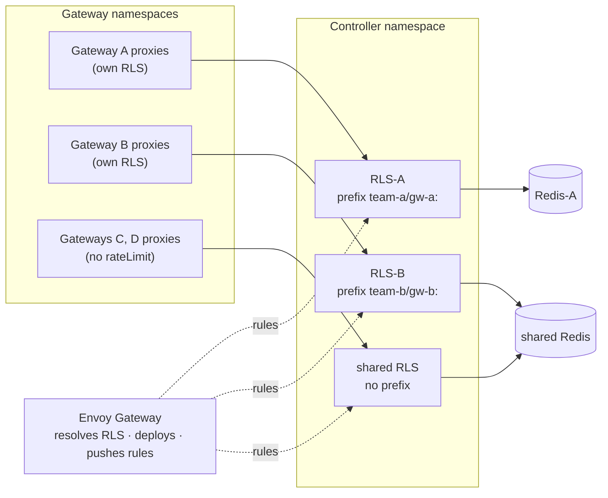

## Overview

This design lets one Envoy Gateway control plane run **dedicated rate limit services (RLS)**, each with its
own Redis connection, for individual Gateways. Today a single RLS and Redis are shared by every Gateway
the control plane manages.

Envoy Gateway provisions the RLS; users provision Redis. Several RLS instances may reference the same
Redis, so dedicated Redis capacity and failure isolation depend on the supplied backends.

This proposal covers only the Gateway scope. A dedicated RLS shared by a GatewayClass is out of scope:
`rateLimit` on a GatewayClass's `EnvoyProxy` is ignored, and may be supported in the future (see
[Future work](#future-work-gatewayclass-scope)).

Tracking issue: [#10520](https://github.com/envoyproxy/gateway/issues/10520)

## Background

Global rate limiting is configured once for the whole control plane, in `EnvoyGateway.rateLimit`. Envoy
Gateway deploys one `envoy-ratelimit` service backed by one Redis, and every Gateway's proxies call it with
the same timeout and failure behaviour.

Ordinary rate limit domains (`<namespace>/<gateway>/<listener>`) keep each Gateway's counters separate;
`shared: true` rules use policy domains to share counters across targets. Infrastructure and service
behaviour are shared in either case:

* **Capacity:** one Redis and one RLS deployment for all traffic.
* **Blast radius:** if one Gateway overloads or breaks the RLS or Redis, every Gateway is affected.
* **Behaviour:** `timeout` and `failClosed` apply to all Gateways.

In multi-team clusters this is often not enough isolation. The only workaround today is running a
separate control plane per Gateway, which is heavy when the rate limit backend is the only thing that
needs to be isolated.

## Goals

* Let a Gateway use its own RLS, optionally backed by its own Redis.
* Let `timeout`, `failClosed`, telemetry and connection settings to the RLS differ between Gateways.
* Keep the shared RLS working exactly as today; dedicated services are opt-in, both for the admin
  (a control-plane setting) and per Gateway.
* Allow global rate limiting with a dedicated RLS even when no shared RLS is configured.

## Non-Goals

* A dedicated RLS per GatewayClass, or one shared by any other set of Gateways, in the first iteration.
  Each dedicated RLS serves exactly one Gateway.
* Dedicated RLS for merged Gateways (`mergeGateways`) in the first iteration.
* User-managed (bring-your-own) RLS in the first iteration. Envoy Gateway still deploys and configures
  the RLS. A user-managed RLS may be proposed separately as a follow-up.
* Rate limit backends other than Redis.
* Dedicated RLS on the host (standalone) provider in the first iteration.
* Changing how rate limit rules or domains are generated.
* Uninterrupted rate limiting while the dedicated RLS configuration is being changed.

## Assumptions

A dedicated RLS is infrastructure: a platform or Gateway owner sets it up once, together with its Redis,
and it normally stays unchanged for the life of the Gateway. Switching a Gateway between the shared and a
dedicated RLS, or changing its Redis backend or credentials, is expected to be rare and planned.

This design therefore optimizes for a simple, correct steady state rather than for seamless changes.
Changes are reconciled the way other Kubernetes resources are: Envoy Gateway converges to the new desired
state, and rate limiting may be degraded, or not enforced, until the change converges (see
[Changing the configuration](#changing-the-configuration)). If this assumption turns out to be wrong,
smoother changes (for example, migrating between services before removing the old one) can be added
later without changing the API.

## API

The setting lives on `EnvoyProxy`, the existing API for per-Gateway infrastructure. A Gateway already
references an `EnvoyProxy` in its own namespace through `spec.infrastructure.parametersRef`, so no new
attachment mechanism is needed. Only this Gateway-level attachment enables a dedicated RLS; see
[GatewayClass EnvoyProxy](#gatewayclass-envoyproxy).

A new optional `spec.rateLimit` field holds the same settings as `EnvoyGateway.rateLimit`:

| Field             | Description                                                                     |
| ----------------- | ------------------------------------------------------------------------------- |
| `backend`         | Required Redis connection for the dedicated RLS (URL or Secret reference, TLS). |
| `timeout`         | How long proxies wait for the RLS. Defaults to 20ms.                            |
| `failClosed`      | Deny traffic when the RLS can't be reached. Defaults to false.                  |
| `telemetry`       | Metrics and tracing for the dedicated RLS.                                      |
| `serviceSettings` | Connection settings from proxies to the RLS (circuit breakers, etc.).           |

Deployment settings for the dedicated RLS (`rateLimitDeployment`, `rateLimitHpa`, `rateLimitPDB`) sit under
`spec.provider.kubernetes`, next to the existing proxy deployment settings.

These use the same types as the proxy settings (`KubernetesDeploymentSpec` and friends). `patch` is applied
only when the `EnvoyProxyPatch` runtime flag is enabled, the same as for the proxy Deployment.

> **Security risk.** The dedicated RLS runs in the controller namespace (see
> [Namespace and certificates](#namespace-and-certificates)), but its workload settings come from
> `EnvoyProxy`, which is often authored by Gateway owners. Whoever can author that `EnvoyProxy` can use
> `patch`, `volumes`, `securityContext` and similar fields to configure a pod in the controller namespace,
> for example to mount a Secret there or run with elevated privileges. Proxy Deployment settings already
> carry this risk outside Gateway namespace mode. Dedicated RLS introduces it even in Gateway namespace
> mode, because the RLS still runs in the controller namespace.
>
> Before enabling tenant-authored dedicated RLS workload customization, admins must either restrict
> creation and updates of the supplying `EnvoyProxy` to trusted platform administrators through RBAC, or
> enforce an admission policy that allows only approved workload settings. The policy must cover
> deployment, HPA and PDB settings, including patches, and allowlist safe fields and values rather than
> rely on a partial denylist. Controller-namespace Secret references, custom images, additional and init
> containers, environment variables, volumes and mounts, security settings and ServiceAccount overrides
> all need to be covered. The same restrictions must apply to every `EnvoyProxy` a Gateway can reference.
>
> Disabling `EnvoyProxyPatch` is an additional restriction, not sufficient protection: ordinary
> `KubernetesDeploymentSpec` fields can also select images and reference controller-namespace Secrets.
> Tenant-authored workload customization is supported only with the admission restrictions above;
> otherwise workload customization must remain administrator-authored. Dedicated RLS with built-in
> workload settings can be enabled independently, as described below.
>
> Built-in workload settings remove the workload risks above, but not every risk. With only
> `enableDedicatedRateLimit` enabled, Gateway owners still choose addresses that a pod in the controller
> namespace connects to: the Redis URL and the OTLP endpoint in `telemetry.tracing.provider.url`. This
> can bypass NetworkPolicies that restrict tenant namespaces and reach internal services from the
> controller namespace. Each Gateway owner can also add an RLS Deployment to the controller namespace,
> consuming its resources; a ResourceQuota there could then prevent Envoy Gateway's own pods from
> scheduling. Admins should restrict egress from dedicated RLS pods with NetworkPolicy and plan capacity
> and quota for the controller namespace before enabling dedicated RLS for tenants.

### Example: restricting dedicated RLS egress

The following NetworkPolicy, applied by an admin in the controller namespace, limits every dedicated
RLS pod (selected by the labels defined in [Service identity](#service-identity)) to DNS, the Envoy
Gateway configuration server, an approved Redis namespace and an approved OTLP collector. It also
allows only Envoy proxy pods to call the RLS. Envoy Gateway does not create this policy.

```yaml
apiVersion: networking.k8s.io/v1
kind: NetworkPolicy
metadata:
  name: dedicated-ratelimit
  namespace: envoy-gateway-system          # the controller namespace
spec:
  podSelector:
    matchLabels:
      app.kubernetes.io/component: ratelimit
      gateway.envoyproxy.io/ratelimit-scope: gateway
  policyTypes:
  - Ingress
  - Egress
  ingress:
  - from:                                  # Envoy proxies, in any namespace
    - namespaceSelector: {}
      podSelector:
        matchLabels:
          app.kubernetes.io/component: proxy
          app.kubernetes.io/managed-by: envoy-gateway
    ports:
    - port: 8081                           # RLS gRPC
  egress:
  - to:                                    # cluster DNS
    - namespaceSelector:
        matchLabels:
          kubernetes.io/metadata.name: kube-system
      podSelector:
        matchLabels:
          k8s-app: kube-dns
    ports:
    - port: 53
      protocol: UDP
    - port: 53
      protocol: TCP
  - to:                                    # rate limit configuration server
    - podSelector:
        matchLabels:
          control-plane: envoy-gateway
    ports:
    - port: 18001
  - to:                                    # approved Redis instances
    - namespaceSelector:
        matchLabels:
          kubernetes.io/metadata.name: redis-system
    ports:
    - port: 6379
  - to:                                    # approved OTLP collector, if tracing is used
    - namespaceSelector:
        matchLabels:
          kubernetes.io/metadata.name: observability
      podSelector:
        matchLabels:
          app: otel-collector
    ports:
    - port: 4317
```

Notes for adapting it:

* NetworkPolicy matches pods, namespaces and IP ranges, not hostnames. A Redis outside the cluster
  needs an `ipBlock`, or a CNI-specific policy that supports FQDN rules.
* This single policy lets every dedicated RLS reach every approved Redis. NetworkPolicy rules are
  additive: a pod may make any connection allowed by at least one policy that selects it, so adding
  narrower policies cannot take this access away. To limit each RLS to its own tenant's Redis, first
  remove the Redis rule from the common policy, keeping its default deny, DNS, configuration server,
  OTLP and ingress rules. Then add one policy per Gateway that selects on
  `gateway.envoyproxy.io/owning-gateway-namespace` and `gateway.envoyproxy.io/owning-gateway-name` and
  allows only that tenant's Redis.
* The DNS, controller and proxy labels and the ports shown match a default Helm installation; check them
  against the cluster. NetworkPolicy has no effect unless the CNI enforces it.
* The shared RLS is not selected, because it does not carry the `ratelimit-scope: gateway` label.

### Enabling dedicated RLS

Because of this risk, dedicated RLS is disabled by default. Admins opt in through a new field in the
`EnvoyGateway` configuration, next to the other switches for risky features such as
`enableEnvoyPatchPolicy`, `enableLua` and `enableBackend`:

```yaml
apiVersion: gateway.envoyproxy.io/v1alpha1
kind: EnvoyGateway
extensionApis:
  enableDedicatedRateLimit: true   # defaults to false
  enableDedicatedRateLimitWorkloadOverrides: false   # defaults to false
```

A disabled switch never rejects the Gateway. Settings that a switch does not allow are ignored, the
Gateway stays `Accepted=True` and keeps serving all of its traffic, and the ignored settings are
reported as a warning on the `EnvoyProxy` status, naming the setting to enable. This follows the
existing handling of `patch` fields while `EnvoyProxyPatch` is disabled. Rejecting the Gateway instead
would remove all of its listeners, so a control-plane switch change could take many tenants' Gateways
offline at once.

While `enableDedicatedRateLimit` is disabled, `rateLimit` on a Gateway's `EnvoyProxy` is ignored as
above, but the Gateway does not fall back to the shared RLS: the user asked for an isolated RLS, and
silently losing that isolation would be worse than a visible error. Instead:

* The Gateway reports `RateLimitReady=False` with reason `DedicatedRateLimitDisabled`.
* Global rate limit policies targeting the Gateway report an error for that Gateway, and the routes
  they apply to follow the ignored block's `failClosed`:
  * `failClosed: true`: those routes return HTTP 500, as when no RLS is available today.
  * `failClosed: false` or not set: those routes keep serving without global rate limiting.

  `spec.rateLimit` reuses the `EnvoyGateway.rateLimit` type, whose `failClosed` is a plain boolean
  defaulting to `false`, so an omitted field and an explicit `false` are the same value and behave the
  same way here, as they do for a running RLS. Today that field has neither `omitempty` nor an
  `+optional` marker, so the generated EnvoyProxy CRD would make it required inside `rateLimit` and
  reject an `EnvoyProxy` that omits it. As part of this API change, `RateLimit.FailClosed` gains
  `+optional` and `omitempty`. It stays a `bool`, so the meaning of an omitted value is unchanged and
  existing `EnvoyGateway` configurations remain valid.

  Other routes and listeners of the Gateway, and other Gateways, are not affected.

Disabling the setting after dedicated RLS is in use has the same effect: the dedicated RLS is removed
and the routes with global rate limits on those Gateways follow `failClosed` as above, until the owner
removes `rateLimit` (moving the Gateway to the shared RLS, if configured) or the admin enables the
setting again. RLS workload fields on an `EnvoyProxy` without `rateLimit` have no effect either way.

The two settings are control-plane-wide opt-ins. `enableDedicatedRateLimit` allows Gateway owners to
configure a dedicated RLS using built-in workload defaults. It does not permit RLS workload customization.
When `enableDedicatedRateLimitWorkloadOverrides` is false, `rateLimitDeployment`, `rateLimitHpa` and
`rateLimitPDB` on a Gateway-level `EnvoyProxy` are ignored with a warning naming the setting, and the
dedicated RLS runs with built-in workload defaults. Rate limiting keeps working. Fields on a
GatewayClass or without `rateLimit` retain the scope behavior described below.

Admins may additionally enable `enableDedicatedRateLimitWorkloadOverrides` to accept those workload
fields. This requires `enableDedicatedRateLimit: true`; an inconsistent control-plane configuration is
rejected at startup. The RBAC or admission restrictions above apply whenever customization is enabled.
Disabling customization rolls existing dedicated RLS back to built-in workload defaults and reports the
ignored fields as warnings; Gateways are not rejected. Controller-owned isolation settings remain
protected even when both switches and `EnvoyProxyPatch` are enabled.

`rateLimit` is not accepted in the control-plane default `EnvoyGateway.envoyProxy`. Control-plane-wide
rate limiting stays configured in one place, `EnvoyGateway.rateLimit`.

### Example

This example customizes replicas and therefore requires both
`extensionApis.enableDedicatedRateLimit: true` and
`extensionApis.enableDedicatedRateLimitWorkloadOverrides: true`
(see [Enabling dedicated RLS](#enabling-dedicated-rls)).
Omit the `provider` block to use built-in workload defaults with only the first switch enabled.

```yaml
apiVersion: gateway.envoyproxy.io/v1alpha1
kind: EnvoyProxy
metadata:
  name: team-a
  namespace: team-a
spec:
  rateLimit:
    backend:
      type: Redis
      redis:
        urlRef:
          secretKeyRef:
            name: team-a-redis
            key: url
    timeout: 50ms
    failClosed: true
  provider:
    type: Kubernetes
    kubernetes:
      rateLimitDeployment:
        replicas: 3
---
apiVersion: gateway.networking.k8s.io/v1
kind: Gateway
metadata:
  name: team-a
  namespace: team-a
spec:
  gatewayClassName: eg
  infrastructure:
    parametersRef:
      group: gateway.envoyproxy.io
      kind: EnvoyProxy
      name: team-a
  listeners:
  - name: http
    protocol: HTTP
    port: 80
```

## Scope

A dedicated RLS always serves exactly one Gateway. Which RLS a Gateway uses is decided as follows:

| Configuration                                              | Result                                                   |
| ---------------------------------------------------------- | -------------------------------------------------------- |
| The Gateway's own `EnvoyProxy` sets `rateLimit`            | A dedicated RLS for that Gateway.                        |
| Only the GatewayClass's `EnvoyProxy` sets `rateLimit`      | Ignored; one of the last two rows applies.               |
| `mergeGateways` enabled                                    | No Gateway-level `EnvoyProxy`; one of the last two rows. |
| No Gateway-level `rateLimit`, `EnvoyGateway.rateLimit` set | The shared control-plane RLS (today's behaviour).        |
| No Gateway-level `rateLimit`, no shared RLS                | Global rate limits are rejected (today's behaviour).     |

### Shared rules

Ordinary rules keep separate counters through their Gateway listener domains, as today.

Rules with `shared: true` share one bucket among the policy's targets **that use the same RLS**. Each
dedicated RLS keeps its own bucket for the rule, and the shared control-plane RLS keeps one bucket for
all targets on it. For example, a shared 100rps rule whose targets are on Gateway A (dedicated RLS),
Gateway B (dedicated RLS) and Gateways C and D (shared RLS) allows up to 100rps on A, 100rps on B and
100rps across C and D together.

Domains are generated exactly as today, on every RLS; proxies and RLS configuration see no change.
Buckets are kept apart in Redis instead. The RLS supports a `CACHE_KEY_PREFIX` setting that it prepends
to every Redis key it reads or writes. Envoy Gateway sets it on each dedicated RLS Deployment to
`<gatewayNamespace>/<gatewayName>:` and leaves it unset on the shared RLS, as today. All keys of a
dedicated RLS, for shared and ordinary rules alike, are therefore separate from those of every other RLS,
even when several RLS use the same Redis database. Whether targets share a bucket depends only on which
RLS their Gateways use, never on the Redis backends behind them.

The prefix cannot collide with existing keys. The RLS builds each key from the prefix, the domain, `_`
and the descriptors. Domains consist only of Kubernetes names, listener section names and `/`, so
without a prefix a shared RLS key contains only lowercase letters, digits, `-`, `.` and `/` before its
first `_`. A dedicated RLS key always contains `:` before that point, so it never matches a shared RLS
key. Two dedicated RLS keys differ in the text before their first `:`, which is their Gateway's
namespace and name.

Admins can already set `CACHE_KEY_PREFIX` on the shared RLS through
`EnvoyGateway.provider.kubernetes.rateLimitDeployment` (container env or patch). A shared prefix that
contains `:`, such as `team-a/gw-a:`, could equal a dedicated prefix and merge buckets. The argument
above still holds for any shared prefix without `:`, because the shared key then has no `:` before its
first `_`. Envoy Gateway therefore checks the effective shared `CACHE_KEY_PREFIX` after rendering the
shared RLS Deployment: while `enableDedicatedRateLimit` is true, a shared prefix containing `:` is an
inconsistent control-plane configuration and fails startup, like the other inconsistent switch
settings. A shared prefix without `:` is allowed and keeps working as today.

The prefix is derived from the Gateway, not from the RLS settings. It stays the same when the RLS is
updated, including when its Redis backend changes.

Users who need one bucket across Gateways should keep those Gateways on the shared RLS. A shared bucket
never spans more than one RLS.

Whenever a shared rule's effective targets use more than one RLS, the policy reports
`SharedRateLimitCrossScope=True` with reason `MultipleRLSScopes`. The message lists the RLS involved
and states that each enforces the limit separately. The policy remains accepted, and the condition is
removed when no shared rule's targets span more than one RLS. The user guide must explain this
behaviour.

### GatewayClass EnvoyProxy

`rateLimit` and the RLS workload fields (`rateLimitDeployment`, `rateLimitHpa`, `rateLimitPDB`) are
ignored on an `EnvoyProxy` referenced by a GatewayClass's `spec.parametersRef`. Gateways in the class
are not affected by them. The GatewayClass stays `Accepted=True`, and its condition message notes that
these fields are ignored, so the configuration is not silently dropped.

These fields are also never inherited from the class through `mergeType`. With StrategicMerge or
JSONMerge, Envoy Gateway resolves `rateLimit` and the RLS workload fields from the Gateway's own,
unmerged `EnvoyProxy`; class values for them are discarded before merging. Normal merge rules still
apply to unrelated proxy fields. A Gateway therefore gets a dedicated RLS only when its own `EnvoyProxy`
sets a complete `rateLimit` block, including `backend`.

### Merged Gateways

With `mergeGateways` enabled, a Gateway's `spec.infrastructure.parametersRef` must be unset, as required
today, and the class `rateLimit` block is ignored as above. Merged Gateways therefore keep using the
shared RLS. This design does not change that attachment restriction.

### Workload settings

A dedicated RLS uses the `rateLimitDeployment`, `rateLimitHpa` and `rateLimitPDB` of the Gateway's
`EnvoyProxy`, then built-in defaults for omitted settings. Neither the GatewayClass `EnvoyProxy`,
`EnvoyGateway.envoyProxy` nor the shared RLS settings under `EnvoyGateway.provider.kubernetes` supply
defaults for dedicated RLS workloads. RLS workload fields in `EnvoyGateway.envoyProxy` are rejected when
loading the control-plane config. RLS workload fields on a Gateway `EnvoyProxy` without `rateLimit` have
no effect and are reported as a warning on the Gateway. The shared RLS continues to use its existing
control-plane workload settings.

## How it works

1. **Resolution.** When translating each Gateway, Envoy Gateway works out which RLS it uses (dedicated or
   shared) from the scope rules above. Global rate limit policies are accepted for a Gateway when it has
   either kind of RLS.
2. **Deployment.** Envoy Gateway deploys one RLS per Gateway with a dedicated RLS, named after that
   Gateway (for example `envoy-ratelimit-<hash>`), with a cache key prefix derived from the Gateway (see
   [Shared rules](#shared-rules)). It removes the RLS when the Gateway is deleted or no longer sets
   `rateLimit`.
3. **Rate limit configuration.** Each dedicated RLS receives only the rate limit rules of its Gateway.
   The shared RLS keeps receiving the rules of all Gateways without a dedicated RLS. A shared policy
   domain is included in the configuration of every RLS that serves at least one of the policy's
   targets. The configuration server runs whenever any RLS exists, even when no shared RLS is
   configured.
4. **Proxy configuration.** Each Gateway's proxies are pointed at their RLS, with that RLS's `timeout`,
   `failClosed` and connection settings.



Solid arrows are rate limit checks; dotted arrows are rules pushed by Envoy Gateway. RLS-B and the
shared RLS use the same Redis database but keep separate counters through their cache key prefixes.

### Service identity

Each RLS has a stable identity: the Gateway (namespace/name) for a dedicated RLS, or the existing shared
identity. Resource names and the configuration each RLS receives are keyed by this identity, so several
Gateways referencing the same `EnvoyProxy` each get their own RLS rather than sharing one.

The identity depends only on the Gateway, not on settings. Changing the settings of an existing RLS, including
its Redis backend, therefore updates that RLS in place rather than creating a new one; see
[Changing the configuration](#changing-the-configuration).

For dedicated RLS, explicit `rateLimitDeployment.name`, `rateLimitHpa.name` and `rateLimitPDB.name` are
not supported; they are ignored and reported as a warning on the `EnvoyProxy`. Envoy Gateway generates the names of the Deployment,
Service, HPA, PDB and copied credential Secrets from the scope identity. Generated identities reserve the
existing shared RLS identity and include the scope kind, leaving room for a GatewayClass scope later. The
HPA target and Service and PDB selectors refer only to that scope's Deployment and pods; no selector
spans dedicated scopes or the shared RLS.

Dedicated RLS pods carry the following labels:

| Label                                            | Value                                             |
| ------------------------------------------------ | ------------------------------------------------- |
| `app.kubernetes.io/name`                         | The generated RLS name, never `envoy-ratelimit`   |
| `app.kubernetes.io/component`                    | `ratelimit`                                       |
| `app.kubernetes.io/managed-by`                   | `envoy-gateway`                                   |
| `gateway.envoyproxy.io/ratelimit-scope`          | `gateway`                                         |
| `gateway.envoyproxy.io/owning-gateway-namespace` | The Gateway's namespace                           |
| `gateway.envoyproxy.io/owning-gateway-name`      | The Gateway's name                                |

The shared RLS Service, Deployment and PDB select `app.kubernetes.io/name: envoy-ratelimit`,
`app.kubernetes.io/component: ratelimit` and `app.kubernetes.io/managed-by: envoy-gateway`. Adding the
scope labels alone would not exclude dedicated pods from that selector, so dedicated pods use a
different `app.kubernetes.io/name` value instead. The shared selectors therefore never match a
dedicated pod, and they stay unchanged, which matters because a Deployment's selector is immutable.
Each dedicated RLS selects all six labels above, so its selectors match neither the shared RLS nor any
other dedicated RLS.

The owning-gateway labels are the same ones Envoy Gateway already sets on proxy resources. The shared
RLS does not carry them or the `ratelimit-scope` label. A future GatewayClass scope would use a different
`ratelimit-scope` value. The labels are part of the supported interface, so admins can select dedicated
RLS pods in NetworkPolicies and admission policies; see
[Example: restricting dedicated RLS egress](#example-restricting-dedicated-rls-egress).

These identity fields and the dedicated RLS runtime settings `CONFIG_GRPC_XDS_NODE_ID`,
`CONFIG_GRPC_XDS_SERVER_URL`, `CONFIG_TYPE` and `CACHE_KEY_PREFIX` are controller-owned even when
`EnvoyProxyPatch` is enabled. Envoy Gateway validates the rendered resources after applying workload
settings and patches, rejecting changes to generated resource names or namespaces, ownership metadata,
scope labels and selectors, or the HPA target. Custom pod labels cannot overwrite scope labels. The RLS
container must keep the generated runtime settings with their literal values, with no duplicate
definitions or `valueFrom` substitutions, and any change to its `command` or `args` is rejected. These
checks also apply to administrator-authored configuration.

These checks guard against misconfiguration, such as one scope's settings accidentally redirecting
reconciliation or traffic to another scope's resources. They are not a security boundary against a
deliberate author: a custom image can ignore the runtime settings, and additional or init containers
can read the RLS's mounted credentials and certificates. When workload overrides are enabled, the
RBAC or admission restrictions in the [security note](#api) remain the boundary and must cover the
container image and any added containers.

### Namespace and certificates

In the first iteration, dedicated RLS deployments run in the controller namespace, like the shared one.
They reuse the existing mTLS certificates between proxies, the RLS and the control plane, so no new
certificate handling is needed. Proxies in Gateway namespaces can reach them as they reach the shared RLS
today. Running the RLS in the Gateway namespace (in Gateway namespace mode) is a possible follow-up.

### Redis credentials

Redis references are resolved against the Gateway's `EnvoyProxy` that supplied the `rateLimit` block.
`urlRef.secretKeyRef` must be in that `EnvoyProxy`'s namespace. A TLS `certificateRef`
defaults to the same namespace; a cross-namespace reference requires a `ReferenceGrant` that allows that
`EnvoyProxy` to reference the Secret.

Because the RLS runs in the controller namespace, Envoy Gateway copies only the referenced keys into a
Secret it owns for that RLS. It keeps the copy in sync with the source Secret and deletes it when the RLS
is removed. A hash of the copied values is set as an annotation on the RLS pod template, so a credential
rotation triggers a normal rolling update and new pods pick up the new credentials.

**Missing or revoked credentials.** If a referenced Secret is deleted or its `ReferenceGrant` is revoked,
Envoy Gateway deletes its copy, updates the hash and the Gateway reports a condition naming the problem.
The new pods cannot start without the Secret. What happens to the running pods depends on the
Deployment strategy:

* With the built-in `RollingUpdate` strategy, or any rolling strategy that keeps at least one replica
  available, the rollout stalls and the old pods keep serving with the credentials they already loaded.
* With `Recreate`, or a rolling strategy whose `maxUnavailable` allows every replica to go (for example
  `100%`), the old pods are terminated before the replacements fail to start. The RLS then has no ready
  pods and rate limit checks follow `failClosed`.

In both cases, an old pod that stops for any other reason (eviction, node drain, crash) is not
replaced until the references are valid again. Once they are, the rollout completes. Envoy Gateway
does not hold back the pod template change or reject strategies to preserve old pods; strategies other
than the default can only be set when workload overrides are enabled.

Deleting the source Secret is therefore **not** a reliable way to cut off Redis access, nor one to keep
the RLS running: the outcome depends on the strategy and on pod churn. Envoy Gateway does not
provide an RLS stop switch in the first iteration. Removing the `rateLimit` block isn't one either: the
Gateway moves to the shared RLS, if configured, and the dedicated RLS is removed only after that change
converges. To stop a dedicated RLS from using credentials that must no longer be used, revoke them at Redis
(change the password or ACL, or revoke the client certificate). The running pods then lose access on
their next connection attempt, and rate limit checks follow `failClosed`.

Credential resolution failures do not change RLS selection or remove its desired infrastructure or
rules. Envoy Gateway continues translating the Gateway's listeners and routes, including its RLS cluster
and rate limit filter, and never falls back to another RLS because credentials are unavailable.
This also applies on first creation with a missing Secret: the Service and Deployment are provisioned,
but pods requiring the missing credential copy cannot start. Checks that cannot be served follow
`failClosed`. After deletion or revocation, existing pods may continue serving, depending on the
Deployment strategy, as described above.
These rules are derived from current resources on restart and do not depend on retaining an old snapshot.

### Validation and status

A `rateLimit` block without `backend` is rejected by schema validation when the `EnvoyProxy` is applied.
Other invalid settings, such as an unsupported `serviceSettings` field, are reported the same way as
other invalid `EnvoyProxy` settings. The `serviceSettings` restrictions are the same as for the shared
RLS. Settings not allowed by a disabled `extensionApis` switch are not invalid parameters: they are
ignored with an `EnvoyProxy` warning and never set the Gateway `Accepted=False` (see
[Enabling dedicated RLS](#enabling-dedicated-rls)).

Missing Secrets, missing or invalid credential keys, and denied or revoked Secret references are
operational credential failures, not fatal `EnvoyProxy` validation errors. They do not set Gateway
`Accepted=False` or enter the existing path that skips Gateway translation. Instead, the Gateway reports
a separate `RateLimitReady=False` condition with reason `InvalidCredentials` and a message identifying
the failed reference without exposing credential values. Selection, provisioning and proxy translation
continue as specified in [Redis credentials](#redis-credentials). Valid credentials clear this failure;
`RateLimitReady` becomes true only when all the readiness criteria below are met.

Each Gateway using global rate limiting with a dedicated RLS reports which RLS it uses and whether
that RLS infrastructure is ready.
The condition message identifies the selected scope and Service without exposing credentials. For a
dedicated RLS, `RateLimitReady=True` requires all of the following for the current desired configuration:

* All credential references resolve successfully and the owned credential copies are up to date.
* Infrastructure reconciliation has succeeded. The Deployment has observed its latest generation,
  completed the desired rollout, and has at least one available replica, with no old replicas remaining.
  Its pod template includes the current credential hash.
* The Service has at least one ready endpoint belonging to the current rollout.

The controller recomputes readiness as desired workload settings, credentials, workloads and endpoints
change. It does not retain `True` from the previous desired workload configuration while a new rollout
is pending. On restart, readiness remains unknown until the controller has observed the required state.
This condition describes credential resolution and Kubernetes infrastructure readiness. It does not
confirm that RLS endpoints have loaded the desired rules, can connect to Redis, or provide uninterrupted
enforcement. ACK-based configuration readiness is deferred to [TODO](#todo); rule migration still has the
limitations described below.

`RateLimitReady=False` uses the following reasons, in priority order when multiple failures apply:

| Reason                       | Meaning                                                                         |
| ---------------------------- | ------------------------------------------------------------------------------- |
| `DedicatedRateLimitDisabled` | `rateLimit` is set but `extensionApis.enableDedicatedRateLimit` is disabled.    |
| `InvalidCredentials`         | A required credential or its authorization cannot be resolved.                  |
| `ProvisioningFailed`         | Creation or update of a required Kubernetes resource failed.                    |
| `RolloutFailed`              | The Deployment reports that the desired rollout exceeded its progress deadline. |
| `Provisioning`               | Required resources have not yet been observed.                                  |
| `RollingOut`                 | The current Deployment rollout has not completed.                               |
| `NoReadyEndpoints`           | The Service has no ready endpoint from the current rollout.                     |

An unknown observation state uses `RateLimitReady=Unknown` with reason `PendingObservation`. Successful
convergence uses reason `Ready`. A Gateway that no longer uses global rate limiting has this condition
removed, as does a Gateway that switches to the shared RLS. Shared RLS status and credential validation
retain their existing control-plane behavior.

### Host provider

Not supported in the first iteration. Setting `rateLimit` on an `EnvoyProxy` used with the host provider
makes the Gateway `Accepted=False` with a message saying so.

### Tooling

`egctl` can show the rate limit configuration of a dedicated RLS as well as the shared one, and
`egctl x translate` picks the settings up from the `EnvoyProxy` input.

## Changing the configuration

Following the [assumptions](#assumptions), any change to a dedicated RLS (new settings, a new Redis
backend, or moving a Gateway between the shared RLS and its own) is reconciled toward the desired state,
like other Kubernetes resources. Envoy Gateway creates or updates the RLS, publishes the Gateway's rules
to it, points the proxies at it, and removes a dedicated RLS once its Gateway no longer uses it. A
control plane restart simply reconciles again.

While a change rolls out, rate limiting may be degraded in two ways:

* **The RLS can't be reached** (not ready yet, or already removed). Those requests follow `failClosed`.
* **The RLS is reachable but no longer has the Gateway's rules.** This happens when the rules have
  already moved to the new RLS but some proxies still call the old one, which is the shared RLS still
  running for other Gateways, or a dedicated RLS not yet removed. The RLS treats an unknown domain as
  having no limits and allows the request, so **rate limits are not enforced for those requests even
  with `failClosed: true`**.

Both gaps can persist until the proxies successfully apply their new configuration. There is no
guaranteed upper bound: disconnected proxies or rejected updates can prolong the gap, including when
`failClosed: true`. Envoy Gateway does
not keep old rules on the previous RLS until proxies have switched; that would need the migration support
this design leaves out. Users who need continuous enforcement should make such changes during a
low-traffic window.

**Counters after a change.** Moving a Gateway between the shared RLS and a dedicated one changes the
cache key prefix of its keys (see [Shared rules](#shared-rules)), selecting a different keyspace even
if both use the same Redis database. Counters start from zero only when matching, unexpired keys do not
already exist in the destination keyspace. Switching shared → dedicated → shared can reuse surviving
shared counters. Likewise, re-enabling the dedicated RLS for the same Gateway, or recreating a Gateway
with the same namespace and name, can reuse its earlier dedicated counters. A shared policy bucket on
the destination shared RLS may also already contain usage from other targets. The transition does not
reset counters of other targets of the same policy. Changing the Redis backend of a dedicated RLS keeps
its prefix; whether counters carry over then depends on the destination Redis (see
[Counter behavior when changing Redis backends](#counter-behavior-when-changing-redis-backends)).

## Upgrade and compatibility

Without `EnvoyProxy.spec.rateLimit` on a Gateway's `EnvoyProxy`, nothing changes: same shared RLS, same
resource names, same behaviour. Dedicated RLS is disabled by default, so upgrading does not let anyone
create RLS workloads in the controller namespace until an admin sets
`extensionApis.enableDedicatedRateLimit`. `rateLimit` on a GatewayClass's `EnvoyProxy` is ignored in this
iteration, so adding GatewayClass support later only changes behaviour for configurations that are
explicitly reported as ignored today. The GatewayClass condition message makes this visible before
support lands.

## Alternatives considered

* **Support GatewayClass scope in the first iteration.** A class `rateLimit` block would deploy one RLS
  shared by every Gateway in the class, including merged Gateways. This reduces the number of RLS
  deployments, but requires deciding how class and Gateway blocks interact under each `mergeType`,
  tracking which level supplied the merged block, and handling the class RLS lifecycle as Gateways join
  and leave. Deferred; see [Future work](#future-work-gatewayclass-scope).
* **No switch; rely on RBAC and admission policy only.** Less configuration, but every upgraded control
  plane would immediately let anyone who can author an `EnvoyProxy` create pods in the controller
  namespace, protected only by guidance in the docs.
* **A runtime flag instead of an `extensionApis` field.** Runtime flags guard breaking changes and
  experimental behaviour, are often enabled by default and are removed once the change settles; they
  are not meant as permanent security switches. `EnvoyProxyPatch` is enabled by default for this
  reason. `extensionApis` already holds the permanent, disabled-by-default switches for risky features.
* **The switch under `EnvoyGateway.rateLimit`.** That block configures the shared RLS, and one goal is
  to allow dedicated RLS without a shared RLS, so users would have to set it only to reach the switch.
* **A single switch for dedicated RLS and workload customization.** Simpler API, but enabling per-Gateway
  Redis configuration would also allow controller-namespace workload customization. Separate switches
  let admins offer built-in workloads without requiring workload admission policies.
* **Named rate limit profiles in the `EnvoyGateway` config**, referenced by name from `EnvoyProxy`. This
  keeps Redis credentials admin-only, but `EnvoyGateway` changes need a control plane restart, and it adds
  a second place to configure per-Gateway infrastructure.
* **A new `RateLimitService` resource** referenced from `EnvoyProxy` or `BackendTrafficPolicy`. This lets
  any set of Gateways share one dedicated RLS, but it is a new API. Per-Gateway isolation, the main
  need, is covered by the existing `EnvoyProxy` attachment; sharing across Gateways is left to future work.
* **Choosing the RLS per `BackendTrafficPolicy`.** A proxy would then talk to several RLS instances, which
  makes the proxy configuration much more complex and gives Gateways no isolation by default.
* **Multiple control planes** (today's workaround). It works, but it is heavy when only the rate limit
  backend needs to be isolated.

## Proposed decisions

These are the author's recommendations and are open for review.

* `backend` is required in every `rateLimit` block. Overriding only `timeout` or `failClosed` while
  keeping the shared RLS is left to a separate shared-mode design.
* Dedicated RLS is supported only at Gateway scope. `rateLimit` and RLS workload fields on a
  GatewayClass `EnvoyProxy` are ignored, reported in the GatewayClass condition message, and never
  inherited through `mergeType`. Merged Gateways keep using the shared RLS.
* Scope comes from the Gateway's own `EnvoyProxy`; no explicit `scope` field is added.
* A `shared: true` bucket covers only the policy's targets on the same RLS. Domains are unchanged;
  each dedicated RLS sets `CACHE_KEY_PREFIX` to `<gatewayNamespace>/<gatewayName>:` so its Redis keys
  stay separate, and the shared RLS keeps no prefix. A shared prefix set by the admin must not contain
  `:` while dedicated RLS is enabled, otherwise startup fails. Targets spanning more than one RLS
  produce a `SharedRateLimitCrossScope` warning, not a rejection.
* `rateLimit` is not allowed in the control-plane default `EnvoyGateway.envoyProxy`.
* Dedicated RLS workload settings come only from the Gateway's unmerged `EnvoyProxy`, with built-in
  defaults for omitted settings; class and control-plane workload settings are not inherited.
* Dedicated RLS resource names, ownership, scope labels and selectors, and HPA targets are
  controller-owned, as are the runtime settings selecting configuration and Redis key prefixes.
  Workload settings and patches that change these fields are rejected after rendering.
* Dedicated RLS is disabled by default and enabled with `extensionApis.enableDedicatedRateLimit`.
  Workload customization requires the additional, disabled-by-default
  `extensionApis.enableDedicatedRateLimitWorkloadOverrides` switch.
* A disabled switch never rejects a Gateway. Disallowed settings are ignored with an `EnvoyProxy`
  warning and the Gateway keeps serving. Without `enableDedicatedRateLimit`, the Gateway does not fall
  back to the shared RLS: it reports `RateLimitReady=False`, and only routes with global rate limits
  are affected. They follow the ignored block's `failClosed`: `true` returns 500, as when no RLS is
  available today, and `false` or unset serves them without global rate limiting. Without workload
  overrides, the dedicated RLS uses built-in workload defaults.
* Dedicated RLS workload settings use the existing Kubernetes types. `patch` is gated by
  `EnvoyProxyPatch`, but disabling patches alone is insufficient protection. Even with dedicated RLS
  enabled, workload customization must be administrator-authored or constrained by an admission
  allowlist covering all workload settings. Built-in workloads do not require the customization switch.
* Dedicated RLS deployments run in the controller namespace in the first iteration. Running them in the
  Gateway namespace, and the authentication that needs, is deferred.
* Dedicated RLS pods carry documented, controller-owned scope labels so admins can select them in
  NetworkPolicies and admission policies. Their `app.kubernetes.io/name` is the generated RLS name, so
  the unchanged shared RLS selectors never match them. The proposal includes an example egress policy; Envoy
  Gateway does not generate NetworkPolicies in the first iteration.
* Envoy Gateway copies the referenced Redis Secret keys into the controller namespace and keeps the copy
  in sync; a config hash on the pod template rolls the RLS on rotation. Revoked credentials stall that
  rollout under the default strategy, so running pods are not actively stopped; with `Recreate` or a
  strategy allowing all replicas to be unavailable they are. Credentials are revoked at Redis.
* `RateLimit.FailClosed` becomes `+optional` with `omitempty`, so `failClosed` can be omitted in
  `EnvoyProxy.spec.rateLimit`.
* Credential resolution failures report `RateLimitReady=False` without rejecting the Gateway, changing
  RLS selection, or skipping infrastructure, rule or proxy reconciliation, including on first creation.
* Dedicated `RateLimitReady=True` requires the current workload rollout, ready Service endpoints and
  valid credentials. ACK-based configuration readiness and changes to shared RLS status are deferred.
* Dedicated RLS configuration is assumed to be set up once and rarely changed. Changes are plain
  reconciliation with no migration support. While they converge, unreachable RLS calls follow
  `failClosed`, and calls to an RLS that no longer has the Gateway's rules are allowed.
* User-managed RLS is deferred to a separate proposal.

## Acceptance and validation plan

Implementation must cover the following cases with meaningful automated tests:

* **Opt-ins and scope:** both switches default off; built-in workloads work with only dedicated RLS
  enabled; workload overrides require both switches; inconsistent control-plane switches fail startup;
  class fields are ignored and never inherited.
* **Disabled switches:** Gateways stay accepted and serving with an `EnvoyProxy` warning; with dedicated
  RLS disabled, only routes with global rate limits are affected, following `failClosed` (true
  returns 500, false or unset serves unlimited), and nothing falls back to the shared RLS; with workload overrides disabled, the RLS runs with built-in defaults; toggling either switch
  on a running Gateway affects nothing beyond that.
* **Coexistence:** shared and dedicated RLS operate together; dedicated-only operation works without a
  shared RLS; multiple Gateways referencing one `EnvoyProxy` receive distinct services and snapshots.
* **Counter isolation:** two dedicated RLS and the shared RLS using the same Redis database keep
  separate counters, including for `shared: true` rules and a shared RLS with an admin-set prefix
  without `:`; a shared prefix containing `:` fails startup while dedicated RLS is enabled; cross-scope
  policy warnings appear and clear correctly.
* **Counter reuse:** switching back to a previously used shared or dedicated keyspace preserves matching
  unexpired counters rather than promising a reset.
* **Credentials:** initial missing references, rotation, deletion and ReferenceGrant revocation update
  copies, rollouts and status as specified, without fallback or removal of rate limit filters; deletion
  keeps old pods under the default strategy and stops them under `Recreate`.
* **Reconciliation:** controller restart reconstructs scope selection and readiness; Gateway deletion
  removes only its resources; updates preserve scope-specific selectors and HPA targets; the shared RLS
  Service and PDB never select dedicated pods.
* **API:** an `EnvoyProxy` whose `rateLimit` omits `failClosed` is accepted and behaves as `false`.
* **Protected settings:** workload settings and patches cannot override names, selectors, ownership,
  configuration identity, configuration source or cache key prefix, including through duplicate env
  entries, `valueFrom`, or `command` and `args` changes.
* **Transitions and failures:** shared/dedicated transitions, an unavailable RLS and delayed proxy
  updates show the documented failure behavior, including the enforcement gap despite
  `failClosed: true`.

Use schema/CEL tests for API validation, Gateway translation fixtures for selection and conditions,
infrastructure tests for rendered resources and protected settings, and xDS/configuration tests for
per-scope routing and rule distribution. End-to-end tests must demonstrate shared/dedicated coexistence,
dedicated-only operation, same-Redis counter isolation and credential rotation. Tests of migration gaps
should control configuration delivery rather than depend on a timing race. These checks are requirements
for implementation; this proposal itself changes no executable behavior.

## Future work: GatewayClass scope

A dedicated RLS shared by every Gateway in a GatewayClass may be added later, by honouring `rateLimit`
on the class `EnvoyProxy`. It trades isolation for footprint: Gateways in the class share capacity and a
failure domain again, but with fewer RLS deployments and a common Redis connection, which fits when the
GatewayClass is already the team boundary. It would also give merged Gateways a dedicated RLS.

The identity scheme above already leaves room for a GatewayClass scope. Open questions for that design:

* **Inheritance.** Whether a Gateway-level `rateLimit` may override the class RLS, and how the existing
  `mergeType` modes (replace, StrategicMerge, JSONMerge) apply to the block. One option treats
  `rateLimit` as a single unit and lets the Gateway block win; another makes the class RLS mandatory and
  rejects Gateway-level blocks in that class.
* **Unrelated Gateway overrides.** With replace semantics, a Gateway bringing its own `EnvoyProxy` for an
  unrelated reason would silently leave the class RLS.
* **Workload settings.** Whether Gateways on the class RLS may influence its workload settings.
* **Lifecycle.** Keeping the class RLS while at least one Gateway uses it, and the rule migration gaps
  when Gateways move between the class RLS and others.
* **Shared buckets.** Gateway overrides within a class can split `shared: true` buckets across Redis
  backends.
* **Migration from ignored configuration.** Class `rateLimit` blocks that are ignored today would start
  taking effect, so the rollout needs a clear upgrade note.

## TODO

The following concerns also apply to the existing shared RLS mode. They are follow-up work and are not
requirements for introducing dedicated RLS.

### ACK-based configuration readiness

Consider a separate design for configuration readiness across both shared and dedicated RLS. It would
require every ready RLS endpoint to acknowledge the desired snapshot on its current stream, correlating
pod and scope identities and distinguishing pending configuration from a rejected configuration.
Infrastructure readiness alone does not provide this guarantee.

The cross-replica approach below is a candidate for that follow-up, rather than an implementation
requirement of this proposal. Its RPC, timing and identity choices need separate review.

#### ACK observation with multiple controller replicas

RLS configuration streams may connect to any Envoy Gateway replica. Only the elected status writer
publishes Gateway conditions, so readiness cannot depend solely on streams connected to that replica.
Each configuration server exposes a controller-internal, mutually authenticated observation RPC that
reports its current RLS streams. The elected status writer queries every live controller replica serving
the configuration service and combines these observations with Kubernetes workload and endpoint state.
This RPC is restricted to controller identities and does not expose configuration contents or credentials.

Each observation includes the controller pod UID and process incarnation, RLS pod UID, scope identity,
stream identity, and the last ACK or NACK for that stream. RLS pods supply their pod UID separately from
the scope used to select their snapshot. Snapshot versions use a deterministic hash of the canonical
scope configuration, including an empty configuration, rather than a replica-local incrementing counter.
The server matches response nonces to these versions before recording an ACK or NACK. Thus observations
from different replicas can be compared against the status writer's desired snapshot without treating
unrelated local version numbers as equivalent.

Observations are fetched at least every five seconds, expire after fifteen seconds, and are invalidated
immediately when a stream closes or its server process changes. Missing or expired observations produce
`PendingObservation`; a known current stream without the desired ACK produces `ConfigurationPending`.
During a reconnect, multiple observed streams for one RLS pod are treated conservatively: all must have
ACKed the desired snapshot until closure of the superseded stream is observed. A failed replica must be
observed as terminated before its streams are discarded; an unreachable replica is not assumed dead.
This bounds stale readiness after an unobserved disconnection without requiring RLS streams to connect
to the elected controller.

On leadership change, the new status writer starts with no trusted ACK observations, publishes
`PendingObservation`, and obtains fresh responses from all serving replicas before reporting readiness.
Persisted Gateway conditions and observations from a previous controller incarnation are never used as
evidence of an ACK. The same aggregation applies to dedicated and shared RLS scopes.

### Counter behavior when changing Redis backends

Clarify counter reuse in general rate-limit operational guidance. Changing a Redis backend does not
guarantee counters start at zero: matching, unexpired keys on the destination still apply, including
when returning to a previously used backend. This also applies to changes to the existing shared RLS
backend and does not require dedicated-mode counter migration or reset support.

### Shared RLS runtime overrides

Dedicated RLS runtime settings are protected as specified in [Service identity](#service-identity).
Existing shared RLS workload overrides remain unchanged in this proposal. A follow-up should define
supported shared-mode runtime overrides and compatibility before introducing equivalent restrictions.

### Generated NetworkPolicies for RLS

Consider letting Envoy Gateway generate egress NetworkPolicies for RLS pods, for example one per
dedicated RLS that allows only its configured Redis and telemetry endpoints. This would apply to the
shared RLS as well, and needs a way to resolve Redis addresses to namespaces or IP ranges, so it is
left to a follow-up.
