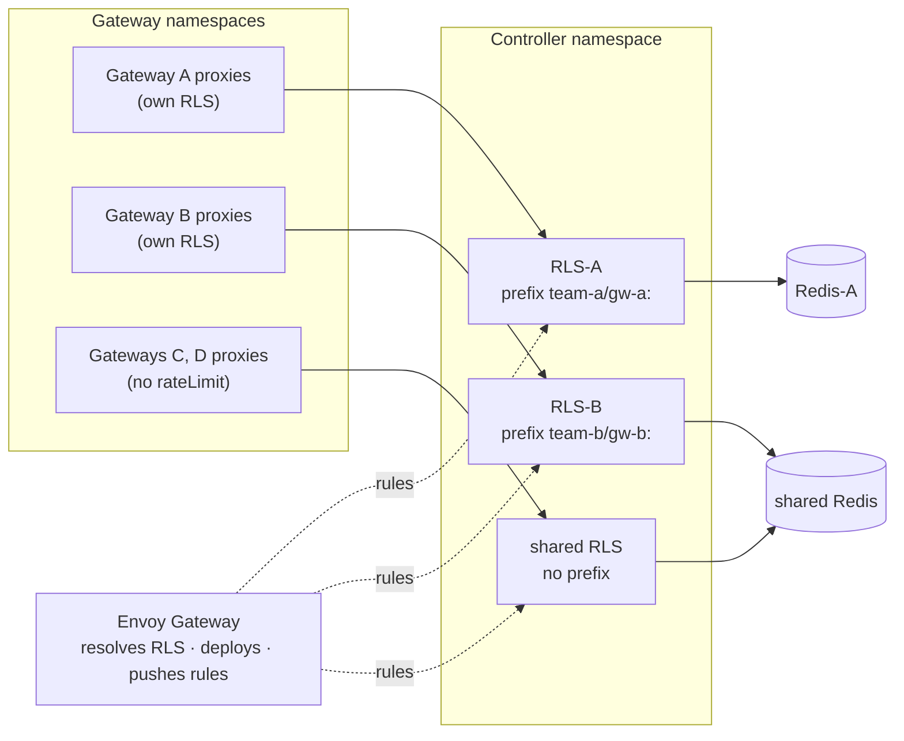

## Overview

This design lets one Envoy Gateway control plane run **dedicated rate limit services (RLS)**, each with its
own Redis connection, for individual Gateways. Today a single RLS and Redis are shared by every Gateway
the control plane manages.

Envoy Gateway provisions the RLS; users provision Redis. Several RLS instances may reference the same
Redis, so dedicated Redis capacity and failure isolation depend on the supplied backends.

This proposal covers only the Gateway scope. A dedicated RLS shared by a GatewayClass is out of scope:
`rateLimit` on a GatewayClass's `EnvoyProxy` is ignored, and may be supported in the future (see
[TODO](#gatewayclass-scope)).

Tracking issue: [#10520](https://github.com/envoyproxy/gateway/issues/10520)

## Background

Global rate limiting is configured once for the whole control plane, in `EnvoyGateway.rateLimit`. Envoy
Gateway deploys one `envoy-ratelimit` service backed by one Redis, and every Gateway's proxies call it with
the same timeout and failure behaviour.

Ordinary rate limit domains (`<namespace>/<gateway>/<listener>`) keep each Gateway's counters separate;
`shared: true` rules use policy domains to share counters across targets. Infrastructure and service
behaviour are shared in either case:

* **Capacity:** one Redis and one RLS deployment for all traffic.
* **Blast radius:** if one Gateway overloads or breaks the RLS or Redis, every Gateway is affected.
* **Behaviour:** `timeout` and `failClosed` apply to all Gateways.

In multi-team clusters this is often not enough isolation. The only workaround today is running a
separate control plane per Gateway, which is heavy when the rate limit backend is the only thing that
needs to be isolated.

## Goals

* Let a Gateway use its own RLS, optionally backed by its own Redis.
* Let `timeout`, `failClosed`, telemetry and connection settings to the RLS differ between Gateways.
* Keep the shared RLS working exactly as today; dedicated services are opt-in, both for the admin
  (a control-plane setting) and per Gateway.
* Allow global rate limiting with a dedicated RLS even when no shared RLS is configured.

## Non-Goals

* A dedicated RLS per GatewayClass, or one shared by any other set of Gateways, in the first iteration.
  Each dedicated RLS serves exactly one Gateway.
* Dedicated RLS for merged Gateways (`mergeGateways`) in the first iteration.
* User-managed (bring-your-own) RLS in the first iteration. Envoy Gateway still deploys and configures
  the RLS. A user-managed RLS may be proposed separately as a follow-up.
* Rate limit backends other than Redis.
* Dedicated RLS with any infrastructure other than Envoy Gateway's built-in Kubernetes infrastructure
  in the first iteration.
* Changing how rate limit rules or domains are generated.
* Validating RLS workload overrides or guaranteeing they are safe. Overrides are gated behind a
  default-off switch, and admins enforce their own requirements with tools such as Kyverno (see
  [Trust boundary](#trust-boundary)).
* Per-Gateway `timeout`, `failClosed` or other proxy-side settings while keeping the shared RLS. That
  needs a separate shared-mode design.
* Redis migration, including data transfer, counter synchronization, backend cutover orchestration
  and rollback. Users provision and operate Redis outside Envoy Gateway.
* Seamless switching between shared and dedicated RLS, or uninterrupted enforcement during a scope
  change. These are planned, potentially disruptive operations.
* Built-in security isolation between mutually untrusted Gateway owners without enforced namespace
  isolation. Per-Gateway client certificates and their lifecycle are deferred.

## Assumptions

A dedicated RLS is infrastructure: a platform or Gateway owner sets it up once, together with its Redis,
and it normally stays unchanged for the life of the Gateway. Switching a Gateway between the shared and a
dedicated RLS, or changing its Redis backend or credentials, is expected to be rare and planned.

The first iteration optimizes for a correct steady state and ordinary Kubernetes reconciliation.
Changes to RLS scope are planned maintenance operations, not coordinated migrations. Operators who
require continuous rate-limit enforcement must stop or externally gate affected traffic before a scope
change and restore it only after verifying the new configuration. A low-traffic window alone does not
provide that guarantee. Credential rotation remains supported without changing the selected RLS.

## API

The setting lives on `EnvoyProxy`, the existing API for per-Gateway infrastructure. A Gateway already
references an `EnvoyProxy` in its own namespace through `spec.infrastructure.parametersRef`, so no new
attachment mechanism is needed. Only this Gateway-level attachment enables a dedicated RLS; see
[GatewayClass EnvoyProxy](#gatewayclass-envoyproxy).

A new optional `spec.rateLimit` field holds the same settings as `EnvoyGateway.rateLimit`:

| Field             | Description                                                                     |
| ----------------- | ------------------------------------------------------------------------------- |
| `backend`         | Required Redis connection for the dedicated RLS (URL or Secret reference, TLS). |
| `timeout`         | How long proxies wait for the RLS. Defaults to 20ms.                            |
| `failClosed`      | Deny traffic when the RLS can't be reached. Defaults to false.                  |
| `telemetry`       | Metrics and tracing for the dedicated RLS.                                      |
| `serviceSettings` | Connection settings from proxies to the RLS (circuit breakers, etc.).           |

`spec.rateLimit` reuses the `EnvoyGateway.rateLimit` type. Its `failClosed` is a plain boolean
defaulting to `false`, so an omitted field and an explicit `false` behave the same way. Today that field
has neither `omitempty` nor an `+optional` marker, so the generated EnvoyProxy CRD would make it required
inside `rateLimit` and reject an `EnvoyProxy` that omits it. As part of this API change,
`RateLimit.FailClosed` gains `+optional` and `omitempty`. It stays a `bool`, so the meaning of an
omitted value is unchanged and existing `EnvoyGateway` configurations remain valid.

Reusing the `RateLimit` type also reuses its API documentation, which today describes only the shared
RLS. In particular, `RateLimitRedisSettings.urlRef` and `RedisURLSource.secretKeyRef` say the Secret
must be in the namespace of the Envoy Gateway rate limit deployment, which is wrong for `EnvoyProxy`
(see [Redis credentials](#redis-credentials)). As part of this API change, these descriptions are made
to cover both uses: in `EnvoyGateway.rateLimit` the Secret is in the controller namespace, and in
`EnvoyProxy.spec.rateLimit` it is in the `EnvoyProxy`'s namespace. The same review applies to every
other description in the reused types, including the TLS `certificateRef`.

Deployment settings for the dedicated RLS (`rateLimitDeployment`, `rateLimitHpa`, `rateLimitPDB`) sit under
`spec.provider.kubernetes`, next to the existing proxy deployment settings.

These use the same types as the proxy settings (`KubernetesDeploymentSpec` and friends). `patch` is applied
only when the `EnvoyProxyPatch` runtime flag is enabled, the same as for the proxy Deployment.

> **Security risk.** The dedicated RLS runs in the controller namespace (see
> [Namespace and certificates](#namespace-and-certificates)), but its workload settings come from
> `EnvoyProxy`, which is often authored by Gateway owners. Whoever can author that `EnvoyProxy` can use
> `patch`, `volumes`, `securityContext` and similar fields to configure a pod in the controller namespace,
> for example to mount a Secret there or run with elevated privileges. Proxy Deployment settings already
> carry this risk outside Gateway namespace mode. Dedicated RLS introduces it even in Gateway namespace
> mode, because the RLS still runs in the controller namespace.
>
> **Workload overrides delegate administrator-level authority in the controller namespace.** Envoy Gateway does not validate workload
> overrides or make them safe; that is why they sit behind a separate switch,
> `enableDedicatedRateLimitWorkloadOverrides`, that is off by default. Admins who enable it must
> enforce their own requirements, either by restricting who can author the supplying `EnvoyProxy`
> through RBAC, or with admission policy tools such as Kyverno, OPA Gatekeeper or Kubernetes
> `ValidatingAdmissionPolicy`. Disabling `EnvoyProxyPatch` alone is not enough: ordinary
> `KubernetesDeploymentSpec` fields can also select images and reference controller-namespace Secrets.
>
> Built-in workload settings remove the workload risks above, but not every risk. With only
> `enableDedicatedRateLimit` enabled, Gateway owners still choose addresses that a pod in the controller
> namespace connects to: the Redis URL and the OTLP endpoint in `telemetry.tracing.provider.url`. This
> can bypass NetworkPolicies that restrict tenant namespaces and reach internal services from the
> controller namespace. Each Gateway owner can also add an RLS Deployment to the controller namespace,
> consuming its resources; a ResourceQuota there could then prevent Envoy Gateway's own pods from
> scheduling. Admins should restrict egress from dedicated RLS pods with NetworkPolicy and plan capacity
> and quota for the controller namespace before enabling dedicated RLS for tenants. The mandatory
> deployment requirements below apply when Gateway owners are not trusted administrators.

### Requirements for untrusted Gateway owners

Enabling the feature alone does not establish tenant isolation. Before granting untrusted owners
access, the platform administrator must enforce all of the following:

* Default-deny ingress and egress for dedicated RLS pods, with explicit access only to their own
  Redis, approved telemetry, DNS and the configuration server. The CNI must enforce these policies;
  broader additive policies must not reopen access. DNS access itself is not protection against
  DNS-based exfiltration and must use a trusted resolver with appropriate controls where required.
* An admission-enforced per-tenant limit on Gateways that can request dedicated RLS, including new
  Gateways referencing an existing `EnvoyProxy`. Limit aggregate allocation as well as individual
  workloads. Enforce safe resource requests and limits on built-in RLS containers, including sidecars,
  and reserve controller scheduling capacity. A shared namespace ResourceQuota alone is insufficient:
  tenant-created resources must not consume the controller's recovery headroom. Changes of reference,
  concurrent creates and deletion/recreation must not bypass the allocation limit.
* RLS caller isolation as described below: separate tenant namespaces and enforced namespace-based
  ingress. Shared certificates and mutable pod labels alone do not qualify. Deployments without
  enforced tenant namespace isolation support trusted Gateway owners only in v1.
* The `EnvoyProxyPatch` runtime flag disabled. It is enabled by default, and proxy `patch` fields
  merge arbitrary fields with no allowlist, including `hostNetwork` and object metadata such as the
  namespace. A tenant could otherwise run its proxy on the node network, where its traffic no longer
  originates from its namespace, or render the proxy into another tenant's namespace, and so call
  another Gateway's RLS.
* Workload overrides remain disabled for tenant authors. If enabled for administrator-authored
  resources, admission or RBAC must prevent tenants from editing or selecting privileged override
  configurations. Restricting edits alone is insufficient if tenants can attach an administrator's
  override-bearing `EnvoyProxy` to their own Gateway.

These controls are deployment prerequisites, not guarantees inferred from the feature switch or
`RateLimitReady`. The installation guide must include their configuration and negative validation
cases. Deployments without them support trusted Gateway owners only.

### Example: restricting dedicated RLS network access

The following NetworkPolicies, applied by an admin in the controller namespace, restrict dedicated RLS
pods (selected by the labels defined in [Service identity](#service-identity)). Envoy Gateway does not
create them. NetworkPolicy rules are additive: a pod may make any connection allowed by at least one
policy that selects it, so a narrower policy cannot take away access that a broader one grants. The
rules that must differ per Gateway therefore live only in per-Gateway policies.

A common policy selects every dedicated RLS. It denies all traffic except DNS, the Envoy Gateway
configuration server, an approved OTLP collector, and Prometheus scraping from the monitoring namespace:

```yaml
apiVersion: networking.k8s.io/v1
kind: NetworkPolicy
metadata:
  name: dedicated-ratelimit
  namespace: envoy-gateway-system          # the controller namespace
spec:
  podSelector:
    matchLabels:
      app.kubernetes.io/component: ratelimit
      gateway.envoyproxy.io/ratelimit-scope: gateway
  policyTypes:
  - Ingress
  - Egress
  ingress:
  - from:                                  # Prometheus, if RLS metrics are enabled (the default)
    - namespaceSelector:
        matchLabels:
          kubernetes.io/metadata.name: monitoring
      podSelector:
        matchLabels:
          app.kubernetes.io/name: prometheus
    ports:
    - port: 19001                          # RLS metrics
  egress:
  - to:                                    # cluster DNS
    - namespaceSelector:
        matchLabels:
          kubernetes.io/metadata.name: kube-system
      podSelector:
        matchLabels:
          k8s-app: kube-dns
    ports:
    - port: 53
      protocol: UDP
    - port: 53
      protocol: TCP
  - to:                                    # rate limit configuration server
    - podSelector:
        matchLabels:
          control-plane: envoy-gateway
    ports:
    - port: 18001
  - to:                                    # approved OTLP collector, if tracing is used
    - namespaceSelector:
        matchLabels:
          kubernetes.io/metadata.name: observability
      podSelector:
        matchLabels:
          app: otel-collector
    ports:
    - port: 4317
```

One policy per Gateway then allows calls from proxies in that Gateway's namespace and connections to
that tenant's Redis only. This example is for Gateway namespace mode, where proxies run in the
Gateway's namespace. It provides namespace-level isolation: multiple Gateways in `team-a` can all
reach this RLS. Use separate namespaces for Gateways that need isolation from each other:

```yaml
apiVersion: networking.k8s.io/v1
kind: NetworkPolicy
metadata:
  name: dedicated-ratelimit-team-a-gw-a
  namespace: envoy-gateway-system          # the controller namespace
spec:
  podSelector:
    matchLabels:
      gateway.envoyproxy.io/ratelimit-scope: gateway
      gateway.envoyproxy.io/owning-gateway-namespace: team-a
      gateway.envoyproxy.io/owning-gateway-name: gw-a
  policyTypes:
  - Ingress
  - Egress
  ingress:
  - from:                                  # proxies in the Gateway's namespace
    - namespaceSelector:
        matchLabels:
          kubernetes.io/metadata.name: team-a
      podSelector:
        matchLabels:
          app.kubernetes.io/component: proxy
    ports:
    - port: 8081                           # RLS gRPC
  egress:
  - to:                                    # team-a's Redis
    - namespaceSelector:
        matchLabels:
          kubernetes.io/metadata.name: team-a-redis
    ports:
    - port: 6379
```

Notes for adapting them:

* The per-Gateway ingress rule identifies callers by namespace, using the `kubernetes.io/metadata.name`
  label that Kubernetes sets and users cannot change. Proxy pod labels are not a reliable identity:
  `EnvoyProxy` pod labels can set any label on a proxy pod, including the owning-gateway labels. In the
  default deployment mode, all proxies run in the controller namespace, so NetworkPolicy cannot tell
  one Gateway's proxies from another's. There, an ingress rule can only select proxy pods by label, and
  it isolates Gateways only if admission policy prevents `EnvoyProxy` pod labels from setting
  `app.kubernetes.io/component` and the owning-gateway labels. See
  [Isolation between Gateways](#isolation-between-gateways).
* The selector labels of dedicated RLS pods are generated by Envoy Gateway (see
  [Service identity](#service-identity)), so with built-in workload settings the per-Gateway
  `podSelector` selects only that Gateway's RLS.
* NetworkPolicy matches pods, namespaces and IP ranges, not hostnames. A Redis outside the cluster
  needs an `ipBlock`, or a CNI-specific policy that supports FQDN rules.
* The DNS, controller, proxy and Prometheus labels and the ports shown match a default Helm
  installation; check them against the cluster. The metrics rule can be dropped when RLS Prometheus
  metrics are disabled in `telemetry`. NetworkPolicy has no effect unless the CNI enforces it.
* The shared RLS is not selected, because it does not carry the `ratelimit-scope: gateway` label.

### Enabling dedicated RLS

Because of this risk, dedicated RLS is disabled by default. Admins opt in through a new field in the
`EnvoyGateway` configuration, next to the other switches for risky features such as
`enableEnvoyPatchPolicy`, `enableLua` and `enableBackend`:

```yaml
apiVersion: gateway.envoyproxy.io/v1alpha1
kind: EnvoyGateway
extensionApis:
  enableDedicatedRateLimit: true   # defaults to false
  enableDedicatedRateLimitWorkloadOverrides: false   # defaults to false
```

The table shows what happens to a Gateway whose own `EnvoyProxy` sets `rateLimit`, for each
combination of the two switches. For an otherwise valid Gateway and `EnvoyProxy` configuration, the
switches alone do not change `Accepted=True`. The table describes steady-state behavior after
reconciliation.

| `enableDedicatedRateLimit` | `enableDedicatedRateLimitWorkloadOverrides` | Dedicated RLS | Workload fields¹ | Routes with global rate limits                                                       | Other routes | Gateway status                                              |
| -------------------------- | ------------------------------------------- | ------------- | ---------------- | ------------------------------------------------------------------------------------ | ------------ | ----------------------------------------------------------- |
| `false`                    | any (no effect)                             | Not deployed  | Ignored          | Same as without `rateLimit`: the shared RLS, or rejected if none is configured       | Unaffected   | `EnvoyProxy` warning; no dedicated `RateLimitReady`         |
| `true`                     | `false`                                     | Deployed      | Ignored, warning | Rate limited by the dedicated RLS                                                    | Unaffected   | `RateLimitReady` reflects the RLS                           |
| `true`                     | `true`                                      | Deployed      | Applied          | Rate limited by the dedicated RLS                                                    | Unaffected   | `RateLimitReady` reflects the RLS                           |

¹ `rateLimitDeployment`, `rateLimitHpa` and `rateLimitPDB`. When they are ignored, the RLS uses
built-in workload defaults.

Ignored settings are reported as warnings on the `EnvoyProxy` status. The rest of this section explains
each row.

A disabled switch never rejects the Gateway. Settings that a switch does not allow are ignored, the
Gateway stays `Accepted=True` and keeps serving all of its traffic, and the ignored settings are
reported as a warning on the `EnvoyProxy` status, naming the setting to enable. This follows the
existing handling of `patch` fields while `EnvoyProxyPatch` is disabled. Rejecting the Gateway instead
would remove all of its listeners, so a control-plane switch change could take many tenants' Gateways
offline at once.

While `enableDedicatedRateLimit` is disabled, `rateLimit` on a Gateway's `EnvoyProxy` is ignored
entirely, and the Gateway behaves exactly as if the block were not set: it uses the shared RLS, as
today, or its global rate limit policies are rejected if no shared RLS is configured. The `EnvoyProxy`
reports a warning naming `extensionApis.enableDedicatedRateLimit`.

The switch, not the tenant-authored `EnvoyProxy`, decides whether a Gateway can leave the shared RLS.
Otherwise, while the feature is disabled, a Gateway owner could add a `rateLimit` block to move a
Gateway off the shared RLS, and with `failClosed` false or unset, every globally limited route would
pass without limits. That would let tenants bypass rate limits an admin enforces through the shared RLS
without the admin having opted in to anything. The cost is that a Gateway owner who expects isolation
silently stays on the shared RLS while the switch is off; the warning makes this visible.

Disabling the setting after dedicated RLS is in use has the same effect: each affected Gateway moves
back to the shared RLS, if configured, and its dedicated RLS is removed after that change converges,
with the transition behavior in [Changing the configuration](#changing-the-configuration).
Re-enabling the setting moves it to a dedicated RLS again. RLS workload fields on an `EnvoyProxy`
without `rateLimit` have no effect either way.

The two settings are control-plane-wide opt-ins. `enableDedicatedRateLimit` allows Gateway owners to
configure a dedicated RLS using built-in workload defaults. It does not permit RLS workload customization.
When `enableDedicatedRateLimitWorkloadOverrides` is false, `rateLimitDeployment`, `rateLimitHpa` and
`rateLimitPDB` on a Gateway-level `EnvoyProxy` are ignored with a warning naming the setting, and the
dedicated RLS runs with built-in workload defaults. Rate limiting keeps working. Fields on a
GatewayClass or without `rateLimit` retain the scope behavior described below.

Admins may additionally enable `enableDedicatedRateLimitWorkloadOverrides` to accept those workload
fields. It only takes effect together with `enableDedicatedRateLimit: true`. While
`enableDedicatedRateLimit` is false, `enableDedicatedRateLimitWorkloadOverrides` has no effect whatever
its value, and Envoy Gateway logs a warning at startup when it is true. This lets admins disable
dedicated RLS by changing only `enableDedicatedRateLimit`, as described above. The RBAC or admission
restrictions above apply whenever customization is enabled.
Disabling customization rolls existing dedicated RLS back to built-in workload defaults and reports the
ignored fields as warnings; Gateways are not rejected.

`rateLimit` is not accepted in the control-plane default `EnvoyGateway.envoyProxy`. Control-plane-wide
rate limiting stays configured in one place, `EnvoyGateway.rateLimit`.

### Example

This example customizes replicas and therefore requires both
`extensionApis.enableDedicatedRateLimit: true` and
`extensionApis.enableDedicatedRateLimitWorkloadOverrides: true`
(see [Enabling dedicated RLS](#enabling-dedicated-rls)).
Omit the `provider` block to use built-in workload defaults with only the first switch enabled.

```yaml
apiVersion: gateway.envoyproxy.io/v1alpha1
kind: EnvoyProxy
metadata:
  name: team-a
  namespace: team-a
spec:
  rateLimit:
    backend:
      type: Redis
      redis:
        urlRef:
          secretKeyRef:
            name: team-a-redis
            key: url
    timeout: 50ms
    failClosed: true
  provider:
    type: Kubernetes
    kubernetes:
      rateLimitDeployment:
        replicas: 3
---
apiVersion: gateway.networking.k8s.io/v1
kind: Gateway
metadata:
  name: team-a
  namespace: team-a
spec:
  gatewayClassName: eg
  infrastructure:
    parametersRef:
      group: gateway.envoyproxy.io
      kind: EnvoyProxy
      name: team-a
  listeners:
  - name: http
    protocol: HTTP
    port: 80
```

## Scope

A dedicated RLS always serves exactly one Gateway. Which RLS a Gateway uses is decided as follows:

| Configuration                                              | Result                                                   |
| ---------------------------------------------------------- | -------------------------------------------------------- |
| The Gateway's own `EnvoyProxy` sets `rateLimit`            | A dedicated RLS for that Gateway.                        |
| Only the GatewayClass's `EnvoyProxy` sets `rateLimit`      | Ignored; one of the last two rows applies.               |
| `mergeGateways` enabled                                    | No Gateway-level `EnvoyProxy`; one of the last two rows. |
| No Gateway-level `rateLimit`, `EnvoyGateway.rateLimit` set | The shared control-plane RLS (today's behaviour).        |
| No Gateway-level `rateLimit`, no shared RLS                | Global rate limits are rejected (today's behaviour).     |

### Shared rules

Ordinary rules keep separate counters through their Gateway listener domains, as today.

Rules with `shared: true` share one bucket among the policy's targets **that use the same RLS**. Each
dedicated RLS keeps its own bucket for the rule, and the shared control-plane RLS keeps one bucket for
all targets on it. For example, a shared 100rps rule whose targets are on Gateway A (dedicated RLS),
Gateway B (dedicated RLS) and Gateways C and D (shared RLS) allows up to 100rps on A, 100rps on B and
100rps across C and D together.

Domains are generated exactly as today, on every RLS; proxies and RLS configuration see no change.
Buckets are kept apart in Redis instead. The RLS supports a `CACHE_KEY_PREFIX` setting that it prepends
to every Redis key it reads or writes. Envoy Gateway sets it on each dedicated RLS Deployment to
`<gatewayNamespace>/<gatewayName>:` and leaves it unset on the shared RLS, as today. All keys of a
dedicated RLS, for shared and ordinary rules alike, are therefore separate from those of every other RLS,
even when several RLS use the same Redis database. Whether targets share a bucket depends only on which
RLS their Gateways use, never on the Redis backends behind them.

The prefix cannot collide with existing keys. The RLS builds each key from the prefix, the domain, `_`
and the descriptors. Domains consist only of Kubernetes names, listener section names and `/`, so
without a prefix a shared RLS key contains only lowercase letters, digits, `-`, `.` and `/` before its
first `_`. A dedicated RLS key always contains `:` before that point, so it never matches a shared RLS
key. Two dedicated RLS keys differ in the text before their first `:`, which is their Gateway's
namespace and name.

Admins can already set a custom `CACHE_KEY_PREFIX` on the shared RLS through its workload settings, for
example `eg:rl:` as shown in the global rate limit task. Envoy Gateway does not check it; like any
workload override, it is the admin's responsibility (see [Trust boundary](#trust-boundary)). A custom
shared prefix must not have the `<namespace>/<name>:` form that dedicated RLS use, or shared and
dedicated counters in the same Redis database can merge. Leaving the shared prefix unset, or giving
dedicated RLS a different Redis database, avoids the question.

The prefix is derived from the Gateway, not from the RLS settings. It stays the same when the RLS is
updated, including when its Redis backend changes.

Users who need one bucket across Gateways should keep those Gateways on the shared RLS. A shared bucket
never spans more than one RLS.

Whenever a shared rule's effective targets use more than one RLS, the policy reports
`SharedRateLimitCrossScope=True` with reason `MultipleRLSScopes`. The message lists the RLS involved
and states that each enforces the limit separately. The policy remains accepted, and the condition is
removed when no shared rule's targets span more than one RLS. The user guide must explain this
behaviour.

### GatewayClass EnvoyProxy

`rateLimit` and the RLS workload fields (`rateLimitDeployment`, `rateLimitHpa`, `rateLimitPDB`) are
ignored on an `EnvoyProxy` referenced by a GatewayClass's `spec.parametersRef`. Gateways in the class
are not affected by them. The GatewayClass stays `Accepted=True`, and its condition message notes that
these fields are ignored, so the configuration is not silently dropped.

These fields are also never inherited from the class through `mergeType`. With StrategicMerge or
JSONMerge, Envoy Gateway resolves `rateLimit` and the RLS workload fields from the Gateway's own,
unmerged `EnvoyProxy`; class values for them are discarded before merging. Normal merge rules still
apply to unrelated proxy fields. A Gateway therefore gets a dedicated RLS only when its own `EnvoyProxy`
sets a complete `rateLimit` block, including `backend`.

### Merged Gateways

With `mergeGateways` enabled, a Gateway's `spec.infrastructure.parametersRef` must be unset, as required
today, and the class `rateLimit` block is ignored as above. Merged Gateways therefore keep using the
shared RLS. This design does not change that attachment restriction.

### Workload settings

A dedicated RLS uses the `rateLimitDeployment`, `rateLimitHpa` and `rateLimitPDB` of the Gateway's
`EnvoyProxy`, then built-in defaults for omitted settings. Neither the GatewayClass `EnvoyProxy`,
`EnvoyGateway.envoyProxy` nor the shared RLS settings under `EnvoyGateway.provider.kubernetes` supply
defaults for dedicated RLS workloads. RLS workload fields in `EnvoyGateway.envoyProxy` are rejected when
loading the control-plane config. RLS workload fields on a Gateway `EnvoyProxy` without `rateLimit` have
no effect and are reported as a warning on the Gateway. The shared RLS continues to use its existing
control-plane workload settings.

The exception is where the RLS image comes from. Private-registry and air-gapped installations set the
RLS image, pull secrets and pull policy in `EnvoyGateway.provider.kubernetes.rateLimitDeployment`, for
example through the Helm values `global.imageRegistry`, `global.images.ratelimit` and
`global.imagePullSecrets`. Without them, a built-in dedicated RLS would pull the compiled default image
and fail with `ImagePullBackOff`, with no admin-level fix while workload overrides are disabled.
The built-in defaults for a dedicated RLS therefore take these settings from the shared RLS
configuration:

* the container image;
* the pod's `imagePullSecrets`;
* the container's `imagePullPolicy`, including when set through a patch as the Helm chart does.

These are admin-authored and apply to every dedicated RLS whether or not workload overrides are
enabled. No other shared RLS setting is inherited. `EnvoyGateway.rateLimit` does not need to be set for
these defaults to apply, so dedicated-only installations can use them too. When workload overrides
are enabled, a Gateway's `EnvoyProxy` can still override them, subject to the
[security note](#api). The pull secrets are referenced from the controller namespace, where the RLS
runs, as they are for the shared RLS today.

## How it works

1. **Resolution.** When translating each Gateway, Envoy Gateway works out which RLS it uses (dedicated or
   shared) from the scope rules above. Global rate limit policies are accepted for a Gateway when it has
   either kind of RLS.
2. **Deployment.** Envoy Gateway deploys one RLS per Gateway with a dedicated RLS, named after that
   Gateway (for example `envoy-ratelimit-<hash>`), with a cache key prefix derived from the Gateway (see
   [Shared rules](#shared-rules)). It removes the RLS when the Gateway is deleted or no longer sets
   `rateLimit`, through ordinary reconciliation as described below.
3. **Rate limit configuration.** Each dedicated RLS receives only the rate limit rules of its Gateway.
   The shared RLS keeps receiving the rules of all Gateways without a dedicated RLS. A shared policy
   domain is included in the configuration of every RLS that serves at least one of the policy's
   targets. The configuration server runs whenever any RLS exists, even when no shared RLS is
   configured.
4. **Proxy configuration.** Each Gateway's proxies are pointed at their RLS, with that RLS's `timeout`,
   `failClosed` and connection settings.



Solid arrows are rate limit checks; dotted arrows are rules pushed by Envoy Gateway. RLS-B and the
shared RLS use the same Redis database but keep separate counters through their cache key prefixes.

### Service identity

Each RLS has a stable identity: the Gateway (namespace/name) for a dedicated RLS, or the existing shared
identity. Resource names and the configuration each RLS receives are keyed by this identity, so several
Gateways referencing the same `EnvoyProxy` each get their own RLS rather than sharing one.

The identity depends only on the Gateway, not on settings. Changing the settings of an existing RLS, including
its Redis backend, therefore updates that RLS in place rather than creating a new one; see
[Changing the configuration](#changing-the-configuration).

For dedicated RLS, explicit `rateLimitDeployment.name`, `rateLimitHpa.name` and `rateLimitPDB.name` are
not supported; they are ignored and reported as a warning on the `EnvoyProxy`. Envoy Gateway generates the names of the Deployment,
Service, HPA, PDB and copied credential Secrets from the scope identity. Generated identities reserve the
existing shared RLS identity and include the scope kind, leaving room for a GatewayClass scope later. The
HPA target and Service and PDB selectors refer only to that scope's Deployment and pods; no selector
spans dedicated scopes or the shared RLS.

Today the shared RLS pods also depend on two support resources with fixed names in the controller
namespace: the `envoy-ratelimit` ServiceAccount and, with default telemetry, the
`statsd-exporter-config` ConfigMap. Envoy Gateway deletes the shared RLS infrastructure, including
these, when `EnvoyGateway.rateLimit` is not set. Dedicated RLS pods must not depend on resources whose
lifecycle belongs to another RLS, so each dedicated RLS gets its own ServiceAccount and, when needed,
its own statsd exporter ConfigMap, with names generated from the scope identity like its other
resources. They are created and deleted with that dedicated RLS. Deleting the shared RLS, or another
dedicated RLS, therefore never removes resources a dedicated RLS uses, including in dedicated-only
installations without `EnvoyGateway.rateLimit`. The shared RLS keeps its existing fixed-name resources.
The `envoy-rate-limit` TLS Secret is managed by the control plane's certificate setup, not by the RLS
infrastructure, and remains shared.

Dedicated RLS pods carry the following labels:

| Label                                            | Value                                             |
| ------------------------------------------------ | ------------------------------------------------- |
| `app.kubernetes.io/name`                         | The generated RLS name, never `envoy-ratelimit`   |
| `app.kubernetes.io/component`                    | `ratelimit`                                       |
| `app.kubernetes.io/managed-by`                   | `envoy-gateway`                                   |
| `gateway.envoyproxy.io/ratelimit-scope`          | `gateway`                                         |
| `gateway.envoyproxy.io/owning-gateway-namespace` | The Gateway's namespace                           |
| `gateway.envoyproxy.io/owning-gateway-name`      | The Gateway's name                                |

The shared RLS Service, Deployment and PDB select `app.kubernetes.io/name: envoy-ratelimit`,
`app.kubernetes.io/component: ratelimit` and `app.kubernetes.io/managed-by: envoy-gateway`. Adding the
scope labels alone would not exclude dedicated pods from that selector, so dedicated pods use a
different `app.kubernetes.io/name` value instead. The shared selectors therefore never match a
dedicated pod, and they stay unchanged, which matters because a Deployment's selector is immutable.
Each dedicated RLS selects all six labels above, so its selectors match neither the shared RLS nor any
other dedicated RLS.

The owning-gateway labels are the same ones Envoy Gateway already sets on proxy resources. The shared
RLS does not carry them or the `ratelimit-scope` label. A future GatewayClass scope would use a different
`ratelimit-scope` value. The labels are part of the supported interface, so admins can select dedicated
RLS pods in NetworkPolicies and admission policies; see
[Example: restricting dedicated RLS network access](#example-restricting-dedicated-rls-network-access).

#### Trust boundary

Envoy Gateway generates everything a dedicated RLS needs: resource names, labels and selectors, the
credential version annotation, environment variables such as the cache key prefix and the Redis and TLS
settings, and volumes and mounts. With built-in workload settings, Gateway owners cannot change any of
it, and this design describes exactly what runs.

Workload overrides and patches are applied on top without validation, as they are for the shared RLS
today. Changing generated values through them is unsupported: it can break isolation between RLS,
credential rotation or readiness reporting, and the behavior in this design then no longer applies.
The same is true of additions such as extra environment variables, `envFrom` sources, custom images,
other Deployment strategies or extra containers. This is why overrides need the separate, default-off
`enableDedicatedRateLimitWorkloadOverrides` switch, and why admins who enable it own the resulting
risk (see the [security note](#api)).

### Namespace and certificates

In the first iteration, dedicated RLS deployments run in the controller namespace, like the shared one.
They reuse the existing mTLS certificates between proxies, the RLS and the control plane, so no new
certificate handling is needed. Proxies in Gateway namespaces can reach them as they reach the shared RLS
today. Running the RLS in the Gateway namespace (in Gateway namespace mode) is a possible follow-up.

### Isolation between Gateways

Reusing the certificates means every proxy presents the same client identity: the client certificate
Envoy Gateway delivers to all proxies over SDS. Every RLS, shared or dedicated, accepts it. The RLS also
does not check which Gateway a request comes from. Any caller that reaches its gRPC port with a trusted
client certificate can send descriptors for any domain the RLS serves and consume that Gateway's
buckets. The shared RLS already behaves this way today.

A dedicated RLS therefore isolates capacity, failures and settings from other Gateways' normal traffic.
It is not, by itself, a security boundary against a Gateway owner who makes their proxies call another
Gateway's RLS, for example through `EnvoyPatchPolicy`, or against another workload that obtains the
client certificate.

Admins who need that boundary must restrict network access to each dedicated RLS to its own Gateway's
proxies, as in the per-Gateway policy in
[Example: restricting dedicated RLS network access](#example-restricting-dedicated-rls-network-access).
Only the source namespace identifies callers reliably, because `EnvoyProxy` pod labels can set any
label on a proxy pod. In Gateway namespace mode, proxies run in their Gateway's namespace; the mode
does not create a separate namespace for each Gateway. The example therefore separates Gateways only
when they are in different namespaces. In the default mode, all proxies run in the controller
namespace, and NetworkPolicy can separate Gateways only if admission policy also prevents `EnvoyProxy`
pod labels from setting the proxy component and owning-gateway labels. The namespace-based example
does not separate Gateways in the same namespace; separating those Gateways also requires protected
Gateway identity labels and corresponding per-Gateway ingress selectors. Source namespace identifies a
caller only while its proxies run in that namespace on the pod network, so the `EnvoyProxyPatch`
runtime flag must also be disabled (see
[Requirements for untrusted Gateway owners](#requirements-for-untrusted-gateway-owners)).

V1 supports untrusted owners only with enforced isolation by tenant namespace and the deployment
controls above. Untrusted deployments with proxies sharing the controller namespace, or tenants sharing
a Gateway namespace, are outside the supported security model. Per-Gateway authenticated identities
are a follow-up, not a prerequisite for the supported v1 modes (see
[Per-scope RLS client identities](#per-scope-rls-client-identities)).

### Redis credentials

Redis references are resolved against the Gateway's `EnvoyProxy` that supplied the `rateLimit` block.
`urlRef.secretKeyRef` must be in that `EnvoyProxy`'s namespace. A TLS `certificateRef`
defaults to the same namespace; a cross-namespace reference requires a `ReferenceGrant` that allows that
`EnvoyProxy` to reference the Secret.

Because the RLS runs in the controller namespace, Envoy Gateway copies only the referenced keys into a
Secret it owns for that RLS. It keeps the copy in sync with the source Secret and deletes it when the RLS
is removed. A credential version is set as an annotation on the RLS pod template, so a
credential rotation triggers a normal rolling update and new pods pick up the new credentials.

The RLS reads credentials once, at startup, so the copied Secret must be current before any new pod
starts. Envoy Gateway therefore changes the copied Secret first and changes the pod template only after
that write has succeeded: on rotation, it updates the copy and then the annotation; on deletion or
revocation, it deletes the copy and then updates the annotation. If the Secret write fails, the pod
template is left unchanged and the change is retried. A pod started for the new template thus never
reads the previous credentials.

The annotation is never derived from the credential values themselves. A plain hash of a Redis URL
containing a human-chosen password would let anyone who can read Deployments in the controller
namespace, but not Secrets, test password guesses offline. Instead, it is a hash of non-secret version
data: a canonical, unambiguous encoding of each reference's purpose, resolved namespace and name,
selected key names, source Secret UID and `resourceVersion`, and authorization state. Reference and key
selection are included even when two references resolve to the same Secret version. Changing a URL key
or TLS reference therefore changes the pod template version even if the source Secret is unchanged.
Credential values are never included. Any change to a source Secret therefore rolls the RLS, including changes to keys
it does not use, which is acceptable for configuration that rarely changes (see
[Assumptions](#assumptions)).

**Missing or revoked credentials.** If a referenced Secret is deleted or its `ReferenceGrant` is revoked,
Envoy Gateway deletes its copy, then updates the annotation, and the Gateway reports a condition naming the problem.
The new pods cannot start without the Secret, so with the built-in `RollingUpdate` strategy the
rollout stalls and the old pods keep serving with the credentials they already loaded. An old pod that
stops for any other reason (eviction, node drain, crash) is not replaced until the references are valid
again; once they are, the rollout completes. A different strategy set through workload overrides, such
as `Recreate`, can stop the old pods first (see [Trust boundary](#trust-boundary)).

Deleting the source Secret is therefore **not** a reliable way to cut off Redis access, nor one to keep
the RLS running: the outcome depends on pod churn. Envoy Gateway does not
provide an RLS stop switch in the first iteration. Removing the `rateLimit` block isn't one either: the
Gateway moves to the shared RLS, if configured, and the dedicated RLS is removed only after that change
converges. To stop a dedicated RLS from using credentials that must no longer be used, revoke them at Redis
(change the password or ACL, or revoke the client certificate). The running pods then lose access on
their next connection attempt, and rate limit checks follow `failClosed`.

Credential resolution failures do not change RLS selection or remove its desired infrastructure or
rules. Envoy Gateway continues translating the Gateway's listeners and routes, including its RLS cluster
and rate limit filter, and never falls back to another RLS because credentials are unavailable.
This also applies on first creation with a missing Secret: the Service and Deployment are provisioned,
but pods requiring the missing credential copy cannot start. Checks that cannot be served follow
`failClosed`. After deletion or revocation, existing pods may continue serving, as described above.
These rules are derived from current resources on restart and do not depend on retaining an old snapshot.

### Validation and status

A `rateLimit` block without `backend` is rejected by schema validation when the `EnvoyProxy` is applied.
Other invalid settings, such as an unsupported `serviceSettings` field, are reported the same way as
other invalid `EnvoyProxy` settings. The `serviceSettings` restrictions are the same as for the shared
RLS. Settings not allowed by a disabled `extensionApis` switch are not invalid parameters: they are
ignored with an `EnvoyProxy` warning and never set the Gateway `Accepted=False` (see
[Enabling dedicated RLS](#enabling-dedicated-rls)).

Missing Secrets, missing or invalid credential keys, and denied or revoked Secret references are
operational credential failures, not fatal `EnvoyProxy` validation errors. They do not set Gateway
`Accepted=False` or enter the existing path that skips Gateway translation. Instead, the Gateway reports
a separate `RateLimitReady=False` condition with reason `InvalidCredentials` and a message identifying
the failed reference without exposing credential values. Selection, provisioning and proxy translation
continue as specified in [Redis credentials](#redis-credentials). Valid credentials clear this failure;
`RateLimitReady` becomes true only when all the readiness criteria below are met.

Each Gateway using global rate limiting with a dedicated RLS reports which RLS it uses and whether
that RLS infrastructure is ready.
The condition message identifies the selected scope and Service without exposing credentials. For a
dedicated RLS, `RateLimitReady=True` requires all of the following for the current desired configuration:

* All credential references resolve successfully and the owned credential copies are up to date.
* Infrastructure reconciliation has succeeded. The Deployment has observed its latest generation,
  completed the desired rollout, and has at least one available replica, with no old replicas remaining.
  Its pod template includes the current credential version.
* The Service has at least one ready endpoint belonging to the current rollout.

The controller recomputes readiness as desired workload settings, credentials, workloads and endpoints
change. It does not retain `True` from the previous desired workload configuration while a new rollout
is pending. On restart, readiness remains unknown until the controller has observed the required state.
This condition describes credential resolution and Kubernetes infrastructure readiness. It does not
confirm that RLS endpoints have loaded the desired rules, can connect to Redis, or provide uninterrupted
enforcement. ACK-based configuration readiness is deferred to [TODO](#todo). Operators must verify
actual enforcement separately before restoring traffic after planned maintenance.

`RateLimitReady=False` uses the following reasons, in priority order when multiple failures apply:

| Reason                       | Meaning                                                                         |
| ---------------------------- | ------------------------------------------------------------------------------- |
| `InvalidCredentials`         | A required credential or its authorization cannot be resolved.                  |
| `ProvisioningFailed`         | Creation or update of a required Kubernetes resource failed.                    |
| `RolloutFailed`              | The Deployment reports that the desired rollout exceeded its progress deadline. |
| `Provisioning`               | Required resources have not yet been observed.                                  |
| `RollingOut`                 | The current Deployment rollout has not completed.                               |
| `NoReadyEndpoints`           | The Service has no ready endpoint from the current rollout.                     |

An unknown observation state uses `RateLimitReady=Unknown` with reason `PendingObservation`. Successful
convergence uses reason `Ready`. A Gateway that no longer uses global rate limiting has this condition
removed, as does a Gateway that switches to the shared RLS. Shared RLS status and credential validation
retain their existing control-plane behavior.

### Supported infrastructure

Dedicated RLS is supported only when Envoy Gateway provisions infrastructure itself with its built-in
Kubernetes infrastructure manager, that is, with `provider.type: Kubernetes`. That manager is the only
one that can create a per-Gateway RLS and report the Deployment and Service state that `RateLimitReady`
requires. Every other configuration is unsupported in the first iteration, including:

* the host provider;
* a custom provider with remote infrastructure: the remote contract cannot request a per-Gateway RLS,
  because `CreateOrUpdateRateLimitInfraRequest` carries no scope, backend, settings or address;
* a custom provider without infrastructure, where nothing provisions the RLS at all;
* any infrastructure type added in the future, until it is explicitly supported.

While `enableDedicatedRateLimit` is true, setting `rateLimit` on a Gateway's `EnvoyProxy` with
unsupported infrastructure makes the Gateway `Accepted=False`, with a message saying so, and no RLS
infrastructure request is sent. Supporting more infrastructure needs its own provisioning and readiness
contract.

While `enableDedicatedRateLimit` is false, this check does not run. `rateLimit` is ignored as for any
other provider, and the Gateway stays accepted, as described in
[Enabling dedicated RLS](#enabling-dedicated-rls). Rejecting it then would let a block the admin never
enabled take down all of the Gateway's listeners. Admins should therefore not enable dedicated RLS with
unsupported infrastructure; if they do, the Gateways that set `rateLimit` are rejected, which is visible and
limited to Gateways that asked for a dedicated RLS.

### Tooling

`egctl` can show the rate limit configuration of a dedicated RLS as well as the shared one, and
`egctl x translate` picks the settings up from the `EnvoyProxy` input.

## Changing the configuration

Envoy Gateway reconciles the desired RLS selection, infrastructure, rules and proxy settings directly.
There is no migration record, ACK gate, retained source configuration or coordinated cutover in v1.
Controller restart reconstructs desired state from current resources.

Adding or removing `rateLimit`, or toggling `enableDedicatedRateLimit`, can switch a Gateway between
shared and dedicated RLS. Treat these as planned maintenance operations. During convergence:

* Calls to an unavailable RLS follow `failClosed`.
* A proxy may still call the previous RLS after its rules have moved. An unknown domain is allowed by
  the RLS, so those requests can bypass limits **even with `failClosed: true`**. Disconnected proxies
  or rejected updates can prolong this gap without a guaranteed upper bound.

Operators requiring continuous enforcement must stop or externally gate affected traffic throughout
the change and verify proxy configuration and actual rate-limit behavior before restoring it.
`RateLimitReady=True` alone is insufficient. Feature disablement requires the same planning; it is
not an emergency enforcement or credential-revocation mechanism.

Updating Redis connection settings rolls the existing RLS Deployment normally. Redis provisioning,
data transfer, cutover, rollback and counter continuity are outside this proposal. Old and new pods
may temporarily use different backends and enforce independent buckets. Credential updates use the
copy-and-rollout procedure above and do not change RLS selection.

**Counters after a change.** Moving a Gateway between the shared RLS and a dedicated one changes the
cache key prefix of its keys (see [Shared rules](#shared-rules)), selecting a different keyspace even
if both use the same Redis database. Counters start from zero only when matching, unexpired keys do not
already exist in the destination keyspace. Switching shared → dedicated → shared can reuse surviving
shared counters. Likewise, re-enabling the dedicated RLS for the same Gateway, or recreating a Gateway
with the same namespace and name, can reuse its earlier dedicated counters. A shared policy bucket on
the destination shared RLS may also already contain usage from other targets. The transition does not
reset counters of other targets of the same policy. These are RLS keyspace semantics, not a promise
to transfer or synchronize counters.

## Upgrade and compatibility

Without `EnvoyProxy.spec.rateLimit` on a Gateway's `EnvoyProxy`, nothing changes: same shared RLS, same
resource names, same behaviour. Dedicated RLS is disabled by default, so upgrading does not let anyone
create RLS workloads in the controller namespace until an admin sets
`extensionApis.enableDedicatedRateLimit`. `rateLimit` on a GatewayClass's `EnvoyProxy` is ignored in this
iteration, so adding GatewayClass support later only changes behaviour for configurations that are
explicitly reported as ignored today. The GatewayClass condition message makes this visible before
support lands.

## Alternatives considered

* **Support GatewayClass scope in the first iteration.** A class `rateLimit` block would deploy one RLS
  shared by every Gateway in the class, including merged Gateways. This reduces the number of RLS
  deployments, but requires deciding how class and Gateway blocks interact under each `mergeType`,
  tracking which level supplied the merged block, and handling the class RLS lifecycle as Gateways join
  and leave. Deferred; see [TODO](#gatewayclass-scope).
* **No switch; rely on RBAC and admission policy only.** Less configuration, but every upgraded control
  plane would immediately let anyone who can author an `EnvoyProxy` create pods in the controller
  namespace, protected only by guidance in the docs.
* **A runtime flag instead of an `extensionApis` field.** Runtime flags guard breaking changes and
  experimental behaviour, are often enabled by default and are removed once the change settles; they
  are not meant as permanent security switches. `EnvoyProxyPatch` is enabled by default for this
  reason. `extensionApis` already holds the permanent, disabled-by-default switches for risky features.
* **The switch under `EnvoyGateway.rateLimit`.** That block configures the shared RLS, and one goal is
  to allow dedicated RLS without a shared RLS, so users would have to set it only to reach the switch.
* **A single switch for dedicated RLS and workload customization.** Simpler API, but enabling per-Gateway
  Redis configuration would also allow controller-namespace workload customization. Separate switches
  let admins offer built-in workloads without requiring workload admission policies.
* **Named rate limit profiles in the `EnvoyGateway` config**, referenced by name from `EnvoyProxy`. This
  keeps Redis credentials admin-only, but `EnvoyGateway` changes need a control plane restart, and it adds
  a second place to configure per-Gateway infrastructure.
* **A new `RateLimitService` resource** referenced from `EnvoyProxy` or `BackendTrafficPolicy`. This lets
  any set of Gateways share one dedicated RLS, but it is a new API. Per-Gateway isolation, the main
  need, is covered by the existing `EnvoyProxy` attachment; sharing across Gateways is left to future work.
* **Choosing the RLS per `BackendTrafficPolicy`.** A proxy would then talk to several RLS instances, which
  makes the proxy configuration much more complex and gives Gateways no isolation by default.
* **Multiple control planes** (today's workaround). It works, but it is heavy when only the rate limit
  backend needs to be isolated.

## Proposed decisions

These are the author's recommendations and are open for review.

* Dedicated RLS is supported only at Gateway scope. `rateLimit` and RLS workload fields on a
  GatewayClass `EnvoyProxy` are ignored, reported in the GatewayClass condition message, and never
  inherited through `mergeType`. Merged Gateways keep using the shared RLS.
* A `shared: true` bucket covers only the policy's targets on the same RLS. Domains are unchanged;
  each dedicated RLS sets `CACHE_KEY_PREFIX` to `<gatewayNamespace>/<gatewayName>:` so its Redis keys
  stay separate, and the shared RLS keeps no prefix; a custom shared prefix is the admin's
  responsibility. Targets spanning more than one RLS produce a `SharedRateLimitCrossScope` warning,
  not a rejection.
* `rateLimit` is not allowed in the control-plane default `EnvoyGateway.envoyProxy`.
* Dedicated RLS workload settings come only from the Gateway's unmerged `EnvoyProxy`, with built-in
  defaults for omitted settings; class and control-plane workload settings are not inherited, except
  the image, pull secrets and pull policy from the shared RLS settings, which are the built-in defaults
  so private-registry installations work.
* Dedicated RLS is disabled by default and enabled with `extensionApis.enableDedicatedRateLimit`.
  Workload customization requires the additional, disabled-by-default
  `extensionApis.enableDedicatedRateLimitWorkloadOverrides` switch, which has no effect while
  `enableDedicatedRateLimit` is false, so the parent switch can be disabled on its own.
* A disabled switch never rejects a Gateway. Disallowed settings are ignored with an `EnvoyProxy`
  warning and the Gateway keeps serving. Without `enableDedicatedRateLimit`, `rateLimit` is ignored
  entirely and the Gateway stays on the shared RLS, so tenants cannot bypass shared rate limits before
  the admin opts in. Without workload overrides, the dedicated RLS uses built-in workload defaults.
* Envoy Gateway is responsible for built-in dedicated RLS workloads. Workload overrides use the
  existing Kubernetes types, are not validated, and are the admin's responsibility, enforced with
  RBAC or admission tools such as Kyverno; this is why they need a separate, default-off switch.
* Dedicated RLS deployments run in the controller namespace in the first iteration. Running them in the
  Gateway namespace, and the authentication that needs, is deferred. Only the built-in Kubernetes
  infrastructure is supported; with any other infrastructure, `rateLimit` makes the Gateway
  `Accepted=False` while `enableDedicatedRateLimit` is true, and is ignored as usual while it is
  false.
* Dedicated RLS pods carry documented scope labels, generated by Envoy Gateway, so admins can select them in
  NetworkPolicies and admission policies. The proposal includes example NetworkPolicies; Envoy Gateway
  does not generate NetworkPolicies in the first iteration.
* All proxies keep sharing one client identity trusted by every RLS. A dedicated RLS isolates capacity,
  failures and settings, but it is a security boundary between Gateways only when admins restrict
  network access to it per Gateway. The namespace-based example provides this isolation in Gateway
  namespace mode only for Gateways in different namespaces; selecting individual Gateways within one
  namespace requires admission-protected identity labels. Untrusted tenants without enforced namespace
  separation are outside the supported v1 security model; per-Gateway identities are deferred.
* Envoy Gateway copies the referenced Redis Secret keys into the controller namespace and keeps the copy
  in sync; a credential version on the pod template, derived from source Secret metadata rather than
  credential values, rolls the RLS on rotation. Revoked credentials stall that
  rollout, so running pods are not actively stopped; credentials are revoked at Redis.
* Credential resolution failures report `RateLimitReady=False` without rejecting the Gateway, changing
  RLS selection, or skipping infrastructure, rule or proxy reconciliation. `RateLimitReady=True`
  requires the current workload rollout, ready Service endpoints and valid credentials. Configuration
  ACK observation is deferred.
* Scope changes use ordinary reconciliation and require planned maintenance. Continuous enforcement
  during changes is not guaranteed, including with `failClosed: true`.

## Acceptance and validation plan

Implementation must cover the following cases with meaningful automated tests:

* **Opt-ins and scope:** both switches default off; built-in workloads work with only dedicated RLS
  enabled and use the image, pull secrets and pull policy from the shared RLS settings, also without
  `EnvoyGateway.rateLimit`; workload overrides require both switches; the overrides switch alone has no effect and does
  not block startup, so disabling only `enableDedicatedRateLimit` works; class fields are ignored and
  never inherited.
* **Disabled switches:** Gateways stay accepted and serving with an `EnvoyProxy` warning; with dedicated
  RLS disabled, a Gateway with `rateLimit` (including `failClosed` false or unset) stays on the shared
  RLS and its shared limits keep being enforced, or its policies are rejected as today without a
  shared RLS; disabling the switch moves dedicated Gateways back to the shared RLS; with workload
  overrides disabled, the RLS runs with built-in defaults.
* **Coexistence:** shared and dedicated RLS operate together; dedicated-only operation works without a
  shared RLS; multiple Gateways referencing one `EnvoyProxy` receive distinct services and snapshots.
* **Counter isolation:** two dedicated RLS and the shared RLS using the same Redis database keep
  separate counters, including for `shared: true` rules and a shared RLS with an admin-set prefix such
  as `eg:rl:`. Cross-scope policy warnings appear and clear correctly.
* **Network isolation:** with the example NetworkPolicies installed and enforced by the CNI, proxies
  in the owning Gateway's namespace can call its dedicated RLS, proxies in another namespace cannot,
  and proxies for multiple Gateways in the owning namespace remain allowed. Verify that the common
  policy does not grant cross-namespace RLS gRPC access or access to another tenant's Redis.
* **Counter reuse:** switching back to a previously used shared or dedicated keyspace preserves matching
  unexpired counters rather than promising a reset.
* **Credentials:** initial missing references, rotation, deletion and ReferenceGrant revocation update
  copies, rollouts and status as specified, without fallback or removal of rate limit filters; the
  copied Secret is written before the pod template changes, and a failed Secret write leaves the
  template unchanged; deletion keeps old pods serving under the built-in strategy.
* **Reconciliation:** controller restart reconstructs scope selection and readiness; Gateway deletion
  removes only its resources; updates preserve scope-specific selectors and HPA targets; the shared RLS
  Service and PDB never select dedicated pods; in dedicated-only mode, and when one of several dedicated
  RLS is deleted, the remaining dedicated RLS keep their ServiceAccounts and ConfigMaps.
* **API:** an `EnvoyProxy` whose `rateLimit` omits `failClosed` is accepted and behaves as `false`;
  generated API docs for `urlRef` and `certificateRef` describe both the `EnvoyGateway` and the
  `EnvoyProxy` namespace rules.
* **Unsupported infrastructure:** with the host provider, a custom provider with remote infrastructure,
  or a custom provider without infrastructure, and `enableDedicatedRateLimit` true, `rateLimit` sets the Gateway `Accepted=False` and no RLS
  infrastructure request is sent; with the switch false, the Gateway stays accepted and follows the
  disabled-switch behavior.
* **Transitions and failures:** exercise shared/dedicated switches, feature disablement, missing shared
  RLS, controller restart, unavailable services and delayed or rejected proxy updates. Verify ordinary
  convergence and the documented unknown-domain enforcement gap even with `failClosed: true`.
* **Credential selection:** switching keys within an unchanged Secret, changing TLS references, and
  changing reference purpose update the credential version and roll pods without hashing secret data.
* **Tenant safeguards:** admission rejects excess allocation under concurrent requests and reference
  changes; controller recovery retains capacity; unauthorized Redis/OTLP destinations and cross-tenant
  RLS calls fail in the supported namespace-isolated deployment. Tenants cannot attach privileged
  override configurations. Document shared-namespace untrusted deployments as unsupported in v1.

Use schema/CEL tests for API validation, Gateway translation fixtures for selection and conditions,
infrastructure tests for rendered resources, and xDS/configuration tests for
per-scope routing and rule distribution. End-to-end tests must demonstrate shared/dedicated coexistence,
dedicated-only operation, same-Redis counter isolation and credential rotation. Transition tests
must control configuration delivery rather than depend on a timing race. These checks are requirements
for implementation; this proposal itself changes no executable behavior.

## TODO

The following are follow-ups, not requirements for the supported v1 deployment modes.

### Coordinated RLS scope changes

A future design could retain source rules until proxies have switched and wait for destination RLS
configuration ACKs before publishing proxy updates. It must address disconnected proxies, multiple
controller replicas, restart recovery and cleanup. Redis migration remains separate from this work.

### ACK-based configuration readiness

A future condition could report whether all serving RLS endpoints have loaded the desired rules.
This requires ACK observations across controller replicas, with stale observations invalidated on
restart or disconnect. V1 reports Kubernetes infrastructure and credential readiness only.

### Validating RLS workload overrides

Neither shared nor dedicated RLS workload overrides are validated in this proposal (see
[Trust boundary](#trust-boundary)). If users need it, a follow-up could reject overrides of generated
settings, for both modes, instead of leaving that to admission policy.

### Per-scope RLS client identities

To support mutually untrusted tenants without enforced namespace isolation in a future version, give
each dedicated RLS its own trust relationship with its Gateway's proxies, for example a client
certificate per Gateway that only that Gateway's RLS accepts, so a proxy cannot call another Gateway's
RLS even when the network allows it. This needs per-Gateway certificate issuance and rotation, and
changes to how the RLS authenticates clients. It also matters in the default deployment mode, where
NetworkPolicy cannot separate Gateways' proxies on its own (see
[Isolation between Gateways](#isolation-between-gateways)).

### Generated NetworkPolicies for RLS

Consider letting Envoy Gateway generate egress NetworkPolicies for RLS pods, for example one per
dedicated RLS that allows only its configured Redis and telemetry endpoints. This would apply to the
shared RLS as well, and needs a way to resolve Redis addresses to namespaces or IP ranges, so it is
left to a follow-up.

### GatewayClass scope

Only needed if users ask for it. A dedicated RLS shared by every Gateway in a GatewayClass could be
added later, by honouring `rateLimit`
on the class `EnvoyProxy`. It trades isolation for footprint: Gateways in the class share capacity and a
failure domain again, but with fewer RLS deployments and a common Redis connection, which fits when the
GatewayClass is already the team boundary. It would also give merged Gateways a dedicated RLS.

The identity scheme above already leaves room for a GatewayClass scope. Open questions for that design:

* **Inheritance.** Whether a Gateway-level `rateLimit` may override the class RLS, and how the existing
  `mergeType` modes (replace, StrategicMerge, JSONMerge) apply to the block. One option treats
  `rateLimit` as a single unit and lets the Gateway block win; another makes the class RLS mandatory and
  rejects Gateway-level blocks in that class.
* **Unrelated Gateway overrides.** With replace semantics, a Gateway bringing its own `EnvoyProxy` for an
  unrelated reason would silently leave the class RLS.
* **Workload settings.** Whether Gateways on the class RLS may influence its workload settings.
* **Lifecycle.** Keeping the class RLS while at least one Gateway uses it, and rule migration
  when Gateways move between the class RLS and others; coordinated cutover needs a separate design.
* **Shared buckets.** Gateway overrides within a class can split `shared: true` buckets across Redis
  backends.
* **Migration from ignored configuration.** Class `rateLimit` blocks that are ignored today would start
  taking effect, so the rollout needs a clear upgrade note.
