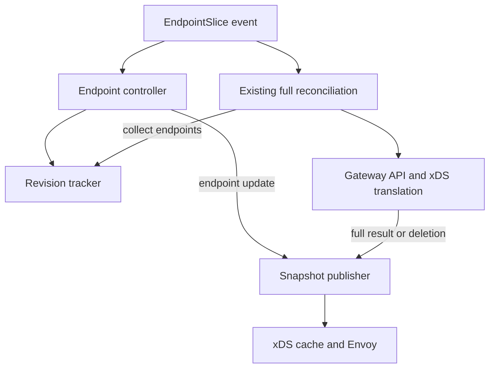
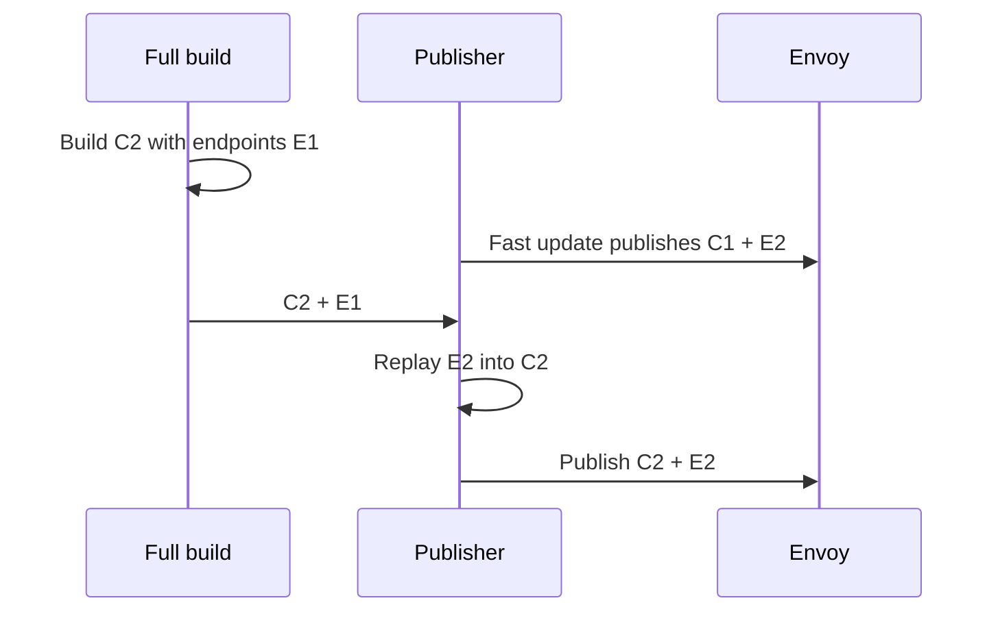

Status: experimental, opt-in.

Related issue: [envoyproxy/gateway#9777](https://github.com/envoyproxy/gateway/issues/9777).

## Goal

Today an EndpointSlice change goes through resource collection, Gateway API
translation and xDS translation before it reaches Envoy. When that full build is
slow, endpoint updates wait for it, even when only a backend address changed.

The fast path sends endpoint changes to Envoy without waiting for a full build.
It only rebuilds endpoint assignments (EDS) and leaves everything else to full
translation.

Non-goals:

- Reducing the number of full builds. Full reconciliation still runs for every
  EndpointSlice event, so total CPU use may go up.
- Handling changes that need more than new endpoints, such as route or cluster
  changes. Those still wait for full translation.

## Overview

There are two paths to Envoy:

- **Full path:** unchanged translation of everything, including endpoints.
- **Fast path:** a new endpoint controller collects a backend's endpoints and
  sends them straight to the publisher, which rebuilds only the affected endpoint
  assignments in the current snapshot.

Both paths publish through one **snapshot publisher**, so they never race.

## Endpoint revisions

Both paths need to tell which endpoints are newer. A backend can span several
EndpointSlices, and Kubernetes resource versions don't give one ordered version
for the whole set: a deleted slice can make the largest version go backward.

Instead, the provider keeps a revision tracker. Both paths collect a backend's
endpoints through it, and it bumps the backend's revision whenever its endpoints
change. Since both paths read from the same tracker, their revisions can be
compared.

The endpoint controller sends an update after every refresh, even when nothing
changed, because the full path may have recorded that revision first. The
publisher drops updates it has already applied.

## Endpoint context

To rebuild an endpoint assignment without full translation, the publisher needs
the cluster settings it was built from: destination order, weights, priorities,
health checks, zones, TLS presence and so on.

While building clusters, the xDS translator saves this context for every cluster
whose endpoints come from EndpointSlices. Static endpoints, DNS clusters and
ClusterIP routing aren't included. A cluster whose assignment an EnvoyPatchPolicy
targets, or an extension hook changed, is also left out, since the fast path
doesn't apply them.

## Snapshot publisher

The publisher is one goroutine shared by all IR keys. For each key it keeps:

- the published snapshot;
- the endpoint context of that snapshot;
- the endpoints and revision each cluster setting was built with;
- an index from each backend to the clusters that use it.

It handles two inputs one at a time:

- **Full results and deletions** from the xDS runner, in the order the runner
  sent them. A deletion can't overtake an earlier result for the same key.
- **Endpoint updates** from the endpoint controller. Pending updates are drained
  together, so a burst produces at most one snapshot per key.

### Fast update

For each cluster setting that uses the updated backend, the publisher compares
revisions. If the update is newer and safe, it rebuilds that cluster's endpoint
assignment from the saved context. It then publishes a copy of the current
snapshot with only those assignments replaced. Other resources are shared with the
old snapshot, so a fast update doesn't re-serialize listeners, routes or clusters.

An update is skipped, and left to full translation, when:

- its revision is not newer than the one already published;
- the backend goes between no endpoints and some endpoints, since full
  translation turns an empty backend into a direct 503 response
  ([#10604](https://github.com/envoyproxy/gateway/issues/10604));
- the address type changes, since that changes the cluster type.

Skipped updates aren't saved. The existing watches already schedule a full
reconciliation for the same event.

### Full result

A full build can start before a fast update and finish after it. Publishing it as
is would roll Envoy back to older endpoints:

So before publishing a full result, the publisher replays the published endpoints
that have a newer revision, using the new result's cluster settings. The same
skip rules apply: if a newer revision can't be used under the new settings, the
full result's own endpoints are kept, and the next full reconciliation catches up.

## Results

These numbers come from a kind cluster with 2000 HTTPRoutes (8000 clusters) and 15
EnvoyPatchPolicies, where one full xDS translation takes about 7s. Each scenario
changes one Service's endpoints 40 times, between 3 and 4 endpoints unless noted.
The test tool and raw results are in
[eds-fast-path-perf](https://github.com/zhaohuabing/playground/tree/main/gateway/eds-fast-path-perf).

### EDS speedup

Time from the EndpointSlice write until Envoy has the new endpoints:

| Scenario | Full path p50 / p99 | Fast path p50 / p99 | p50 speedup |
| --- | --- | --- | --- |
| Nothing else changing | 7.0s / 7.2s | 46ms / 97ms | ~150x |
| Other Services' endpoints changing, 5 updates/s | 11.4s / 14.5s | 47ms / 123ms | ~240x |
| An HTTPRoute edit every 2s, keeping full translation always running | 10.0s / 13.6s | 46ms / 316ms | ~215x |
| The Service goes between 1 and 0 endpoints, which always takes the full path | 7.3s / 7.6s | 7.4s / 7.7s | none |

### Resource impact

The fast path doesn't reduce full builds, since full reconciliation still runs
for every endpoint change. Under the same background load:

- Control plane CPU was about 5–7% higher, partly from the fast updates
  themselves, which take about 20ms each in the publisher.
- Heap was up to about 70 MiB higher, for the cached endpoint state.

## Limitations

- Fast updates don't call extension hooks. A cluster whose assignment a hook
  changed is left to the full path, but a hook that left the current assignment
  alone can still change a later one, such as a hook that filters out some
  addresses. Fast updates skip that change until the next full build.
