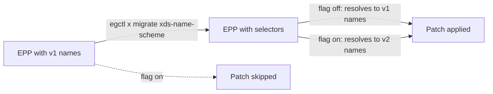
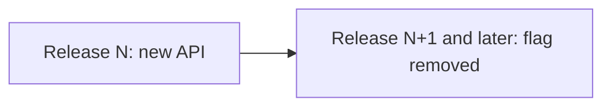

`XDSNameSchemeV2` was added in v1.5 (off by default), and the v1.5 release notes said it would be
turned on in v1.6. As of v1.10 it is still off. This proposal makes it safe to remove, which
turns v2 on for everyone: users can move their EnvoyPatchPolicies off xDS names first, with
tooling that does the rewrite for them.

## What v2 changes

v2 renames xDS resources. It does not change how they are grouped. Gateway listeners on the same
address and port already share one xDS Listener in v1 (`findXdsListenerByHostPort`); v1 just names
the shared resource after one of the Gateway listeners (`<namespace>/<gateway>/<section>`).

| xDS resource | v1 name | v2 name |
|---|---|---|
| TCP Listener | `<ns>/<gw>/<section>` | `tcp-<port>` |
| QUIC Listener | `<ns>/<gw>/<section>-quic` | `udp-<port>` |
| UDP Listener | `<ns>/<gw>/<section>` | `udp-<port>` |
| Default HTTP filter chain | `<ns>/<gw>/<section>` | `http-<port>` |
| HTTP RouteConfiguration | `<ns>/<gw>/<section>` | `http-<port>` |
| HTTPS filter chain and RouteConfiguration | unchanged | unchanged |
| VirtualHost | `<ns>/<gw>/<section>/<host>` | `<host>` (dots replaced by `_` in both) |
| HCM stat prefix | `http-<container port>` | `http-<listener port>` |
| Clusters, endpoints, secrets | unchanged | unchanged |

`<port>` is the Gateway listener port. The container port differs for privileged ports, e.g. 80
becomes 10080.

Because the structure is the same, a patch path like `/default_filter_chain/filters/0/...` points
to the same place under both schemes. Only the resource `name`, and any VirtualHost name inside a
`jsonPath` expression, have to change.

## What breaks when the flag turns on

| Who | Impact | Severity |
|---|---|---|
| EnvoyPatchPolicy targeting a renamed resource | The patch no longer finds its resource and is skipped. The policy reports `ResourceNotFound`, but traffic keeps flowing without the patch, e.g. without an auth filter or a header rule | High: silent behavior change |
| EnvoyPatchPolicy `jsonPath` filtering on a VirtualHost name | Same as above | High |
| Extension servers that look up resources by name | Depends on the extension | Medium |
| User dashboards and alerts on the HCM stat prefix | Metric labels change where the container port differs from the listener port. The dashboards shipped with Envoy Gateway aren't affected | Low: observability only |
| Live connections | Renaming a filter chain makes Envoy drain the old one | Low: graceful, see [Drain](#drain-on-the-flip) |

The goal is no failed requests and no skipped patches. Envoy renames a Listener on the same address
in one LDS update without a gap, so the flip costs one graceful drain of the renamed filter chains.
That is documented rather than avoided.

## Design

Three pieces. Selectors make a patch independent of the naming scheme. The migration tool rewrites
existing patches to use them. Extension servers get the same mapping through the hook context.
None of them changes the default; the flag is removed a release later.



### 1. Scheme-independent targeting in EnvoyPatchPolicy

#### Gateway listener index (internal)

While building xDS, the translator records which Gateway listeners each Listener, filter chain
and RouteConfiguration serves, keyed by the xDS name it just generated:

```go
// in ResourceVersionTable, not sent to Envoy
GatewayListeners map[typedName][]ir.ResourceMetadata // Gateway ns/name + sectionName
```

A shared resource lists every Gateway listener it serves. The index is the same under both
schemes, so it is what the selector resolves against.

It stays in the translator rather than going into xDS `metadata`. A metadata-only change to a
Listener or filter chain makes Envoy drain it, so Listener metadata would drain the shared
listener every time a Gateway listener is added on its port, a drain that doesn't happen today.

Extension servers get the same index through the hook context, see
[Extension servers](#3-extension-servers). The selector doesn't need anything sent to Envoy.

#### EnvoyPatchPolicy API

Make `name` and a new `selector` a oneOf in `EnvoyJSONPatchConfig`: exactly one must be set.

```go
// EnvoyJSONPatchConfig defines the configuration for patching a Envoy xDS Resource
// using JSONPatch semantic
//
// +kubebuilder:validation:XValidation:rule="has(self.name) != has(self.selector)",message="exactly one of name or selector must be set"
// +kubebuilder:validation:XValidation:rule="!has(self.selector) || self.type in ['type.googleapis.com/envoy.config.listener.v3.Listener', 'type.googleapis.com/envoy.config.route.v3.RouteConfiguration']",message="selector is only supported for Listener and RouteConfiguration"
type EnvoyJSONPatchConfig struct {
	// Type is the typed URL of the Envoy xDS Resource
	Type EnvoyResourceType `json:"type"`
	// Name is the name of the resource.
	// Exactly one of name or selector must be set.
	//
	// +optional
	Name *string `json:"name,omitempty"`
	// Selector selects the resource by the Gateway listener it serves, independent of the
	// xDS naming scheme. Only supported for Listener and RouteConfiguration.
	// Exactly one of name or selector must be set.
	//
	// +optional
	Selector *EnvoyPatchResourceSelector `json:"selector,omitempty"`
	// Patch defines the JSON Patch Operation
	Operation JSONPatchOperation `json:"operation"`
}

// EnvoyPatchResourceSelector selects an xDS resource by the Gateway listener it serves.
type EnvoyPatchResourceSelector struct {
	// SectionName is the name of the listener of the targeted Gateway.
	SectionName gwapiv1.SectionName `json:"sectionName"`
	// Name and Namespace of the Gateway, required when targetRef is a GatewayClass
	// (mergeGateways), and must be unset otherwise.
	//
	// +optional
	Name *gwapiv1.ObjectName `json:"name,omitempty"`
	// +optional
	Namespace *gwapiv1.Namespace `json:"namespace,omitempty"`
}
```

`name` is required today, so making it optional only relaxes validation: every existing policy
still has exactly one of the two and stays valid. It follows the `has(self.a) != has(self.b)`
pattern already used in the API, e.g. `url`/`urlRef` in `envoygateway_types.go`. `Name` becomes
a pointer, which is an internal Go change for the translator and the IR. The `mergeGateways`
rule for the selector's `name`/`namespace` depends on `targetRef`, which CEL on this struct can't
see, so the translator checks it and reports it in status.

```yaml
apiVersion: gateway.envoyproxy.io/v1alpha1
kind: EnvoyPatchPolicy
metadata:
  name: custom-response
  namespace: default
spec:
  targetRef:
    group: gateway.networking.k8s.io
    kind: Gateway
    name: eg
  type: JSONPatch
  jsonPatches:
  - type: type.googleapis.com/envoy.config.listener.v3.Listener
    selector:
      sectionName: http
    operation:
      op: add
      path: /default_filter_chain/filters/0/typed_config/local_reply_config
      value:
        mappers: []
```

- `selector.sectionName` selects the xDS resource of `type` that serves that listener of the
  `targetRef` Gateway. With `mergeGateways`, where `targetRef` is the GatewayClass, the selector
  also takes the Gateway `name` and `namespace`.
- It applies to Listener and RouteConfiguration. Cluster, ClusterLoadAssignment and Secret
  names don't change, so they keep using `name`.
- Two Gateway listeners on one port select the same resource. That is the existing v1 behavior,
  where only one of them happens to give the resource its name, so this makes it explicit
  rather than new.
- A selector that matches nothing reports `ResourceNotFound`, as `name` does today.
- `sectionName` names a listener of the Gateway itself, as in a Gateway API `parentRef`. A
  resource that serves only ListenerSet listeners can't be selected; listener names can repeat
  across ListenerSets, so `sectionName` alone wouldn't identify one.
- With HTTP/3, one Gateway listener has a TCP and a QUIC Listener. A Listener selector matches
  the TCP one; the QUIC Listener can only be targeted by `name`.
- The first iteration supports only `sectionName`. Patches on ListenerSet-only or QUIC Listeners
  keep using `name`, and the migration tool lists them for a manual change when the flag is
  turned on. Other match fields, such as a ListenerSet, a protocol or a port, can be added later
  without breaking anything: a new optional field is additive, and making `sectionName` optional
  with an exactly-one-of rule only relaxes validation.

VirtualHosts aren't top-level xDS resources. Patches reach them through a `jsonPath` on the
RouteConfiguration, usually filtering on `name`. Filter on `domains` instead, which is the same
under both schemes:

```yaml
jsonPath: "$.virtual_hosts[?(@.domains[0]=='www.example.com')]"
```

The tool rewrites the name filter to this form (see below).

### 2. `egctl x migrate xds-name-scheme`

A new path under the `egctl x migrate` command from the deprecated-fields proposal. It reuses the
shared flags (`-f`, `--from-cluster`, `-n`/`-A`, `--mode print|in-place|check-only`), the report
format and the exit codes.

```shell
# Rewrite EnvoyPatchPolicies in files; Gateways, routes and policies must be in the same input
egctl x migrate xds-name-scheme -f manifests/

# CI gate: exit 1 if any EnvoyPatchPolicy still depends on a name v2 changes
egctl x migrate xds-name-scheme -f manifests/ --mode check-only

# Read everything from the cluster
egctl x migrate xds-name-scheme --from-cluster -A
```

#### How it maps names

The tool doesn't reimplement the naming rules. It runs the existing translator (as
`egctl x translate` does) on the input Gateways twice, once per scheme, and pairs the resources by
a key that doesn't depend on the name:

| xDS resource | Pairing key |
|---|---|
| Listener | address, port, protocol |
| RouteConfiguration | the Listener and filter chain that reference it |
| VirtualHost | RouteConfiguration plus `domains` |

That gives an exact v1 name → v2 name map, plus the Gateway listeners behind each resource from
the translator's index. The tool can't drift from the translator, and it covers ListenerSets and merged
Gateways without special cases.

#### Rewrite rules

For each EnvoyPatchPolicy, for each `jsonPatches[i]`:

| Input | Output | Result |
|---|---|---|
| `name` is a v1 name of a Listener or RouteConfiguration | `selector.sectionName` (plus `name`/`namespace` under `mergeGateways`) | migrated |
| `name` is already a v2 name | `selector` the same way | migrated |
| `name` of a type v2 doesn't rename | unchanged | none |
| `jsonPath` filters on a v1 VirtualHost name | filter on `domains` | migrated |
| `name` matches no resource in the input | unchanged | error: a Gateway, route or policy is missing from the input, or the patch is already broken |
| `jsonPath` too complex to rewrite safely | unchanged | error: listed for a manual fix |
| `name` is a v1 name of a QUIC Listener, or of a resource that serves only ListenerSet listeners | unchanged | error: no selector exists; listed for a manual fix, with the v2 name |
| A v1 name of a renamed resource elsewhere in the patch, e.g. an HCM `rds.route_config_name` in `operation.value`, or a `jsonPath` filter on a filter chain or RouteConfiguration name | unchanged | error: listed for a manual fix, with the v2 value |
| `op: add` with an empty path (adds a new resource) | unchanged | none: the user names the new resource |

The tool looks for v1 names of renamed resources everywhere in a patch: the target, `jsonPath`,
and `operation.value`. A patch is reported as migrated only if it finds none left. A name inside a value has
no scheme-independent form, so the user has to change it when turning the flag on; the report
gives the v2 value to use.

Selectors are scheme-independent, so the rewritten policy works before and after the flip. Users
can apply it at any time, and the flip doesn't have to happen at the same moment.

#### Best effort

The migration is best effort. It rewrites the forms of reference listed above, but it doesn't
evaluate the patches, so "migrated" means the tool found nothing more to change, not that the
patched xDS is the same under v2. It can miss, for example:

- a scheme-dependent value other than a name, such as a `jsonPath` filter on the HCM stat prefix
  (`http-10080` becomes `http-80`);
- a patch that depends on an earlier one, such as a VirtualHost filter rewritten to its original
  domain after an earlier patch, in this policy or another, changed that domain.

Users review the rewritten policies and test them with the flag on in a non-production
environment before applying them to production.

#### Inputs and limits

- Names depend on more than Gateways. VirtualHosts come from the HTTPRoutes and GRPCRoutes
  attached to a listener, a QUIC Listener exists only when a ClientTrafficPolicy enables HTTP/3,
  and EnvoyProxy changes names through `mergeGateways`. The tool reads the same resources as
  `egctl x translate`: Gateways, ListenerSets, GatewayClasses, EnvoyProxies, routes and
  ClientTrafficPolicies.
- With `--from-cluster` it reads them all. With `-f` they must be in the input; a patch whose
  resource is missing gets an error rather than a guess.
- The tool doesn't touch extension servers or dashboards. Extension authors use the new hook
  context, see [Extension servers](#3-extension-servers); the release notes cover dashboards.

### 3. Extension servers

Extension servers that look up Listeners or RouteConfigurations by name break on the flip, the
same way EnvoyPatchPolicies do. They need a name-independent way to map each xDS resource back to
the Gateway listeners behind it. There are two channels, with different risk.

#### Hook context (default, no flag)

Every hook already receives a context message next to the xDS resource
(`proto/extension/context.proto`). Add the index there:

```protobuf
// GatewayListenerRef identifies a Gateway listener, or a ListenerSet listener, an xDS resource serves.
message GatewayListenerRef {
  string namespace = 1;
  string name = 2;
  string section_name = 3;
  string listener_set_namespace = 4;  // set when the listener comes from a ListenerSet
  string listener_set_name = 5;
  uint32 port = 6;
}

message PostHTTPListenerExtensionContext {
  repeated ExtensionResource extension_resources = 1;
  repeated GatewayListenerRef gateway_listeners = 2;  // new
}

message PostTranslateExtensionContext {
  repeated ExtensionResource extension_resources = 1;
  // new: xDS resource name -> what it serves, for every Listener, filter chain and
  // RouteConfiguration in the request
  map<string, XdsResourceOrigin> listeners = 2;
  map<string, XdsResourceOrigin> filter_chains = 3;
  map<string, XdsResourceOrigin> route_configurations = 4;
}

message XdsResourceOrigin {
  repeated GatewayListenerRef gateway_listeners = 1;
}
```

`PostVirtualHostExtensionContext` gets `gateway_listeners` plus the HTTPRoutes attached to the
VirtualHost.

This is safe to ship on by default: the fields are additive, so existing extensions ignore them,
and nothing reaches Envoy, so it can't cause a drain. It is enough for extensions that act inside
a hook, which is how most extensions work.

The first iteration carries only the Gateway listeners behind each resource, which is what an
extension needs to stop depending on xDS names. The routes and policies behind each filter chain
and RouteConfiguration in `PostTranslateModify` can be added later as new proto fields, which
existing extensions ignore, once extension authors ask for them.

#### xDS metadata (opt-in, an EnvoyProxy setting)

Some extensions or tools read the xDS that Envoy actually receives, e.g. from a config dump, an
xDS proxy, or a later hook that has lost the context. For those, EG can write the same index into
`filter_metadata["envoy-gateway"]` on Listener, FilterChain and RouteConfiguration, as it already
does for Routes and VirtualHosts (`buildXdsMetadata`):

```yaml
metadata:
  filter_metadata:
    envoy-gateway:
      resources:
      - kind: Gateway
        namespace: default
        name: eg
        sectionName: http
      - kind: Gateway
        namespace: default
        name: eg
        sectionName: http-alt
```

It is turned on per data plane with a new EnvoyProxy field, off by default:

```yaml
apiVersion: gateway.envoyproxy.io/v1alpha1
kind: EnvoyProxy
metadata:
  name: with-listener-metadata
  namespace: envoy-gateway-system
spec:
  xdsMetadata:
    # Add the Gateway listeners each resource serves to its xDS metadata.
    # Changing this drains every listener of this proxy once.
    listeners: true
```

It's an API field rather than a runtime flag because it's a lasting choice, not a temporary guard
for a breaking change. It belongs on EnvoyProxy rather than EnvoyGateway because the cost is a
drain of that proxy's listeners. Users can enable it on one Gateway first, and only on Gateways
whose extensions or tools need it, while EnvoyGateway would apply it to every data plane at once.
`xdsMetadata` leaves room for later options, such as the routes and policies behind each resource.

| Resource | Drain on metadata change | Risk |
|---|---|---|
| Listener | Whole listener, on every Gateway listener added to or removed from its port | High |
| FilterChain | That filter chain; the shared HTTP default chain drains on the same events | Medium |
| RouteConfiguration | None, delivered over RDS | None |

RouteConfiguration metadata carries no drain risk, so it could ship ungated. Keeping all three
behind one field gives extensions one switch to opt into, and the default can change later if
the drain proves acceptable in practice. Turning the field on or off also drains every listener
of that proxy once, which the field's documentation says.

## Rollout



| Release | Change | User action |
|---|---|---|
| N | `selector`, `egctl x migrate xds-name-scheme`, extension hook context, EnvoyProxy `xdsMetadata.listeners` (off). The flag stays off by default | Migrate EnvoyPatchPolicies; move extensions off xDS names. Turn the flag on in a non-production environment to verify before upgrading |
| N+1 and later | Flag and v1 naming removed; v2 is always on | Remove the flag from EnvoyGateway config |

The new API ships first so users can migrate while v1 names still work. The flag is removed in
N+1 or later. There is no release with v2 on by default and the flag as an opt-out, since the flag
has been available since v1.5.

`name` stays supported. With v1 gone it just means "the v2 name".

### Drain on the flip

Renaming a filter chain makes Envoy drain the old one: new connections use the new chain, existing
ones are closed after the drain timeout. Long-lived streams (WebSocket, gRPC) reconnect once. This
is the same cost as any listener-level config change and is noted in the release notes.

Renaming a Listener is a remove plus an add on the same address in one LDS update, which Envoy
handles without a gap. The drain comes from the filter chains, not the Listener rename.

## Testing

- **Unit:** golden tests for the listener index, the selector resolution under both schemes, and
  the egctl rewrite rules (the same `testdata/migrate/<path>` layout as `deprecated`).
- **Round trip:** for every EnvoyPatchPolicy golden input, run the egctl rewrite, then translate
  with the flag on and off. Map the v2 names in the flag-on output back to v1 with the tool's
  name map, and the HCM stat prefix likewise; then both outputs must be identical to translating
  the original policy with the flag off. Without the mapping the comparison would fail on the
  renames themselves.
- **E2E:** extend `test/e2e/upgrade` to flip the flag on a live gateway while a load generator
  runs. Assert zero failed requests, and that an EnvoyPatchPolicy using `selector` is still
  applied after the flip. This guards the gap-free Listener rename against Envoy regressions.
